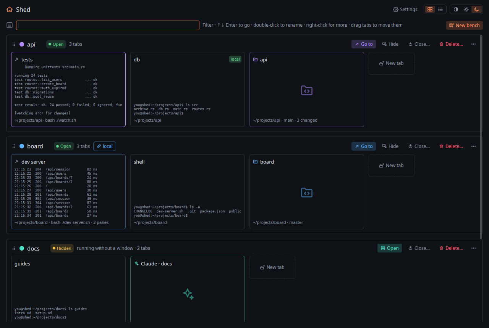
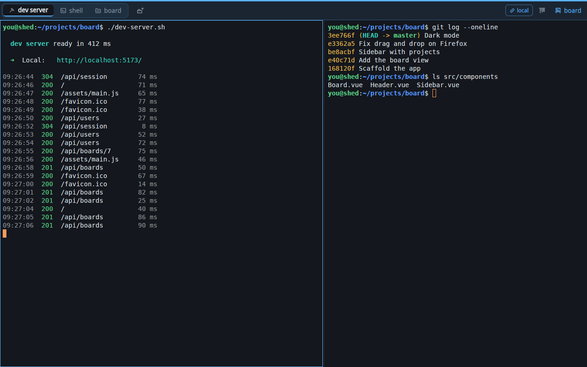
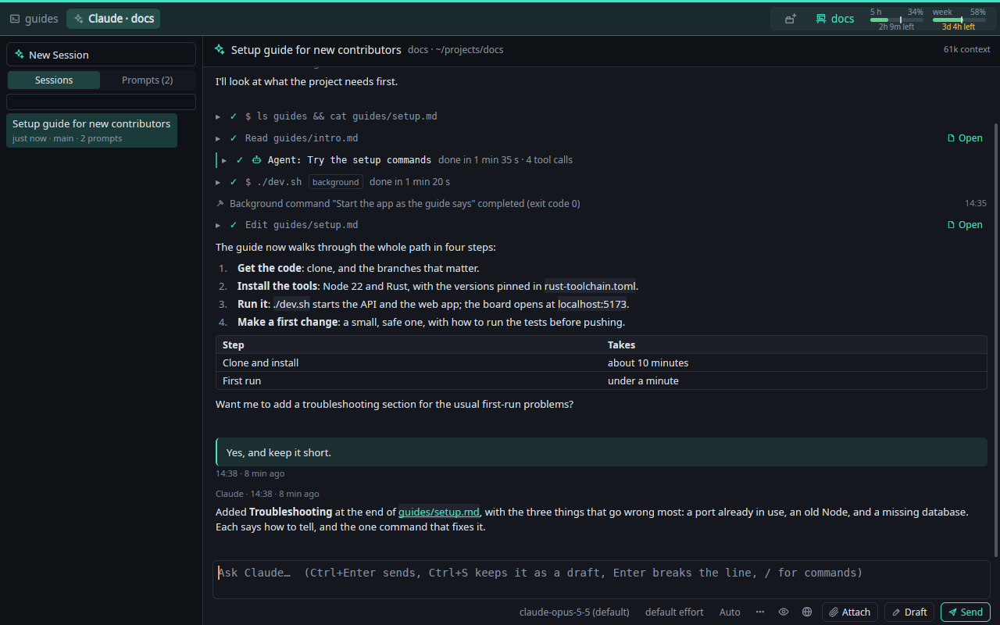
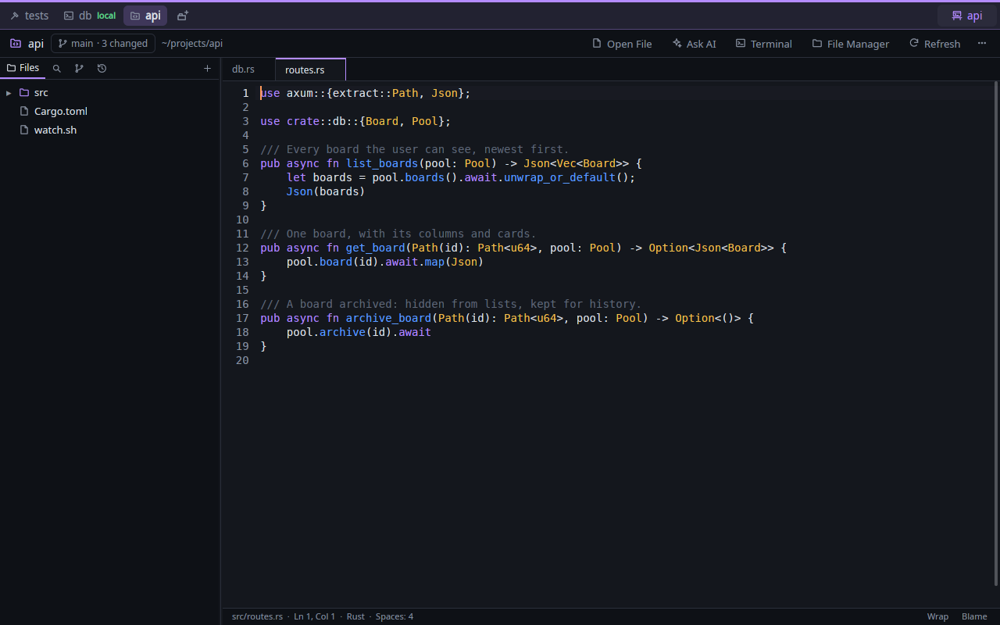
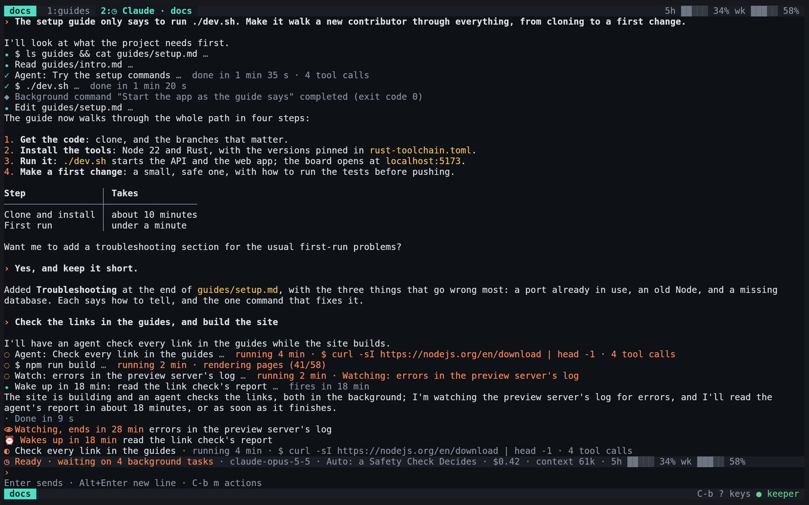
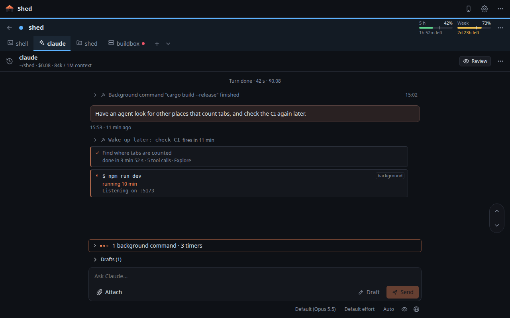
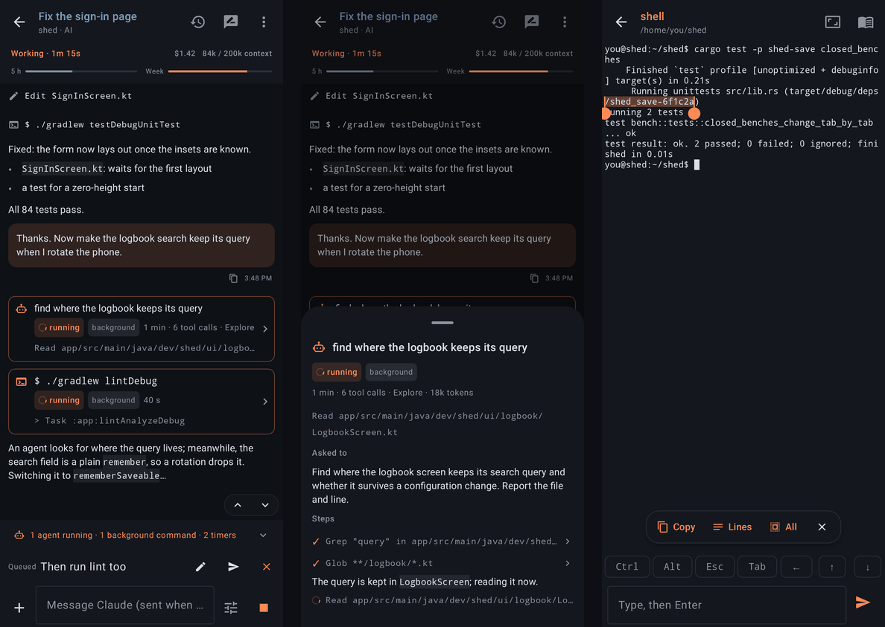

# Shed

A workbench for each thing you work on: its terminals, its code, its Claude Code
sessions, its servers and its web pages, in one window of its own, kept running
by a background process and brought back, as it was, whenever you open it. On
Linux and macOS, in a terminal over ssh, and, through a server of your own, in
a browser and on your phone.



## What it is

Work on a project is spread over many things: a dev server and a shell or two, the
code and its Git state, an AI session, a shell on a staging server, the app in the
browser, the CI. Shed keeps them together as a **bench**: one per project or job,
with its own window, colour and taskbar icon. A bench's tabs come in four kinds:

- **Terminal tabs**: a GPU terminal, split into panes, with each pane's startup
  and teardown commands (`docker compose up -d`, `npm run dev`) and its history.
- **Project tabs**: a folder of code, with a file tree, an editor, search across
  files, Markdown files drawn (tables, pictures, Mermaid and Graphviz diagrams,
  math), and Git: changes by file or by hunk, commits and pushes (shown before
  they go), branches, history, blame and conflicts.
- **AI tabs**: [Claude Code](https://claude.com/claude-code) conversations with an
  interface of their own: answers drawn from Markdown, each step on a line,
  permissions and questions as cards, going back to an earlier message (files
  included), drafts and a queue, and your usage limits with how fast you use them.
- **Remote tabs**: a shell on a server, kept alive there by Shed, so it outlives
  the bench, survives dropped connections, and can be joined from another PC.

The bench's **links** (the app running locally, staging, dashboards) sit on its
tab bar and bring forward the browser tab already showing them.

Everything runs in a small background process, the **keeper**, so windows come and
go while servers, editors, Claude Code and SSH sessions keep running. Closing a
bench saves it (layout, folders, scrollback, open files, AI sessions, drafts) and
runs its teardown; opening it brings it all back. **The Shed window** shows every
bench and tab at a glance, and is where you make, open, hide and close them.







## Away from the desk

The same benches can be reached in three more ways, all optional:

- **[`shed tui`](docs/user-guide.md#shed-in-a-terminal-shed-tui)**: Shed in a terminal, over ssh too: benches, terminals with
  splits, AI tabs, project tabs with Git, the logbook. Leaving it stops
  nothing.
- **[A nexus](docs/user-guide.md#reaching-shed-from-elsewhere)**: a small server you host. Link your machines to it once
  (`shed nexus join`), and its **web app** and the **Android app** show your
  workspaces from anywhere: benches, terminals, projects and diffs, the
  logbook, and above all your AI tabs (answer Claude, send it pictures and
  files, review what it changed, watch your limits). Shed's own window can
  show another linked workspace too.
- **[A workspace on a server](docs/user-guide.md#a-workspace-on-a-server)**: Shed without windows, its keeper running as a
  service, so benches and Claude Code keep working while your computers are
  off.







## Highlights

- **Nothing stops when a window closes.** Hide a bench and it keeps running; open
  it again and every pane, file and conversation is as you left it.
- **Benches you can reproduce.** Per pane: a folder to start in, startup and
  teardown commands, editable in a Setup panel or by hand in a plain TOML file.
  Benches open quietly; **Run Startup** starts them when you want.
- **Code without leaving the bench.** Files follow the disk as Claude or a build
  changes them; paths in terminals and in Claude's answers open the file at its
  line.
- **Claude Code, made comfortable.** Select and copy anything, formatted; see the
  screenshots it reads; keep drafts and queued messages across restarts; long
  conversations open at once; sessions split over several files read as one;
  fork, rename or delete sessions; go back to before any message, files
  included. Sub-agents, background commands, watches and wake-ups each have a
  line above the prompt while they run, and the tab says what it waits on.
- **Review what Claude changed**, turn by turn or for the session: not staged,
  staged, committed and pushed, each with what fits it, and **Explain** asks a
  copy of the session why, without growing its context.
- **Your browser, lent by hand**: one AI tab at a time can use your Chrome or
  Brave (Claude in Chrome), for an hour at most, never saved.
- **Bookmarks** of files, folders and AI messages, per bench, a key away.
- **History across tabs and benches**: every command, with its folder, exit status
  and where it ran. Up walks this tab's history, Ctrl+Up the bench's, Ctrl+Shift+Up
  everything; Ctrl+R searches it all. Remote shells keep theirs on the server.
- **Distinct benches.** Sixteen colours (or your own), a taskbar icon per bench,
  tab groups, tags with colours set once for every tab.
- **Safe with your setup.** A backup of your settings and benches every day, and
  settings files always written whole.
- **From anywhere, if you want it** (see above): password and TOTP, devices
  paired once, view-only per machine; private tabs never leave it.
- **Notifications that know where you are**: Claude waiting for you (loud), a
  turn or a long command done (normal), a workspace gone offline (silent).
  Claude's show on the desktop when its tab is not in front; in an open web or
  Android app as a banner; pushed to your phone (ntfy or UnifiedPush, never
  Google) or browser only when no app is in view and nobody is at that
  computer.
- **Fast**: GPU rendering, kitty keyboard protocol, input methods, find in
  scrollback, clickable links and paths, OSC 52 clipboard. Light and dark,
  following your desktop.

Shed runs on Linux, under X11 or Wayland, with a Vulkan driver, and on macOS (new
there: tried less). Its shell integration (history, aliases) is for bash and zsh;
AI tabs need Claude Code installed; remote tabs need Linux servers reachable over
ssh.

## Install

The commands are `shed` and `shedd`. The package is called `shed-terminal`, because
Debian, Ubuntu and Arch already have a hex editor named `shed`.

**With Cargo** (any distribution, no root; Rust 1.95 or newer):

```sh
cargo install --locked --git https://github.com/odolha/shed shed-app shed-keeper
shed
```

**As a Debian, Ubuntu or Mint package:**

```sh
git clone https://github.com/odolha/shed && cd shed
packaging/deb/build.sh
sudo apt install ./target/debian/shed-terminal_*.deb
```

**On Arch:** `cd shed/packaging/arch && makepkg -si` builds the latest commit.

Building needs `build-essential pkg-config libxkbcommon-dev libxkbcommon-x11-dev
libwayland-dev libxcb1-dev libfontconfig-dev` on Debian-likes, or `base-devel
libxkbcommon-x11 wayland fontconfig` on Arch.

**On macOS** (Rust 1.95 or newer, and `xcode-select --install`):

```sh
git clone https://github.com/odolha/shed && cd shed
packaging/macos/bundle.sh
cp -R target/macos/Shed.app /Applications/
ln -s /Applications/Shed.app/Contents/MacOS/shed /usr/local/bin/shed   # the command, optional
```

`cargo install` (above) works on macOS too, without the app bundle. On a Mac one
bench window looks like another in the Dock: bench icons are Linux's.

**Updating.** From a checkout of this repository (`git pull` first), one
command each:

```sh
tools/reinstall.sh            # this computer (Linux): builds shed and shedd, installs them, offers to restart Shed
shed-nexus-update             # on the nexus server, as root (and its server workspace, if any)
tools/deploy-nexus.sh root@nexus.example.com   # the same, from your computer over ssh
tools/android-install.sh      # the Android app, onto the phone over adb
```

Updated any other way, run `shed stop` once (or let `shed` offer to): the
keeper still running is the old one. Every bench is saved first. See
[Updating](docs/user-guide.md#updating) in the guide.

**A nexus** for the web and Android apps is set up with one script on an
Ubuntu or Debian server: see [Deploying a nexus](docs/nexus-deploy.md). The
Android app is built from source: see [android/README.md](android/README.md).

## Getting started

Run `shed`. The Shed window opens; make a bench with **New bench**, and it opens in a
window of its own, with a terminal. Right-click the new-tab button for a **project
tab** (a folder of code), an **AI tab** (Claude Code) or a **remote tab** (a shell
on a server). From a terminal of the bench, `shed project` opens the repository
you are in, and `shed ai` an AI tab working there.

| Keys | |
| --- | --- |
| Ctrl+Shift+T / Ctrl+Shift+W | New tab / close pane |
| Ctrl+Shift+E / Ctrl+Shift+O | Split right / split down |
| Ctrl+P / Ctrl+Shift+F (project tab) | Open a file by name / search every file |
| Ctrl+Shift+V (Markdown file) | View drawn / edit the text |
| Ctrl+Enter / Ctrl+S (AI tab) | Send / keep as a draft |
| Ctrl+Shift+R (AI tab) | Review what Claude changed |
| Ctrl+Shift+S | Setup: startup, teardown and aliases |
| Ctrl+Shift+M | The bench's bookmarks |
| Shift+F10 | The shown tab's menu |
| Ctrl+R | Search the logbook |
| Up / Ctrl+Up / Ctrl+Shift+Up | Walk this tab's / bench's / all history |
| Super+Space | Bring Shed forward |

The [User Guide](docs/user-guide.md) walks through everything, with the full list
of keys, commands and settings.

## Documentation

- [User Guide](docs/user-guide.md): how Shed is used.
- [Architecture](docs/architecture.md): how it works inside.
- [Development](docs/development.md): building, testing and working on Shed.
- [Deploying a nexus](docs/nexus-deploy.md): the server for the web and Android
  apps, and a workspace on a server.
- [The web app](web/README.md) and [the Android app](android/README.md):
  building and working on them.
- [Roadmap](docs/roadmap.md): what is still open.
- [History](docs/history/README.md): the plans Shed was built from, and the
  decisions in them.

## License

Shed is available under either the [MIT](LICENSE-MIT) or the
[Apache 2.0](LICENSE-APACHE) license, at your option.
