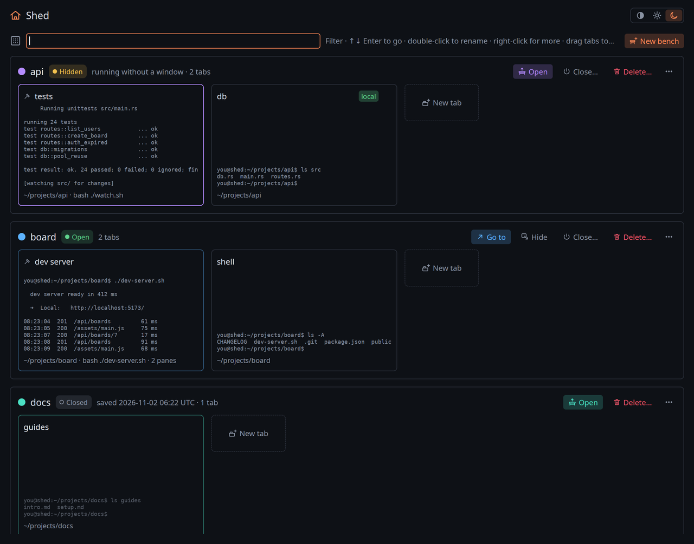
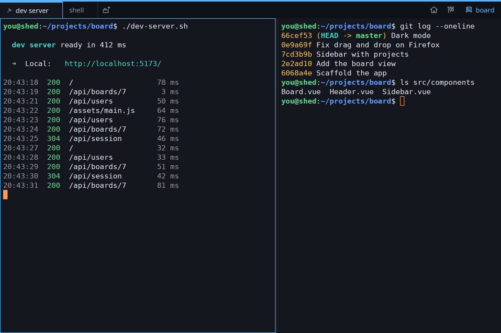

# Shed

A GPU-accelerated terminal for Linux whose shells outlive its windows, and which
organises your work into **benches**: workspaces with their own window, colour and
taskbar icon, saved with everything needed to bring them back.



## What it is

Most terminals tie your shells to a window: close it, and everything running in it
stops. Shed keeps every shell and program in a small background process, the
**keeper**, so windows come and go while your dev servers, editors and SSH sessions
keep running.

On top of that, Shed groups your work the way you think about it:

- **Benches** are workspaces, one per project or job. Each has its own window,
  colour and taskbar icon, its tabs and split panes, its folder, and its own aliases.
- **The Shed window** shows every bench and tab at a glance, with a live preview of
  each, and is where you make, open, hide, close, rename and recolour them.
- **Benches are saved** with their layout, folders and scrollback. Opening one brings
  it back as it was: its startup commands run (`docker compose up -d`, `npm run
  dev`), editors and watchers restart, and anything risky is typed but waits for
  Enter. Closing one runs its teardown (`docker compose down`).
- **The logbook** keeps every command you run, with its folder, exit status and
  where it ran. Up walks this tab's history, Ctrl+Up the bench's, Ctrl+Shift+Up
  everything; Ctrl+R searches it all.



## Highlights

- **Shells that outlive windows.** Close a bench's window and it keeps running,
  hidden; open it again and every pane is exactly as you left it, screen and all.
- **Workspaces you can reproduce.** Per pane: a folder to start in, startup
  commands, and teardown commands, all editable in a Setup panel or by hand in a
  plain TOML file.
- **Distinct windows.** Sixteen bench colours (or any colour of your own), shown in
  the tab bar, the focused pane's border and a taskbar icon per bench. Pin one to
  your dock and it opens that bench.
- **History across tabs and benches**, with prefix matching, a search overlay, tags
  (`prod`, `staging`) and private tabs that keep their history to themselves.
- **Aliases at three levels**, global, per bench and per tab, layered over your
  shell's own.
- **Ask for a command.** Type `> start this project` and an AI (Claude Code by
  default, or any command-line AI) looks at the folder and puts the command on
  your prompt, for you to check and run.
- **Light and dark**, following your desktop by default.
- **Fast**: GPU rendering; on the machine it was measured on, it printed output
  faster than GNOME Terminal and kitty. Kitty keyboard protocol, input methods,
  find in scrollback, clickable links and paths, OSC 52 clipboard.

Shed runs on Linux, under X11 or Wayland, with a Vulkan driver. Its shell
integration (logbook, history keys, aliases) is for bash and zsh.

## Install

The commands are `shed` and `shedd`. The package is called `shed-terminal`, because
Debian, Ubuntu and Arch already have a hex editor named `shed`.

**With Cargo** (any distribution, no root; Rust 1.95 or newer):

```sh
cargo install --locked --git https://github.com/odolha/shed shed-app shed-keeper
shed
```

**As a Debian, Ubuntu or Mint package:**

```sh
git clone https://github.com/odolha/shed && cd shed
packaging/deb/build.sh
sudo apt install ./target/debian/shed-terminal_*.deb
```

**On Arch:** `cd shed/packaging/arch && makepkg -si` builds the latest commit.

Building needs `build-essential pkg-config libxkbcommon-dev libxkbcommon-x11-dev
libwayland-dev libxcb1-dev libfontconfig-dev` on Debian-likes, or `base-devel
libxkbcommon-x11 wayland fontconfig` on Arch.

After updating, run `shed stop` once (or let `shed` offer to): the keeper still
running is the old one. Every bench is saved first.

## Getting started

Run `shed`. The Shed window opens; make a bench with **New bench**, and it opens in a
window of its own. From there:

| Keys | |
| --- | --- |
| Ctrl+Shift+T / Ctrl+Shift+W | New tab / close pane |
| Ctrl+Shift+E / Ctrl+Shift+O | Split right / split down |
| Ctrl+Shift+S | Setup: startup, teardown and aliases |
| Ctrl+R | Search the logbook |
| Up / Ctrl+Up / Ctrl+Shift+Up | Walk this tab's / bench's / all history |
| Ctrl+Shift+F | Find in scrollback |
| Super+Space | Bring Shed forward |

The [User Guide](docs/user-guide.md) walks through everything, with the full list
of keys, commands and settings.

## Documentation

- [User Guide](docs/user-guide.md): how Shed is used, with screenshots.
- [Architecture](docs/architecture.md): how it works inside.
- [Development](docs/development.md): building, testing and working on Shed.

## License

Shed is available under either the [MIT](LICENSE-MIT) or the
[Apache 2.0](LICENSE-APACHE) license, at your option.
