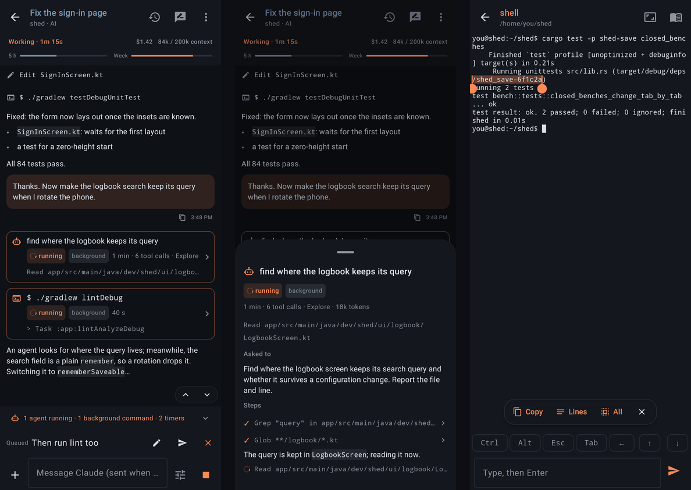

# Shed for Android

The Android app reaches your Shed workspaces through your nexus (see
[Reaching Shed from elsewhere](../docs/user-guide.md#reaching-shed-from-elsewhere)):
benches and tabs, AI tabs (the conversation, sub-agents and background tasks,
Claude Code's notes and timers, permissions, questions, prompts with photos and
files, sessions, drafts, review), terminals, the logbook, project files,
search and Git. Native Kotlin with Jetpack Compose; no Google Play Services, so
it builds from source and suits F-Droid.



## Build

Nothing system-wide is needed: `tools/android-env.sh` points `JAVA_HOME` and
`ANDROID_HOME` at a JDK 21 and an Android SDK in `~/.cache/shed-dev/android`
(or `$SHED_ANDROID_DIR`). Its header says how to fill that folder once (a
Temurin JDK, the command-line tools, `sdkmanager --licenses`, then
`platforms;android-36`, `build-tools;36.0.0` and `platform-tools`; about 1 GB, no
emulator images).

```sh
. tools/android-env.sh
cd android
./gradlew assembleDebug                      # app/build/outputs/apk/debug/app-debug.apk
./gradlew testDebugUnitTest lintDebug        # JVM tests and lint
./gradlew testDebugUnitTest --tests 'dev.shed.screens.*' -Pshed.screenshots=/tmp/shed-android
                                             # screens drawn as PNGs (default: app/build/screenshots)
```

The Gradle wrapper downloads Gradle itself. Versions are pinned in
`gradle/libs.versions.toml`. minSdk 29 (Android 10), targetSdk 36.

**Release signing is not configured**: only debug builds are made for now.
A release build needs a keystore of your own and a `signingConfig`.

## Install on a phone

Turn on developer options and USB debugging on the phone, plug it in (or
pair it over Wi-Fi, see the script's `--help`), then build and install in one
go, again after every update (sign-in and settings stay):

```sh
tools/android-install.sh
```

or by hand:

```sh
adb devices                                   # the phone should be listed
adb install -r android/app/build/outputs/apk/debug/app-debug.apk
```

## Sign in and pair

1. Set up a nexus (see [Deploying a nexus](../docs/nexus-deploy.md)) and its
   account in its web app: user name, password, an authenticator (TOTP).
2. In the app: the nexus address (`https://nexus.example.com`), user name,
   password and a code from the authenticator (or a recovery code). The phone
   becomes a device of the account and gets a device token, kept encrypted with
   a key in the Android Keystore. Plain `http://` is accepted only for
   `10.0.2.2` and `localhost` (an emulator or `adb reverse` reaching a nexus on
   your computer during development).
3. Link a workspace: on the computer, `shed nexus join https://nexus.example.com`
   prints a code. In the app (or the web app), **Devices → Approve a
   Workspace…**, type that code, give the workspace a name and a fresh
   authenticator code. See
   [Linking a workspace](../docs/user-guide.md#linking-a-workspace).
4. **Settings → Unlock with fingerprint or screen lock** asks for it whenever
   the app comes back. **Sign Out…** revokes this phone's token at the nexus and
   forgets it here. Devices lists every device; revoking one asks for a code.
   A pairing request you did not make: **Reject…** on its row.

A workspace that allows viewing only (its policy is `view`) shows everything
but offers no changes.

## Notifications (ntfy)

While the app is in the foreground it tells the nexus so (`Visible`); while
it, or Shed in a browser, is in front of you, notifications come over the
connection and show as a banner at the bottom (**Open** goes to the tab),
and nothing is pushed. Only when no Shed app is in view, and nobody has used
the workspace's computer for its `[nexus] away_after_minutes` (5), does the
nexus push, in one of two ways, never through Google:

- **A ntfy topic** (the usual way, with a ntfy server you run; see
  "Notifications on the phone with ntfy" in
  [Deploying a nexus](../docs/nexus-deploy.md)): the nexus publishes to it
  (`[push] ntfy_url`), and the phone reads it in the ntfy app. Install the ntfy
  app (F-Droid), set its default server to yours (`https://ntfy.example.com`),
  sign in (Settings → Users) and subscribe to the topic Shed's **Settings →
  Notifications** shows (with **Copy**). Shed's app does not register for
  UnifiedPush then (and leaves it if it had). Tapping a notification opens
  its tab (`shed://w/{workspace}/b/{bench}/t/{tab}`, which the app takes even
  when closed). The kinds chosen in Settings decide what the topic carries
  (what any of your phones wants).
- **UnifiedPush**, when the nexus has no topic: a *distributor* app on the
  phone (ntfy) keeps one connection to a push server, and the nexus sends to
  the endpoint it gives, encrypted for the app (RFC 8291), so the push server
  sees only ciphertext. In Shed: **Settings → Notifications**, turn on Push
  notifications, pick ntfy if asked, then choose which kinds you want: Claude
  waits for an answer, Claude finished a turn, a long command finished, a
  workspace went offline. Each has its own Android notification channel, at
  its level: Claude waiting high (sound, pops up), a turn or command done
  default, a workspace offline low (silent, only in the list); change any in
  Android's settings for Shed.
  Settings shows whether the nexus pushes to this phone; turning push off
  unregisters from the distributor and tells the nexus
  (`POST /api/v1/push/unsubscribe`). Without a distributor installed, Settings
  says how to get one.

## The code

`app/src/main/java/dev/shed/`:

| Where | What |
| --- | --- |
| `api/Api.kt` | The API's types, generated from `crates/shed-api` (`cargo run -p shed-codegen`); never edited by hand |
| `net/` | `ShedJson` (the JSON setup; entries, events and enum values a newer workspace sends read as unknown), `NexusHttp` (`/api/v1/…`, bearer token), `NexusSocket` (the `/api` WebSocket: requests by id, subscriptions as flows, reconnects) |
| `data/` | The account (token sealed with a Keystore AES-GCM key) and the app's settings |
| `push/` | How pushes come (`pushMode`: a ntfy topic or UnifiedPush), UnifiedPush registering, the endpoint to the nexus, notifications |
| `ui/` | Compose screens: `Nav.kt` (routes, `shed://` links, live notifications as a snackbar; `LiveNotice.kt` their text), `workspaces/`, `bench/`, `ai/` (transcript, Markdown, prompt, sessions, drafts, review), `terminal/` (screen model, re-wrapping, selecting), `logbook/`, `project/`, `git/`, `devices/`, `settings/`, `common/` (scaffold, long-press menus, the lists' scrollbar) |
| `ShedApp.kt`, `MainActivity.kt` | The session (connects in the foreground, rests a minute after), the lock |

Tests (`app/src/test`) run on the JVM: JSON round-trips (and what a newer
workspace may send), the socket against a fake nexus (MockWebServer), sub-agent
and timer wording, terminal re-wrapping and selecting, the Markdown reader, text
ranges from the API (UTF-16 positions, used as Kotlin strings index them),
the AI tab's following and jumps (`ui/ai/Follow.kt`) and its settings sheet,
the scrollbar's estimate (`ui/common/Scrollbar.kt`) and the long-press menus.
`screens/` draws screens with Robolectric and Roborazzi at a phone's size,
dark and light (the AI tab: opened, scrolled up, typing, limits, settings,
agents, the scrollbar, your message's menu; against a pretend nexus,
`FakeNexus.kt`: the menus of benches, the logbook and files, and selecting in
a terminal), as pictures to look at; nothing is compared, so they never fail
on a pixel.
