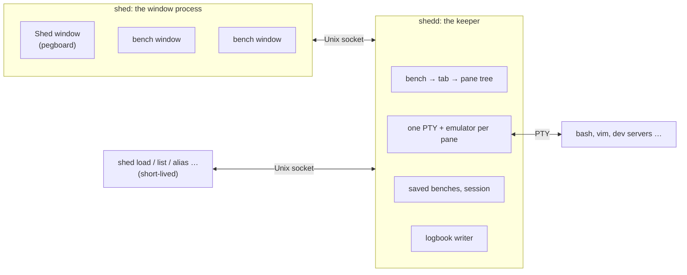

# How Shed works

This document describes Shed's moving parts: its two processes, how they talk, how a
pane's screen survives windows coming and going, how benches are saved and brought
back, and how the shell, the logbook and the desktop fit in. The
[User Guide](user-guide.md) describes the product; [Development](development.md)
covers building and testing.

## Two processes

**`shedd`, the keeper**, holds everything that must outlive a window: every PTY and
the program in it, the tree of benches, tabs and panes, and a terminal emulator per
pane. It is a daemon, one per user, found through a socket in
`$XDG_RUNTIME_DIR/shed/` and kept unique with a lock file there. The first `shed`
starts it if it is not running; it stops when Shed is closed, on `shed stop`, at
logout, or once nothing runs in it and no window is connected.

**`shed`, the window process**, draws the Shed window and one window per open bench,
with GPUI (the UI framework from the Zed editor, community edition). It is single
instance: running `shed` again, or a bench's launcher, only asks the keeper to have
the existing window process show something. Every other `shed` subcommand is a
short-lived client of the keeper.

Windows hold no state of their own beyond what they draw. Closing a bench's window
detaches from it; the keeper keeps it running, hidden.

## The protocol

Frames on the socket are `[u32 length][u8 kind][payload]`. Terminal input and output
travel as raw bytes, tagged with their pane, so a busy pane costs a copy and no
encoding. Everything else is a control message, `ClientMsg` to the keeper and
`KeeperMsg` back, encoded with postcard (in `shed-proto`).

A client opens with `Hello { version }`, and the keeper answers `Welcome`. The tree
is broadcast whole (`TreeChanged`) after every change; windows render from it, and every action a window or the CLI takes
(new tab, split, rename, move a tab, set colours, setup, aliases) is a message the
keeper applies to it.

Postcard encodes enum variants by position, so the rules are: new messages go at the
end of their enum, and `Hello`, `Shutdown` and `Error` keep their positions forever
(a test pins them). `PROTOCOL_VERSION` changes with every change to the messages; a
window refuses a keeper of another version and says so, and `shed stop` stops any
keeper, reading its process from the socket (`SO_PEERCRED`) and sending SIGTERM if it
does not understand the request.

## A pane's screen

Each pane has a terminal emulator in the keeper (`alacritty_terminal`, vendored with
a few read-only accessors, behind Shed's `Emulator` trait). The keeper feeds it all
output, which lets it:

- **answer the terminal's queries** (cursor position, device attributes, colours)
  itself, exactly once, whether or not a window is attached. Replies that binary
  output happens to provoke (`cat image.png`) are dropped, so they never land on the
  prompt;
- **replay** the pane: when a window attaches, the keeper serializes the emulator's
  whole state (scrollback, both screens, cursor, pen, modes, charsets, tab stops,
  colours, title, keyboard flags) as bytes that bring a fresh emulator to the same
  state, and sends them before any further output. A full-screen editor reappears
  mid-edit. If the output so far stops inside an escape sequence or a UTF-8
  character, the replay ends with that unfinished part, so the rest of it,
  arriving next, completes it in the window too.

The window process runs its own emulator per pane, fed by the replay and then the
live output, and draws from it. Keys are encoded there, the xterm way or with the
kitty keyboard protocol when a program asks for it (presses, repeats, releases,
and modifier keys on their own), and sent to the keeper as input.

## Shell integration

Shed starts bash with its own startup file, which reads your `~/.bashrc` and then
Shed's hook (`shell/shed.bash`). zsh starts with `ZDOTDIR` pointing at a folder of
Shed's whose `.zshenv` puts your own `ZDOTDIR` back, runs your `.zshenv` and loads
the zsh hook (`shell/shed.zsh`); zsh then reads your `.zprofile` and `.zshrc` as
usual, and the hook finishes setting up at the first prompt, after them. Either
hook reports, as escape sequences in the output:

- `OSC 133` marks around the prompt and each command (prompt start, input start,
  command start, command end with its exit status);
- `OSC 7`, the current folder;
- a private `OSC 7777` with the text of each command, the history-walk state, and
  the shell's own aliases.

The keeper reads these marks from the output of every pane. They tell it where each
pane's prompt is (startup and teardown commands are typed one per new prompt, and a
prompt redrawn by the line editor does not count), what is running, and what to write to
the logbook. The folder and the program in the foreground are also read from
`/proc` every second, for tag rules and for saving.

The hook also gives each tab its own history file, binds Ctrl+Up and Ctrl+Shift+Up to
walk the logbook (through `shed hook walk`), and applies Shed's aliases from a file
the keeper writes per tab, at every prompt.

## The AI prompt

When Shed's AI prompt is on, the keeper starts shells with `SHED_AI=1`, and the hook
takes over Enter (and Ctrl+J, which is what an Enter typed ahead arrives as): a
line starting with `>` is not run but sent to the keeper as an `OSC 7777` request,
and the line is emptied. The keeper runs the configured command (`sh -c`, in the
pane's folder, `claude -p` by default) with a prompt on its stdin: the request,
the shell, the system, the folder, the tab's last commands from the logbook and
the pane's last lines of text (neither for private tabs). Its output, cleaned of
code fences, is typed at the prompt as a bracketed paste, so it does not run. The
pane's `ai` state in the tree (asking, or failed and why) drives the chip in the
window; Escape there sends `CancelAsk`, which stops the command.

## The logbook

The logbook is a SQLite database (WAL mode, with an FTS5 trigram index for search).
The keeper writes it from a thread of its own; windows and the CLI open it read-only.
Each entry records the command, folder, exit status, start and duration, and the
pane, tab and bench it ran in, so the three scopes (tab, bench, everything) are only
filters on one table. Commands from private tabs are kept with the tab only.

## Saving and loading benches

A bench is saved as `~/.local/share/shed/benches/<name>.toml`, plain TOML meant to be
readable and editable: name, colour, badge, folder, aliases, and per tab its name,
tags, layout and panes. A layout is written as text, like
`right 0.6 (0) (down 0.5 (1) (2))`. Per pane: its folder, what was running, and its
startup and teardown. Each pane's scrollback goes beside it, as zstd-compressed text.

The keeper saves every running bench each minute, within a second of a change to
setup or aliases, on rename, when closing a bench, and when it stops.

A closed bench is changed in its file: Shed sends the keeper an edit (`EditSaved`:
rename, colour, badge, a tab's name, tags or place, a new or removed tab, a pane's
setup, aliases), which loads the file, applies it and saves it back, leaving the
scrollback as it was. A running bench is changed in the tree instead, and the keeper
refuses file edits to it.

Moving a tab where either bench is closed (`MoveTabAcross`) combines the two: from
a closed bench into a running one, the keeper starts the tab's panes as loading
would and takes the tab out of the file; from a running bench into a closed one,
it writes the tab into that file under new ids (so loading that bench cannot
mistake its panes for the ones still stopping), then stops the panes as closing
would; between closed benches it moves the tab and its scrollback between files.

**Loading** rebuilds the bench in the keeper: panes start in their folder, with
their old scrollback fed to the emulator dimmed above a "restored" line, then either
run their startup commands or bring back what was running, by the rack rules
(restart, type and wait for Enter, or leave out).

**Closing** saves the bench, then runs each pane's stop sequence concurrently:
Ctrl+C, wait for the prompt; SIGTERM to the foreground group if needed; teardown
commands one per prompt; then a hangup.

**Closing Shed** records which benches run and which have windows
(`session.toml`, for `auto_restore`), closes every bench that way, and stops the
keeper; the window process quits when its connection ends.

Benches keep their ids when saved, so a loaded bench has the same tab and pane ids
as before; a pane's read loop only acts on the PTY it started, so a bench closed and
loaded again at once does not confuse old panes with new.

## Windows and the desktop

The Shed window has the app id `dev.shed`; each bench window
`dev.shed.bench.<key>`, where the key is the slug of the bench's first name and
never changes. A bench window's icon is set as it opens and, on X11, replaced
when the bench's colour or badge changes. For each bench Shed writes a hidden desktop entry and an icon (the
bench template: a terminal window on a workbench, rendered in the bench's colour
with resvg) to
`~/.local/share`, so docks show one icon per bench and a pinned one runs
`shed load <key>`. Installed packages provide Shed's own entry and icons in the
hicolor theme.

Settings (`shed.toml`) and themes are watched and applied live by both processes.
With `theme = "auto"`, the window process follows the desktop's colour scheme
(through the XDG desktop portal) and tells the keeper, which answers programs'
colour queries from the theme in effect.

## macOS

The same code runs on macOS, with these differences:

- what a pane runs and where is read with `proc_pidinfo` and `KERN_PROCARGS2`
  instead of `/proc`, and the keeper's process is found with `LOCAL_PEERPID`
  instead of `SO_PEERCRED`;
- the runtime folder (socket and lock) is `$TMPDIR/shed`;
- zsh starts as a login shell, as Mac terminals start it, and the AI command runs
  in the login shell too (apps opened from the Dock get a bare PATH);
- there are no desktop entries or per-bench Dock icons: a Mac app has one Dock
  icon. `Shed.app` (`packaging/macos/bundle.sh`) holds both binaries, and has a
  menu bar with Quit (Cmd+Q, which asks as closing the Shed window does);
- the default keys use Cmd, the default font is Menlo, and Option types
  characters unless `[macos] option_as_alt` is set.

## Drawing

A terminal view turns its emulator's visible cells into a frame: runs of text with
the same style shaped together, and backgrounds only where they differ from the
default. On integrated GPUs every window-sized quad costs milliseconds per frame, so
a frame is kept to one window-sized layer: the vendored `gpui_ce_wgpu` turns the
first opaque full-window background into the clear colour, which is close to free.
The vendored `gpui_ce_linux` fixes key releases lost on X11. Both patches are
described in `SHED_PATCHES.md` in their folders.

## The code

| Crate | What it holds |
| --- | --- |
| `shed-model` | The bench → tab → pane tree, ids, colours, settings and themes, XDG paths |
| `shed-proto` | The socket messages and framing |
| `shed-emu` | The `Emulator` trait and its `alacritty_terminal` backend, replay, key and mouse encoding, shell-mark parsing |
| `shed-keeper` | `shedd`: PTYs, the socket server, saving, closing, the shell marks |
| `shed-save` | Saved bench files, layouts as text, rack rules, scrollback, the session |
| `shed-logbook` | The logbook database, and the bash and zsh hooks |
| `shed-desktop` | Bench and app icons, desktop entries |
| `shed-app` | `shed`: the Shed and bench windows, terminal views, menus, the CLI |

`vendor/` holds the patched copies of `alacritty_terminal`, `gpui_ce_wgpu` and
`gpui_ce_linux`; `packaging/` the Debian and Arch packaging, desktop entry and
systemd unit; `tools/screenshots/` the demo setup the docs' screenshots come from.
