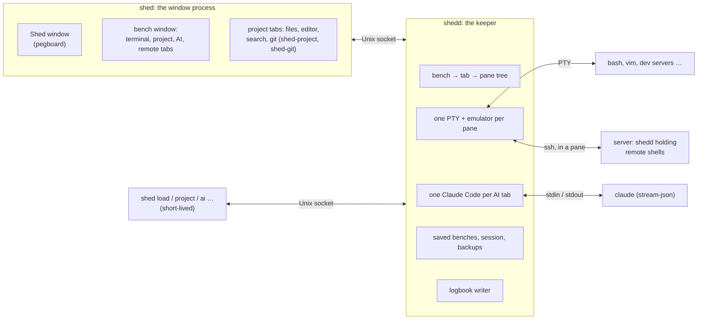
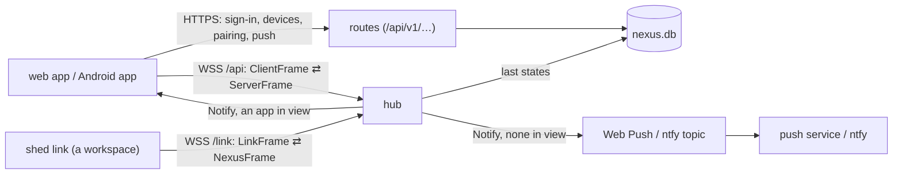

# How Shed works

This document describes Shed's moving parts: its two processes and how they talk,
how a pane's screen survives windows coming and going, the four kinds of tab
(terminals, project folders, Claude Code conversations, remote shells), how benches
are saved and brought back, and how the shell, the logbook, the browser and the
desktop fit in. The [User Guide](user-guide.md) describes the product;
[Development](development.md) covers building and testing; the
[Roadmap](roadmap.md) what is still open.

## Two processes

Everything that must outlive a window lives in the keeper: shells and the programs
in them, Claude Code sessions, the tree of benches and tabs, what is saved. The
window process draws, and does the work of a project tab itself (reading files,
watching the folder, running `git`), since none of it needs to run while the tab
is not shown. A remote tab is a pane like any other whose program is
`shed remote connect`, which reaches a keeper on the server over ssh.

**`shedd`, the keeper**, holds everything that must outlive a window: every PTY and
the program in it, the tree of benches, tabs and panes, and a terminal emulator per
pane. It is a daemon, one per user, found through a socket in
`$XDG_RUNTIME_DIR/shed/` and kept unique with a lock file there. The first `shed`
starts it if it is not running; it stops when Shed is closed, on `shed stop`, at
logout, or once no bench runs in it and no client is connected, unless told to
stay (`shedd --persist`, or `[keeper] stay = true` in `shed.toml`, for a server
reached over ssh). A bench running with no panes (an AI tab at work on its own)
counts as running.

**`shed`, the window process**, draws the Shed window and one window per open bench,
with GPUI (the UI framework from the Zed editor, community edition). It is single
instance: running `shed` again, or a bench's launcher, only asks the keeper to have
the existing window process show something. Every other `shed` subcommand is a
short-lived client of the keeper.

**`shed tui`, the terminal interface** (`crates/shed-tui`), is another client
of the same keeper, drawing in a terminal with ratatui and crossterm: see
[The terminal interface](#the-terminal-interface).

Windows hold no state of their own beyond what they draw. Hiding a bench closes its
window and detaches from it; the keeper keeps it running. Closing a bench's window
asks first whether to close the bench or hide it.

## The protocol

Frames on the socket are `[u32 length][u8 kind][payload]`. Terminal input and output
travel as raw bytes, tagged with their pane, so a busy pane costs a copy and no
encoding. Everything else is a control message, `ClientMsg` to the keeper and
`KeeperMsg` back, encoded with postcard (in `shed-proto`).

A client opens with `Hello { version, kind }`, and the keeper answers `Welcome`.
The kind is a window, a CLI command, the link (`shed link`, which hears what
windows hear but counts as no window: what it attaches stays hidden), or a
terminal interface (`shed tui`, `ClientKind::Tui`): it hears what windows hear,
and what it asks to show (`Show`) the keeper hands back to it, but it is not
the window process, so `shed load` and launchers still go to a window, and
`KeeperStatus::windows` does not count it. Its benches are not "shown" for the
session either, and its `Detach` does not hide a bench a window shows. Shed's
desktop app on another computer, through the nexus, is `ClientKind::Remote`,
treated the same way: it does what a window does and its own `Show`s come
back to it, but it is no window here (a `shed` or launcher on this machine
opens its own window while one is attached), and the benches it shows are
not this machine's shown ones. The link starts each tunnel's connection with
`Tunnelled` (the nexus's device, logged), and the keeper takes a window on
such a connection for `Remote` whatever it says. The tree
is broadcast whole (`TreeChanged`) after every change to windows and the link; windows render from it, and every action a window or the CLI takes
(new tab, split, rename, move a tab, set colours, setup, aliases) is a message the
keeper applies to it.

Postcard encodes enum variants by position, so the rules are: new messages go at the
end of their enum, and `Hello`, `Shutdown` and `Error` keep their positions forever
(a test pins them). `PROTOCOL_VERSION` changes with every change to the messages; a
window refuses a keeper of another version and says so, and `shed stop` stops any
keeper, reading its process from the socket (`SO_PEERCRED`) and sending SIGTERM if it
does not understand the request.

## A pane's screen

Each pane has a terminal emulator in the keeper (`alacritty_terminal`, vendored with
a few read-only accessors, behind Shed's `Emulator` trait). The keeper feeds it all
output, which lets it:

- **answer the terminal's queries** (cursor position, device attributes, colours)
  itself, exactly once, whether or not a window is attached. Replies that binary
  output happens to provoke (`cat image.png`) are dropped, so they never land on the
  prompt;
- **replay** the pane: when a window attaches, the keeper serializes the emulator's
  whole state (scrollback, both screens, cursor, pen, modes, charsets, tab stops,
  colours, title, keyboard flags) as bytes that bring a fresh emulator to the same
  state, and sends them before any further output. A full-screen editor reappears
  mid-edit. If the output so far stops inside an escape sequence or a UTF-8
  character, the replay ends with that unfinished part, so the rest of it,
  arriving next, completes it in the window too.

The window process runs its own emulator per pane, fed by the replay and then the
live output, and draws from it. It keeps one only for the panes of each open
bench's three most recently shown tabs (the scrollback would otherwise sit in both
processes for every tab); a tab shown again after that asks the keeper for a
replay of its panes (`ClientMsg::Replay`). Whether such a pane is at its prompt
then comes from the tree (no foreground tool), as the prompt marks were before
the replay. Keys are encoded there, the xterm way or with the
kitty keyboard protocol when a program asks for it (presses, repeats, releases,
and modifier keys on their own), and sent to the keeper as input.

## Shell integration

Shed starts bash with its own startup file, which reads your `~/.bashrc` and then
Shed's hook (`shell/shed.bash`). zsh starts with `ZDOTDIR` pointing at a folder of
Shed's whose `.zshenv` puts your own `ZDOTDIR` back, runs your `.zshenv` and loads
the zsh hook (`shell/shed.zsh`); zsh then reads your `.zprofile` and `.zshrc` as
usual, and the hook finishes setting up at the first prompt, after them. Either
hook reports, as escape sequences in the output:

- `OSC 133` marks around the prompt and each command (prompt start, input start,
  command start, command end with its exit status);
- `OSC 7`, the current folder;
- a private `OSC 7777` with the text of each command, the history-walk state, and
  the shell's own aliases.

The keeper reads these marks from the output of every pane. They tell it where each
pane's prompt is (startup and teardown commands are typed one per new prompt, and a
prompt redrawn by the line editor does not count), what is running, and what to write to
the logbook. The folder and the program in the foreground are also read from
`/proc` every second, for tag rules and for saving.

Tag colours set in `[tag_colors]` belong to the keeper: `Config::recolor_tags`
gives tags those colours when a window sets a tab's tags, when tag rules make
them, when a saved bench loads or is listed for the Shed window, and across the
tree whenever `shed.toml` changes. Windows list the tags they can offer with
`bench_window::known_tags` (running and closed benches, and the configured ones).

The hook also gives each tab its own history file, binds Ctrl+Up and Ctrl+Shift+Up to
walk the logbook (through `shed hook walk`), and applies Shed's aliases from a file
the keeper writes per tab, at every prompt. The shell's own aliases edited in Shed
(`SetShellAlias`) are lines in `shell-aliases.sh` in the config folder, which the
keeper edits and makes `~/.bashrc` and `~/.zshrc` source; the hook (told the path by
`SHED_SHELL_ALIASES`) reads it at the first prompt and again whenever it changes,
then sends the shell's aliases again. Bash runs signal traps only once a line is
entered, so changes wait for the next prompt rather than interrupting the one shown.

## The AI prompt

When Shed's AI prompt is on, the keeper starts shells with `SHED_AI=1`, and the hook
takes over Enter (and Ctrl+J, which is what an Enter typed ahead arrives as): a
line starting with `>` is not run but sent to the keeper as an `OSC 7777` request,
and the line is emptied. The keeper runs the configured command (`sh -c`, in the
pane's folder, `claude -p` by default) with a prompt on its stdin: the request,
the shell, the system, the folder, the tab's last commands from the logbook and
the pane's last lines of text (neither for private tabs). Its output, cleaned of
code fences, is typed at the prompt as a bracketed paste, so it does not run. The
pane's `ai` state in the tree (asking, or failed and why) drives the chip in the
window; Escape there sends `CancelAsk`, which stops the command.

## The logbook

The logbook is a SQLite database (WAL mode, with an FTS5 trigram index for search).
The keeper writes it from a thread of its own; windows and the CLI open it read-only.
Each entry records the command, folder, exit status, start and duration, and the
pane, tab and bench it ran in, so the three scopes (tab, bench, everything) are only
filters on one table. Commands from private tabs are kept with the tab only.
A search as typed (`tag:prod deploy`) is split into text and tag by
`shed_logbook::parse_query`, so every client reads it the same way.

## Tab kinds

A tab has a kind (`TabKind`). A **terminal** tab holds panes, each a PTY in the
keeper. A **project** tab holds a folder (`Project { root, open, active, exclude }`:
its open files and excluded globs too, sent by the view with `SetProject`) and no panes: its
layout and active pane name a pane that does not exist, and `locate_pane` skips
it. The keeper keeps it in the tree and saves it; closing it (`CloseTab`) takes it
out at once, since nothing in it has to stop. A bench leaves the tree when its
last tab does, so a bench whose shells have all exited stays while it has a
project tab.

What a project tab shows lives in the window process: `ProjectView`
(`project_view.rs`), made when its bench first opens and kept while the tab is in
the tree, so unsaved edits survive hiding the bench. In a bench window, keyboard
focus goes to the active tab's active pane, or to the project view (`state::Focus`).

The parts without UI are crates of their own:

- `shed-project`: the file list (the `ignore` crate's parallel walk, honouring
  Git's ignore rules and the tab's excludes); a watch per folder (`notify`,
  inotify on Linux, non-recursive so ignored trees cost nothing), whose changes
  arrive in batches about 40 ms apart, new folders being watched as they appear;
  ranking files by a typed name (`nucleo-matcher`); searching the file list
  with ripgrep's engine (`grep-searcher`, `grep-regex`) on a thread per core,
  each file's hits handed on as it is done, stopping at a limit or when
  cancelled (no index: nothing can be out of date); and colouring
  (`tree-sitter-highlight` with compiled-in grammars, spans per line by byte
  range; Kotlin's query is Shed's own, in `queries/`).
- `shed-text`: the text being edited: a rope (`ropey`), one selection, undo
  grouped by typing runs, the editor's edits (indent, comment, move and
  duplicate lines, find and replace), and `reload`, which applies only the lines
  that differ (`similar`) so the cursor stays with its text.

`text_view.rs` draws a `shed-text` buffer: only the rows in view, each shaped and
painted on one canvas (no element per line), positions on the monospace cell
grid. It is editable or read-only, numbered or not, wrapped or not, and can grow
with its text, for the prompts to come. Colouring runs off the UI thread a moment
after typing pauses; the colours of the previous version show meanwhile.

Following the disk: watch batches reach `ProjectView::on_disk_change`, which
updates the file list and tree and, for an open file, reloads it if it has no
unsaved edits or flags the conflict if it has. Saving writes the file; the watch
event that follows finds the text unchanged and does nothing. Unsaved edits are
written to `$XDG_STATE_HOME/shed/recovery/` (`shed_project::recovery`) 1.5 s
after typing pauses and read back when the file next opens. A terminal's Ctrl+click on a path asks `AppState`
(through the `AppHandle` global) to open it in the bench's project tab.

## Git

Git runs through the `git` program (`shed-git`), so the user's config, credential
helpers, SSH agent, hooks and signing apply. It never waits on a terminal
prompt (`GIT_TERMINAL_PROMPT=0`): a command that needs one fails and says why.
Reads use machine formats: `status --porcelain=v2 --branch -z` for the branch,
upstream, ahead/behind and every changed file, `log` with NUL-separated fields,
`blame --line-porcelain`. A diff is made from the two versions of the file
(`git show HEAD:path`, `:path` for the index, the file on disk) with `similar`,
as hunks; staging, unstaging or discarding one hunk applies that hunk as a patch
(`git apply --cached`, `-R`).

What a Git panel knows and does is `shed_git::session`, without a UI: a
`GitSession` (the repository, its status and outgoing commits, the history,
commits' files, amend, a `PushReview` waiting) and operations that run Git and
block (`refresh`, `load_diff` from a `DiffSource`, `hunk_action`, `commit`,
`PushReview::read`/`confirm`, `history`, `BranchOp::run`, `conflicts_in`). In a
project tab (`project_git.rs`, a child module of `project_view.rs`), every
Git command runs on the background executor. The status is read again 150 ms
after any change the folder watch reports (`.git` included, so commits and
switches made outside Shed show) and after every action; a fetch runs every
`fetch_minutes`. Diffs open as tabs among the files (not saved with the bench),
drawn as a `uniform_list` of rows: hunk headers with their actions, lines with
both numbers, or old and new side by side. The outgoing commits
(`Repo::outgoing`: `@{upstream}..HEAD`, or `HEAD --not --remotes` without an
upstream) are read with each status; a push first reads them again with
`Repo::push_target` (the branch's `remote` and `merge` config, else `origin`)
into a `PushReview` the Changes panel shows until confirmed.

## Remote tabs

A remote tab (`TabKind::Remote { host, id }`) is a terminal tab whose pane runs
`shed remote connect HOST ID`, again whenever the bench loads (the pane's startup).
Each connect notes the host first in `~/.local/state/shed/remote-hosts`; the
hosts offered for a new remote tab (`shed_client::remote::known_hosts`) are those,
then the running benches' remote tabs', then the saved benches' (latest saved
first), then `~/.ssh/config`'s `Host` names (`config_hosts`: patterns and `Match`
blocks left out, `Include`s followed a few levels deep), without Git-only hosts
(`User git`, a Git service's name or `HostName`) unless a remote tab used one.
That makes sure the server has this build of `shedd` (`uname -m` and an id file
checked over ssh; the binary sent through ssh's stdin when they differ), then runs
`ssh -t HOST ~/.local/bin/shedd attach ID` in a loop (ssh's `ControlMaster`
shares one login between the steps).

On the server, `shedd attach` (`shed-keeper/src/attach.rs`) connects to the keeper
there (starting one, detached, if none runs: without the PC's `LANG`/`LC_*`
that ssh forwarded when the server lacks those locales, so its shells don't warn),
finds the bench `remote-ID`
(running, saved, or new), sizes its pane to the terminal, attaches, and relays:
the replay (after a full reset) and output to stdout, stdin to the pane, window
size changes to `Resize`. The terminal is put in raw mode. Only terminal bytes
cross ssh, so local and server Shed need not be the same version. A newer
`shedd` that finds an older keeper still holding the shells re-runs itself as
that keeper's program (`/proc/PID/exe attach ID`).

Exit codes tell the loop what happened: 0, the shell ended (or was ended); 2,
this end let go; 3, the shell was lost with its keeper (a reboot), so the loop
joins again, and the server's keeper brings the saved bench back.

ssh runs with `ServerAliveInterval=5`, `ServerAliveCountMax=3` and
`ConnectTimeout=10`, so a dead connection ends within about 15 s. The attach is a
client of the shared connection (the `ControlMaster`), which may itself be the dead
part: each join learns that master's pid (`ssh -O check`, opening one with `ssh
HOST true` when there is none), and after any other end (or Reconnect) closes it
(`ssh -O exit`, else SIGTERM to that pid) before joining again, so the next join
opens a fresh connection. Only that master is closed, not a newer one another tab
opened meanwhile, so tabs to one server cannot keep closing each other's. Steps
that type nothing (`-O`) are killed after 3 s; a master that does not answer has
its socket (the path from `ssh -G`) removed. A join ending badly within 10 s
counts as failed: the loop waits 3 s, 6 s, … up to 30 s before the next.

**Reconnect** (`ClientMsg::ReconnectRemote`): the keeper sends SIGUSR1 to the
pane's foreground job when it is `shed remote connect` (the job leads its process
group); the loop, which polls ssh with `try_wait` rather than blocking, stops ssh
(SIGTERM, then kill), puts the terminal settings back, closes the master and joins
at once. When the pane's shell is at a prompt instead (Ctrl+C stopped the loop),
the keeper types the tab's connect command again. Connectors call
`Call::ReconnectRemote`, which the link passes on for a running remote tab. Closing the
bench or the tab (`CloseTab`) locally sends no Ctrl+C to a remote pane (it would
reach the server's program): the hangup ends ssh and the shell stays.
`EndRemoteTab` first writes a close request (an OSC 7777 sequence) into the pane,
which the attach turns into deleting the server's bench; dropping a bench tells
every `Cli` client attached to it that its panes exited, so the other PCs'
attaches end too.

The ID is the server's name for the shell (the tab id of the tab that made it),
so any PC can join it: `NewRemoteTab { join: Some(ID) }` makes a local tab
running `shed remote connect HOST ID` for that ID. Several attaches to one bench
are just several clients; each sends its terminal size with input (at most every
half second) and on SIGWINCH, so the last PC to type sets the size.
`shedd list` prints the server's shells, one tab-separated line each (id,
running/saved, attached clients from `KeeperStatus.attached`, server bench and
tab ids, folder, foreground program); it reads saved `remote-*` benches from the
store when no keeper runs, and starts nothing. The window asks for it over ssh
with `BatchMode` (`remote::list_shells`), so it never prompts.

A remote pane's commands are not written to the local logbook (the keeper skips
remote tabs); the server's keeper logs them, as its shell has Shed's hooks. Ctrl+R
in a remote tab runs `shedd logbook` (an SQLite `VACUUM INTO` copy to stdout)
into `logbook-HOST.sqlite` in the runtime folder, and searches it with the
server's bench and tab ids from `shedd list` as "here".

## Startup and teardown

A bench loads quietly by default (`load_bench(quiet)`: shells and scrollback, no
`after_prompt` queue, nothing held; a remote tab's connect command still runs);
`ShowTarget::LoadAndStart` or `start_on_open` run the startup as before.
`Bench.started` records that the startup ran since it opened: `RunStartup` queues
each pane's startup (with its waits, as a load would), `RunTeardown` stops tools
and runs teardowns keeping the bench, and closing a bench or a tab runs teardown
commands only when `started`.

## Sizes

The configured font size is also the interface's scale (`theme::ui_scale`, size
÷ 14, set when settings apply): chrome sizes go through `theme::us(n)`, AI and
project tabs multiply it with the tab's own zoom (`z()`), the tab bar with
`tab_bar_scale`. `ResetZoom` sets every running tab's zoom to 0 and rewrites
closed benches' files that had any.

## Scrollbars

GPUI draws none: `shed-app/src/scrollbar.rs` paints a thumb (one quad) over the
right edge of what scrolls and listens to the mouse at the window, so a drag goes
on outside it. A `scrollbar::Source` is a `ScrollHandle` (scrollable boxes and
uniform lists), a `ListState` (the AI conversation, which measures every entry so
the length is known), or custom metrics and a setter (the editor's own scroll; a
terminal's scrollback in lines, from `Emulator::history_size` and
`display_offset`).

Jumping between commands: the emulator marks the first cell of the line where a
command is typed (`Flags::SHED_PROMPT`, a vendored-alacritty patch) when the
shell's OSC 133;B arrives, splitting its input there; the mark moves with the
line into history. A replay writes `OSC 7777;shed;prompt-line` after each marked
line, so a reattached window's emulator marks the same lines.
`Emulator::jump_to_prompt` scrolls to the previous or next marked line. The AI
tab jumps between the starts of prompts and of the responses to them.

## Links and the browser

A bench's links (`Bench.links`, set with `SetBenchLinks` or `SavedEdit::Links`;
older saved files kept them on project tabs, and `SavedBench::to_bench` gathers
those into the bench) open through Shed's browser extension when it is there (`browser.rs`, `browser/chrome/`). The extension (Manifest V3,
its ID fixed by the public key in its manifest) connects at browser start to the
native messaging host `dev.shed.browser`, which `shed browser setup` registers in
each Chromium-based browser's `NativeMessagingHosts` folder; the host is
`shed browser-host` (through a small script that keeps `SHED_RUNTIME_DIR`). The
host listens on `browser.sock` in Shed's runtime folder. To open a link the
window writes a JSON line there; the host passes it to the extension as a native
message (length, then JSON), which focuses the most recently used tab whose
address starts with the link's (origin and path), or opens one, and answers the
same way. No socket, or no answer within three seconds, means no extension: the
link opens with the desktop's opener.

Pictures are read as data (bytes, kind, size: `shed_project::picture`) and
drawn (`shed-app/src/picture.rs`) from their bytes (`gpui::Image`, keyed by a
hash of them), not from their path, which GPUI caches: a picture changed on disk reloads with the open file. Their diffs
(project tab's Changes, the AI review) read both versions' bytes
(`Repo::show_bytes`, or the file) and show them side by side in place of hunks.

## AI tabs

An AI tab (`TabKind::Ai`: folder, extra folders, session id, model, mode, effort,
following) is a Claude Code conversation. The keeper runs `claude -p
--input-format stream-json --output-format stream-json --include-partial-messages
--permission-prompt-tool stdio` in the folder (`--resume` with the tab's session),
one process per tab, started by the first prompt (or as the user starts typing,
`AiStart`) and kept between turns (`server/ai.rs`). It sends `initialize` first;
the reply lists the commands and models (`AiInfo`). Prompts go in as JSON lines;
every line coming out goes through `shed_ai::Transcript`, which turns stream
events, tool calls, tool results and permission requests (`control_request`
`can_use_tool`) into entries. Changes are sent to every window as `AiUpdate`
(entries from the first changed one on, at most every 40 ms), and the tab's
activity (idle, working, waiting) and session id go into the tree. The user's
answer to a permission request goes back as a `control_response` (with
Claude Code's suggested rules for "for this session"); Stop is a `control_request`
`interrupt`. Model and mode changes go to the running process; other folders or
effort start a new one at the next prompt. `rate_limit_event`s carry the usage
limits (`AiLimits`).

Opening another session in the tab (`AiOpenSession`) stops the process unless
Claude has something going on (`AiRt::has_work`: a turn, a sub-agent or
background command running, a wake-up waiting). Then the conversation, process
and all, moves to `State.ai_away` and goes on in the background; the tree lists
those as `AiTab.away` (session id and activity, not saved). The sessions list
marks every session Claude is at (`AiTab::running`: the shown one unless idle,
and those away), and the tab's icon, the TUI and the link's notifications go by
`AiTab::overall_activity`. Its events find it by the process's generation
(`State::ai_of_process`); only the shown one sends queued messages or reaches
windows. The flush loop stops one once it has nothing left to do (its session
file has it all). Opening its session again moves it back as it is, without
reading the file.

**Forks.** `AiForkSession` shows a fork of a session: `AiTab.session` is
`None` and `fork_of` names the session it copies (saved with the bench until
it starts). The keeper reads that session's conversation for it, with no
session id of its own; its first prompt starts Claude Code with `--resume
<fork_of> --fork-session`, which writes a new session, and the flush loop puts
its id in `session` and clears `fork_of`, as for any new session.

The browser (Claude in Chrome) belongs to at most one AI tab (`AiTab.browser`;
`ai_settings` clears it on every other tab, `load_bench` on a bench loaded
while another tab has it). Claude Code runs with `--no-chrome`, and the
keeper adds Claude Code's own server for the extension (`claude
--claude-in-chrome-mcp`, named `claude-in-chrome`) with a `control_request`
`mcp_set_servers` when the tab is connected, and sets the servers back to none
when it lets go: at once, mid-turn too. Not `--chrome` with `mcp_toggle`:
Claude Code remembers a toggle per folder in `~/.claude.json`, which would
switch the extension off for the person's own `claude` in that folder too. Each
server process is its own connection to the extension, so the session gets a
tab group of its own. The window looks for the extension's folder in the
browsers' profiles (`browser::claude_browsers`) to say where Claude will work,
or that it is missing.

Each prompt goes out with a message id of Shed's own (`uuid`), which Claude
Code keeps in its session file; the transcript also notes the id of the last
message before each prompt (`PromptMark`). `AiEdit` (edit and send again) asks
Claude Code to `rewind_files` to that prompt's id (it runs with
`CLAUDE_CODE_ENABLE_SDK_FILE_CHECKPOINTING`), then stops it, cuts the
transcript, and starts it with `--resume SESSION --resume-session-at BEFORE
--fork-session` (a new session that starts as a copy up to there; before the
first prompt, a fresh one), and sends the new text.

**Sub-agents and background tasks.** A tool that goes on after its call (an
`Agent`/`Task` call, `Bash` with `run_in_background`, `Monitor`) carries a
`Run` in its `Tool.run` (state, background, Claude Code's task id, times, tool
calls, tokens, what it is doing, its report, and for agents its last
`Run::MAX_STEPS` steps, each step's output cut). Live, a sub-agent's own
messages come as `assistant`/`user` events with `parent_tool_use_id` set to its
Agent call (complete messages, never `stream_event`s); the transcript turns
them into steps of that tool (`transcript/tasks.rs`, `owners` maps the tools an
agent calls back to it), never into entries. `system` events tell the rest:
`task_started` (task id, tool id, `is_backgrounded`), `task_progress` (tool
calls, tokens), `task_updated`, `task_notification` (status, summary; an
agent's summary is its last words). A sub-agent's own tasks (its commands)
come as such events too, with its tool ids (`owned_by_subagent`,
`parent_task_id`): they go to its run (`sub_tasks`), the step marked as it
ended, never a note in the conversation. A background agent's tool result is "Async
agent launched" with its `agentId` (`tool_use_result` live, `toolUseResult` in
the file); a background command's has `backgroundTaskId`. Saved sessions keep
sub-agents apart: `<session>/subagents/agent-ID.jsonl` (`isSidechain` records)
with `agent-ID.meta.json` naming the tool call (`toolUseId`, `finished`);
`load_session` reads them as the agents' steps (`read_subagents`), and
`finish_loading` marks what was still running as ended with its session. With
its sub-agents a session can take a while to read, so the keeper reads it off
its lock (`ai_load`, on a blocking thread) when a window first watches the tab
or opens another session, and sends it once read.

A run changing on an entry before the end (an agent working on while the
conversation goes on) is changed in place: `Transcript::take_update` gives
those entries apart from "everything from entry N", and the keeper sends them
as `AiEntries` (each entry alone; a running agent with its latest
`LIVE_STEPS` steps only, the rest counted as skipped, all of them once it
ends), so the window lays out one entry, not all after it, and keeps what it
parsed (keyed by what it read). Idle, the window is drawn again once a second
only while a run is in its first minute or a timer in its last, every 30 s while
a run goes on longer or a timer is further off (their times show whole minutes
then), and not at all otherwise; marks of runs turn only while Claude works.

User messages are read as notes only when they start with one of Claude Code's
tags, block after block; `<system-reminder>` and hook context are taken off the
end only, as whole blocks; a tag in the user's own words, or one never closed,
stays theirs.

**Claude Code's notes.** Some user messages are Claude Code's, not the user's:
`<task-notification>` (a background task finished, a watch's `<event>`; as a
user message starting a turn, or a `queued_command` attachment when it came
mid-turn), `<command-name>`/`<command-args>` (a slash command, shown as the
user's `/name args`), `<local-command-stdout>`, `<bash-input>`/`<bash-stdout>`
(a `!` command), `<system-reminder>` and `<local-command-caveat>` (hidden),
`<user-prompt-submit-hook>`, compaction summaries (`isCompactSummary`),
"[Request interrupted…", and `isMeta` messages: a wake-up's prompt
(`turnOrigin: "scheduled"`) or a background agent handing back (`origin.kind:
"peer"`, `<agent-message from=…>`), the rest hidden. `shed_ai::notes` reads
them; the transcript updates the run they name and adds an `Entry::Note` (kind,
line, folded detail) instead of a prompt. A note's line is always one line
(`notes::one_line_note`): more (a command without a description, which Claude
Code names by the command) goes into its detail, as code. Live, notifications are `system`
events, not messages.

An agent's hand-back (its report, sent with its `SubagentHandback` tool) comes
in several shapes: an `isMeta` message "Another Claude session sent a message:"
with `<agent-message from="ID">` and a note for Claude after it; a
`queued_command` attachment with `origin.kind: "peer"` when it came mid-turn
(sent to the model as a `<system-reminder id=…>` beside a tool result); and in
the stream only as the agent's last step, the `SubagentHandback` call. Any of
them, wherever it is (a message of its own, a reminder before or after the
user's words, a peer message without its meta flag), becomes one
`NoteKind::Message` note ("Agent report from “name”: first line", the report
folded below) and the agent's `Run::report`; the same report seen twice (live
step, then the message) is noted once. The task notification that only points
at the message ("This agent's report was delivered…") leaves the report as it
is. The window pins running agents, and those ended in the last minute, above
the prompt (`AiView::agents`, kept with the status).

**Turns Claude starts.** While its process runs, Claude Code starts turns by
itself: when a background task ends, a watch sees something, or a wake-up or job
fires. Each begins with `system` `init` (and for a wake-up a
`command_lifecycle` event, `wakeup_source` `loop_wakeup` or `schedule_wakeup`);
an `init` while idle makes the tab Working again, so a message sent then waits
in the queue. A watch's events show only as such turns live (their text is in
the session file).

**Timers.** `Status.timers` lists what Claude set for later: wake-ups
(`ScheduleWakeup`: reason, prompt, when, from `scheduledFor`), jobs
(`CronCreate`: id, schedule, next run; `CronList` results put the list right)
and watches (`Monitor`: task id, until when). They go when they fire, are
cancelled (`CronDelete`, `ScheduleWakeup` with `stop`, `TaskStop`) or end; a
new wake-up replaces the waiting one. They are Claude Code's own and live only
as long as its process (`--input-format stream-json` keeps it, and it does
fire them); `Transcript::stopped` (the process ends: the tab or bench closes,
folders or effort change, the keeper stops) clears them with a note saying so.

Claude's questions come as a `can_use_tool` request for its AskUserQuestion
tool: the transcript keeps them in the `Permission` entry (`questions`), the
window draws them as a form, and `AiAnswerQuestions` answers with the tool's
input plus `answers` (question → chosen labels joined by ", ", or the user's
own words), which is where Claude Code reads them.

The window draws an answer from `shed_ai::markdown` (pulldown-cmark turned
into blocks of text with styled ranges), as pieces of selectable text
(`shed-app/src/ai_text.rs`); code blocks are coloured by `shed-project`'s
highlighter. A selection runs from (entry, piece, byte) to another; each piece's
`StyledText` layout maps the mouse to a byte. A copy puts plain text on the
clipboard and the same as HTML (`markdown::to_html`) in the string's metadata
behind `shed-html:`, which the patched Linux clipboard offers as `text/html`.

Sessions are read from Claude Code's own files
(`~/.claude/projects/<folder>/<id>.jsonl`), by the window to list them (titles from
its `ai-title` records) and by the keeper to show a session again. Pictures in a
prompt (sent, or base64 image blocks in a saved session) are written once to
`$XDG_STATE_HOME/shed/ai-pictures/<hash>.<ext>` (`Transcript::keep_picture`), and
`Entry::User.pictures` carries their paths for the window to show; pictures in a
tool's result (Claude reading a screenshot) go to `Tool.pictures` the same way,
and Claude Code's `[Image: original …]` notes that follow them, sent as user
messages, are not shown as prompts. The keeper deletes pictures there unseen for
60 days (`prune_pictures`, by modification time, which `keep_picture` renews).
Other files and folders go with a prompt as their paths (an "Attached files:"
list after its text, for Claude to read with its own tools): dropped, picked
(**Attach**, `prompt_for_paths`) or pasted. A paste of files copied in a file
manager is a `ClipboardEntry::ExternalPaths`: macOS's clipboard gives one, and
the patched Linux one (`gpui_ce_linux`, X11 and Wayland) adds one when the
clipboard offers `text/uri-list`.

Each entry the conversation list draws is an `EntryView` of its own (it asks
the `AiView` to draw it, and follows the `AiView`'s notifications), so its layout
is kept apart and a hover change inside one entry notifies that entry's view.
GPUI still marks the `AiView` dirty as its ancestor, and the entry views read
it, so they are all drawn again; moving the conversation's state into a model
of its own would let the others be reused.

The window's conversation list starts at `AiView::first` (the last
`SHOWN_AT_FIRST` entries), with one row above the entries while earlier ones are
out of it; that row, once painted, splices the next ones in (`show_from`),
keeping the view where it was. Rows and entries map through `row` / `entry_at`;
search, the prompt list and block jumps `reveal` an entry before scrolling to it.
Drafts are `AiTab.drafts`, saved with the bench. A window changes an AI tab's
settings and kept state one thing at a time (`AiChange`: settings, unsent text,
a draft added, changed or removed, a change viewed, explanations), so two clients
changing different things at once do not undo each other; a draft is changed or
removed only if it is still what the client saw. Each draft
names its session (`Draft.session`): Claude Code's session id, or a draft
session's key (`draft-…`, `AiTab.draft_session` while one is shown, opened with
`AiOpenSession` like a session). When Claude Code reports a session id the tab
did not have (the first one, or a fork's after an edit or a revert), the keeper
moves the drafts of the tab's previous key to it (`AiTab::move_drafts`); a
revert to before the first message makes them a draft session again. Older
files' plain `drafts` go to the tab's session when read.

`changes_ui.rs` is what a project tab's Changes and the review share: diff
rows (laid out by `shed_git::layout`: unified, or side by side with removed
lines facing the added ones) and their drawing, status letter colours, and
changed files by folder (`folder_rows`, also in `shed_git::layout`). The review is
`shed-review` (no UI: what changed, keys, Viewed marks, explaining) drawn by
`ai_review.rs`, a child module of the AI view, which runs `shed_review::read` off the UI
thread over each repository the tab works in: `Repo::head_at` finds in the reflog
where HEAD was when the turn's (or session's) first prompt was sent,
`commits_since` the commits after it and which the upstream has; with the
status, every change goes into one of four layers (not staged, staged,
committed, pushed), each with its diff. Its actions are Git commands
(`apply` for hunks, `undo_commits` = `reset --soft`, `revert_staged` =
`revert --no-commit`). Viewed marks are `AiTab.viewed`: a key per change and an
FNV hash of its texts, so a change that differs since is not viewed.

**Explain** asks aside (`shed_ai::aside`): the window runs `claude -p --resume
<session> --fork-session --no-session-persistence` in plan mode, with Edit,
Write and Bash disallowed and a JSON schema for the answer, giving it each
change numbered, how far it went and its diff (cut short:
`Found::explain_request`, 150 lines a file and 4000 in all;
`ExplainRequest::ask` runs it, `answered` turns the answers into what is kept). The fork knows the
conversation, so it can say why; it is not saved, so the session's file and
context stay as they were. Answers are `AiTab.explained` (key, hash, text).

The usage limits come from Claude Code's `rate_limit_event`s; the keeper keeps
the last ones (`state_dir/ai-limits.json`, with when they were reported), sends
them to each window as it says hello, and drops a window once it has reset.
Bench windows with an AI tab draw them (`ai_view::limit_bars`).

`list_sessions` links each session to the one it came from: the session holding
the message its first message follows, else an older one holding its first
prompt (Claude Code copies messages into a new file when it continues or forks
one). Where in the parent it goes on (past every message both have) tells
continued (at the parent's end) from branched (earlier); the list is a tree,
each family by its most recent session, and the window shows a family as one
row (`shed_ai::session_rows`: families opened or not, draft sessions first,
filtered by words). `load_session` reads a session with the files it goes on from, oldest
first, each up to where it does, a message id once; `PromptMark.session` keeps
which file the message before a prompt came from, and editing that prompt
resumes that file.
Deleting a session (`AiDeleteSession`) is the keeper's, so it can refuse
safely: it lists the folder's sessions off the lock and takes the session with
those going on from it (`going_on_from`: they read their beginning from its
file); if another AI tab shows one of them it answers `Error`; if the asking
tab does, that tab goes to a new session (its Claude Code stopped) first. The
drafts of those sessions leave the tab, and `trash_sessions` moves their
`<id>.jsonl` and `<id>/` to `state_dir/ai-trash/<unix seconds>-<id>/` with a
`restore.txt` (`mv` lines back); the keeper's hourly upkeep deletes those
older than 30 days (`prune_trash`, by the time in the name). The window asks
first (a `Critical` prompt: Enter cancels) and refuses at once what it can see
is open elsewhere. Connectors call `Call::AiDeleteSession`; the link refuses
draft sessions, odd ids and private tabs' sessions, and passes the rest on,
waiting for the keeper's `Done` or `Error`.
`shed-ai` has
no UI and no processes; its tests replay recorded streams
(`crates/shed-ai/tests/streams/`) and read saved sessions
(`tests/sessions/`), and `crates/shed-app/tests/ai_tabs.rs` (and `ai_agents.rs`,
`ai_questions.rs`, `ai_delete.rs`) run the keeper against a stand-in `claude`
(`SHED_CLAUDE`; `ai_delete.rs` points `CLAUDE_CONFIG_DIR` at a temporary folder).

`ai_view.rs` draws the conversation with GPUI's `list` (variable-height rows,
only those in view, following the end as it grows), a light Markdown renderer,
and the prompt as a `TextView`.

## Saving and loading benches

A bench is saved as `~/.local/share/shed/benches/<name>.toml`, plain TOML meant to be
readable and editable: name, colour, badge, folder, aliases, and per tab its name,
tags, layout and panes, or for a project tab its folder (`[tabs.project]`,
`root = "~/code/web"`). A layout is written as text, like
`right 0.6 (0) (down 0.5 (1) (2))`. Per pane: its folder, what was running, and its
startup and teardown. Each pane's scrollback goes beside it, as zstd-compressed text.

`shed_save::backup` copies the setup (config folder's `*.toml`/`*.sh` and
`themes/`, the data folder's `*.toml` and `benches/*.toml`) into
`backups/<stamp>/{config,data}/`, built in a `.part` folder and renamed into
place. The keeper's `main.rs` runs `backup::daily` at start and hourly (one a
day, newest 14 kept); `shed backup` makes, lists and restores them (restore only
with no keeper running). Settings writers use `paths::write_whole` (temporary
file, then rename; links followed).

The keeper saves every running bench each minute, within a second of a change to
setup or aliases, on rename, when closing a bench, and when it stops.

A closed bench is changed in its file: Shed sends the keeper an edit (`EditSaved`:
rename, colour, badge, a tab's name, tags or place, a new or removed tab, a pane's
setup, aliases), which loads the file, applies it and saves it back, leaving the
scrollback as it was. A running bench is changed in the tree instead, and the keeper
refuses file edits to it. Clients say what changes (`shed_client::BenchEdit`) and
`BenchEdit::to_msg` picks the message for a running or a closed bench.

The Shed window asks the keeper for the closed benches and every card's preview
(`Pegboard`) four times a second while it is the active window, once a second
while it is only on screen, and not while nobody can see it: it asks again as it
comes into view.

Moving a tab where either bench is closed (`MoveTabAcross`) combines the two: from
a closed bench into a running one, the keeper starts the tab's panes as loading
would and takes the tab out of the file; from a running bench into a closed one,
it writes the tab into that file under new ids (so loading that bench cannot
mistake its panes for the ones still stopping), then stops the panes as closing
would; between closed benches it moves the tab and its scrollback between files.

Tab groups on a bench's tab bar are only dividers: a tab's `divider` (`TabDivider`:
none, a space, a new row) starts a group there, and a group is the tabs from one
divider to the next (`shed_model::groups`). Moving one tab (`MoveTab`,
`MoveTabNextTo`) puts it into the group it lands in, a group's first tab handing
its divider on as it leaves; changing a divider (`SetTabDivider`) starts, joins or
moves a group to a row of its own. What moves several tabs or dividers at once (a
group moved left or right, a tab dropped to make a group or a row of its own) is
worked out by the window from the bench as it knows it (`groups::move_group`,
`groups::alone_before`) and sent as the bench's whole new order, `ArrangeTabs`,
which the keeper applies in one change (`Shed::arrange_tabs`; tabs opened
meanwhile stay after). The tab bar notes where each tab was laid out
(`BarLayout`, from the groups' `on_children_prepainted`), and goes by that for
where a dragged tab would drop (`DropAt`), which group a right-click is for, and
the lines it paints between groups sharing a row.

**Loading** rebuilds the bench in the keeper: panes start in their folder, with
their old scrollback fed to the emulator dimmed above a "restored" line, then either
run their startup commands or bring back what was running, by the rack rules
(restart, type and wait for Enter, or leave out).

Panes with **Starts after** wait: the keeper holds their startup at their first
prompt until every pane they wait for is ready, which is when its queued startup
has finished with exit status 0 (from the shell marks), or when its output, with
escape sequences taken out and the commands Shed typed left out, shows its
**Ready when** text. A failure, or the pane closing, keeps its waiters held; the
pane's `held` state in the tree says why, and `StartNow` releases one.

**Closing** saves the bench, then runs each pane's stop sequence concurrently:
Ctrl+C, wait for the prompt; SIGTERM to the foreground group if needed; teardown
commands one per prompt; then a hangup.

**Closing Shed** records which benches run and which have windows
(`session.toml`, for `auto_restore`), closes every bench that way, and stops the
keeper; the window process quits when its connection ends.

Benches keep their ids when saved, so a loaded bench has the same tab and pane ids
as before; a pane's read loop only acts on the PTY it started, so a bench closed and
loaded again at once does not confuse old panes with new.

## Windows and the desktop

The Shed window has the app id `dev.shed`; each bench window
`dev.shed.bench.<key>`, where the key is the slug of the bench's first name and
never changes. A bench window's icon is set as it opens and, on X11, replaced
when the bench's colour or badge changes. For each bench Shed writes a hidden desktop entry and an icon (the
bench template: a terminal window on a workbench, rendered in the bench's colour
with resvg) to
`~/.local/share`, so docks show one icon per bench and a pinned one runs
`shed load <key>`. Installed packages provide Shed's own entry and icons in the
hicolor theme. Another workspace's benches get entries of their own,
`dev.shed.bench.<workspace slug>.<key>` (a dot apart, which this PC's keys
never have), running `shed load --workspace <id> <key>`
(`ShowTarget::InWorkspace`: the keeper hands it to the window process as
`KeeperMsg::ShowInWorkspace`, which switches workspace if needed and asks
that keeper to `Load` the bench); their windows' app IDs are the same, so
pins group with windows. They are written by `AppState::sync_identities` as
this PC's are, and removed when a `Pegboard` from that workspace has the
bench neither running nor saved (`prune_launchers`).

With `[desktop] taskbar_follows_workspace` (`shed_desktop::taskbar`), entering
a workspace also swaps the panel's pinned bench launchers, on a thread of
its own: Shed's state folder keeps `taskbar.json` (whose pins the panel has,
and each workspace's pins per panel place with where they were) and, before
the first change, a copy of the panel's settings in `panel-backup/`. Pins not
starting with `dev.shed.bench.` are never moved. Cinnamon: every spices
settings file with a `pinned-apps` list (the grouped window list and its
forks) is rewritten, then `org.Cinnamon.ReloadXlet(uuid, "APPLET")` over
D-Bus (`gdbus`), since the applet reads pins only as it loads (Cinnamon's
`updateSetting` would change the value without the applet redrawing).
GNOME: `gsettings` `org.gnome.shell favorite-apps`, which the shell follows
live. The panel is found from `XDG_CURRENT_DESKTOP`; elsewhere nothing is
changed.

Each window's place (size and position while not maximized, and whether it is
maximized or full screen) is sent to the keeper half a second after it stops
changing (`SetWindow`), and when the window hides or Shed closes. The keeper keeps a
bench's in the tree and its saved file, and the Shed window's in `window.toml`;
windows open from it, centered instead if no display shows that spot any more. On
X11 the vendored `gpui_ce_linux` makes that work: it asks the window manager for
the position (with static gravity, so it means the window's content, not its
frame), reads where the window really is on screen, and sets a starting maximized
or full-screen state as a property before mapping, which is when window managers
read it; a minimized window still reports itself maximized. A normal place that
fills a display (as older X11 builds saved minimized maximized windows) opens
maximized, so the window manager draws its maximized frame: square corners, the
close button in the screen's corner.

Settings (`shed.toml`) and themes are watched and applied live by both processes.
With `theme = "auto"`, the window process follows the desktop's colour scheme
(through the XDG desktop portal) and tells the keeper, which answers programs'
colour queries from the theme in effect.

## macOS

The same code runs on macOS, with these differences:

- what a pane runs and where is read with `proc_pidinfo` and `KERN_PROCARGS2`
  instead of `/proc`, and the keeper's process is found with `LOCAL_PEERPID`
  instead of `SO_PEERCRED`;
- the runtime folder (socket and lock) is `$TMPDIR/shed`;
- zsh starts as a login shell, as Mac terminals start it, and the AI command runs
  in the login shell too (apps opened from the Dock get a bare PATH);
- there are no desktop entries or per-bench Dock icons: a Mac app has one Dock
  icon. `Shed.app` (`packaging/macos/bundle.sh`) holds both binaries, and has a
  menu bar with Quit (Cmd+Q, which asks as closing the Shed window does);
- the default keys use Cmd, the default font is Menlo, and Option types
  characters unless `[macos] option_as_alt` is set.

## Drawing

A terminal view turns its emulator's visible cells into a frame: runs of text with
the same style shaped together, and backgrounds only where they differ from the
default. On integrated GPUs every window-sized quad costs milliseconds per frame, so
a frame is kept to one window-sized layer: the vendored `gpui_ce_wgpu` turns the
first opaque full-window background into the clear colour, which is close to free,
and draws border-only boxes (cards, a focused pane's frame) as four edge strips,
which with the vendored `gpui_ce_render` (quads rasterized only inside their clip)
cost their border rather than their area. Shed never uses GPUI's `opacity`, which
draws through a window-sized layer. GPUI redraws a whole window whenever something
under the pointer changes its hover style, and renders again the view that holds
it and every view above it (other views are kept). It also redraws a window
whenever an entity read while drawing it changes. So the Shed window draws from
what it keeps rather than from `AppState` (which changes with every title a
program sets, every tool and folder change): the window keeps what its header
shows, and the pegboard has a view per bench (`BenchCard`) holding what that
bench shows (`CardModel`: the bench without what is not drawn, such as the
titles under a tab's own name, its previews, the selection). `Pegboard::sync`
makes these again whenever the tree, the keeper's answer, the filter or the
selection change, and only a bench that shows differently is drawn again; a
change nothing shows draws no frame at all, and a hover draws one bench. Menus
read the bench as it is when they open. The card previews are painted line by
line rather than as an element per line. Bench windows work the same way: a
`BenchWindow` keeps what it draws of `AppState` (`Shown`: the colours, the
errors, and its shown tab's layout and views), its tab bar is a view of its own
(`TabBar`) holding what the bar shows (`BarModel`: each tab's title, icon and
tags, the controls, the usage limits, the text field being edited), and both
are made again at each change to `AppState` and drawn only when they differ. A
change to one bench draws only that bench's window; a terminal's output, an AI
tab's ticks or a project's redraws draw their own view, and the window's root
(a few elements) above them, but not the tab bar. Views inside a bench window
do not read `AppState` while drawing either (an AI tab follows its bench's
project views for their file lists; the Setup panel keeps its bench). The vendored `gpui_ce_linux` fixes key releases lost on X11, and window placement
there (see above); it also stops an idle window's frame timer, which upstream ran
at the display's refresh rate for as long as the window was visible.
The patches are described in `SHED_PATCHES.md` in their folders.

## The terminal interface

`shed tui` (`crates/shed-tui`) is a client of the keeper like the window
process, drawing with ratatui over crossterm. `App` (`app.rs`) holds the
state: the tree, the pegboard's data, the screen (benches or a bench), and for
the bench shown an emulator per pane of its three most recent tabs (as the
windows keep them), AI views and project views. Everything reaches it as an
`Event`: frames from the keeper, the terminal's keys, mouse and pastes, a
clock tick, and `Apply` closures carrying the results of work done on other
threads (Git, search, file reading, session lists, the review), so the state
has one owner and tests drive it without a terminal. `run.rs` connects it to
the real terminal: raw mode, the alternate screen, mouse capture, bracketed
paste, the kitty keyboard flags where the terminal has them; a thread each for
the keeper, the terminal and the clock; a frame drawn at most every 16 ms
while something changed.

Opening a bench attaches to it (and detaches the one shown before); its panes'
screens arrive as `Replay`, then live output, into `shed-emu` emulators.
Drawing a pane copies the emulator's snapshot cell by cell into ratatui's
buffer; a pane takes the size it is drawn at (`Resize`, with no cell size in
pixels). Splits are laid out as tmux lays them (`layout.rs`): each split
gives a line of cells to the divider and the rest by its ratio. Keys are
named as GPUI names them and encoded by `shed_emu::keys` per the pane's modes
(`keys.rs`), so the kitty protocol, application cursor keys and bracketed
paste behave as in a window; the mouse goes through `shed_emu::mouse` when
the program asked for it. The prefix key (Ctrl+B) makes the next key Shed's.

AI tabs render the transcript from `AiUpdate` (`ai.rs`), Markdown through
`shed_ai::markdown` into styled, wrapped lines (`md.rs`), and change the tab
with the same messages as the windows (`AiSend`, `AiAnswer`,
`AiAnswerQuestions`, `AiChange`). Project tabs use `shed-project` (walk,
watch, fuzzy ranking, search, colouring) and `shed_git::session`; the review
uses `shed-review`. Nothing is edited in the interface: `$EDITOR` runs in a
new terminal tab (`NewCommandTab`).

**Builds.** `shed-app` has two cargo features, both on by default: `gui`
(GPUI, its platform crates, `image`, `x11rb`; the window modules, gated in
`main.rs`, and `gui.rs`, which starts the window process) and `tui`
(`shed-tui`). `cargo build -p shed-app --no-default-features --features tui`
builds a `shed` with the CLI and `shed tui` and no display libraries (the
build script links libxkbcommon only with `gui`); without `gui`, plain `shed`,
`shed new` and `shed load` run the terminal interface.

## The nexus

The nexus (`shed-nexus`, [the plan](nexus-plan.md)) is a server of its own,
apart from Shed's two processes: an axum server with a SQLite database
(`nexus.db`, WAL, in its data folder), configured by `nexus.toml`. Workspaces'
links dial out to it; the web and Android apps (connectors) speak only to it. It
keeps the account, the paired devices and each workspace's last state, relays
between connectors and links, and sends notifications (live to the apps in
view, else pushed). The API's types are
in `shed-api`; the nexus reads only their envelope.

- **The account** is one user: an argon2 password hash, a TOTP secret and ten
  recovery codes (hashed, single use). Until it exists, the nexus writes a
  setup link with a one-time code (`/setup#code=…`: in the fragment, which no
  proxy sees) to `setup-link.txt` in its data folder (0600) at every start, and
  logs only where it is; setting up takes the code, a user
  name and password, then a code from the authenticator. TOTP codes are taken
  within a step either side, and each step only once (the last used one is
  stored).
- **Signing in** takes password and TOTP (or a recovery code). A browser gets a
  session (`shed_session` cookie: `HttpOnly`, `Secure` unless turned off,
  `SameSite=Strict`) and a CSRF token it sends in `X-Shed-Csrf` with every
  change (after a reload, `GET /api/v1/session` gives it again); a phone gets
  a device token for `Authorization: Bearer`, and so does Shed's desktop
  app, whose token ends `desktop_days` (30) after that sign-in
  (`devices.expires`, `SignedIn::expires`; past it the token is refused,
  connections close and the minute's cleanup revokes the device). Changing
  the password revokes every browser, phone and desktop but the current
  one. Tokens are
  256 random bits; the database keeps their SHA-256 only. The guard
  (`auth::Guard`) counts by address, an IPv4 address or an IPv6 /64. A sign-in
  or setup attempt counts as a failure from when it starts until it succeeds
  (so attempts at once count before argon2 has checked any), and an address
  with a few is locked out for a while. After many failures from everywhere
  the nexus slows down instead of locking everyone out: addresses that never
  signed in share a few attempts a minute, each waiting its turn (or refused
  if that is over 10 s off), while addresses that signed in or that devices
  were seen from (remembered, and read from the devices at start) are not held
  back. Argon2 runs two at a time (`App::argon`). Revoking a device, changing
  the password and approving a pairing ask for a fresh TOTP code; wrong ones
  are counted per device, apart from sign-ins, so failed sign-ins from
  elsewhere never block them. Pairing requests have a rate of their own. The
  guard's maps are bounded (the oldest entries go). Every sign-in, failure,
  pairing, revocation and password change goes into the audit log.
- **Pairing**: a workspace asks (`pair/start`) and gets a code to show
  (`K7QF-2M9D`) and a secret to poll with; it is gone after ten minutes. The
  signed-in user types the code (the list of waiting requests leaves codes
  out, giving an id to reject by) and approves it, naming the workspace. The
  next poll makes the workspace (a device of kind workspace, with a token) and
  gives the token out, once; the nexus never keeps it. At most three requests
  wait per address and fifty in all, the oldest making way.
- **Who may come in**: optionally only some address ranges, and only some
  countries (from a GeoIP CSV of ranges, which also gives the country shown with
  devices and audit entries). Behind a reverse proxy, `X-Forwarded-For` is
  believed only from `trusted_proxies` (loopback with `trusted_proxy`), and the
  client is the right-most address in it that is not a trusted proxy. The
  server loop (`lib.rs`, hyper with axum's router) caps connections at once
  and closes those that do not send a request's headers in time. A browser's
  `/api` socket must come from an allowed origin (the public URL's by default).
  Answers carry a strict Content-Security-Policy and the usual hardening headers.

**Relaying.** `raw.rs` mirrors `shed_api::wire`'s frames with the payloads
(`call`, `topic`, `event`, `state`, `ok`) kept as raw JSON, read field by field
so the key order does not matter; a call the nexus does not know passes through
byte for byte (a test checks every frame round-trips unchanged). The hub
(`relay.rs`) knows every live socket. A connector's `Request` or `Subscribe`
goes to the workspace's link under an id the nexus picks; the `Response` or
`Event`s come back under it and go out under the connector's id. Each
subscription is forwarded as is, even when two connectors watch the same thing
(sharing streams can come later). A request unanswered for 60 s is answered
`Timeout`; one to a workspace not connected, `Offline` (or `NotFound`). When a
link goes, its subscriptions end (`Ended`, `Offline`) and its requests are
answered `Offline`; when a connector goes, its subscriptions are unsubscribed at
the link. The nexus does not read calls, so a workspace's policy (view only) is
enforced by its link. Revoking a device, or its session running out, closes its
sockets at once (with `Goodbye`). Sockets are pinged every 30 s and dropped
after 90 s of silence; one that cannot keep up (4096 frames queued) is dropped.
Frames may be up to 24 MB (pictures for AI prompts travel inside them).

**Tunnels.** Shed's desktop app showing another workspace (see "Other
workspaces" below) speaks that keeper's own protocol through the nexus. Only a
device of kind `desktop` (signed in with `device.kind = desktop`, which gets a
bearer token like a phone) may open one; browsers and phones get `Forbidden`.
`ClientFrame::TunnelOpen { id, workspace }` goes to the link as
`NexusFrame::TunnelOpen` under an id the nexus picks (from the same space as
requests and subscriptions); the link answers `LinkFrame::TunnelOpened` or
`TunnelClosed` (with why), passed on as `ServerFrame::TunnelOpened`/`TunnelClosed`
under the connector's id. Data goes both ways as binary WebSocket messages, a
big-endian `u32` tunnel id and the bytes (`wire::tunnel_data`), with the id
swapped on the way. The link is told which device opened a tunnel
(`LinkTunnelOpen::device`, its id and name). Opening is written to the audit
log (`tunnel-open`, the device and the workspace's name), and so is every
end (`tunnel-close`: by the desktop, by the workspace, the desktop's
connection or the workspace gone, too slow) and refusal (`tunnel-refused`:
not a desktop, offline, too many, or the link said `Forbidden`); the hub
queues those (`TunnelAudit`) for a task of `relay::background` to write, out
of its lock. A connector has at most 8 tunnels. A tunnel
closes when either end asks (`TunnelClose`), when its connector goes (the link
hears `TunnelClose`), when the device is revoked (its socket closes), and when
the workspace goes offline (`TunnelClosed`, `Offline`). Each connection may
have at most 8 MB of tunnel data queued (`Outbox::backlog`, counted as it is
written to the socket): data that would go past it closes that tunnel at both
ends instead of buffering, and the rest of the connection carries on.

**State.** A link sends its workspace's whole state when it changes; the nexus
passes it to every connector and keeps it (written to the database every few
seconds), so an offline workspace still shows as it was. `Welcome` carries the
workspaces and their last states; `Workspaces` goes out when one comes, goes or
is renamed.

**Notifications.** A link's `Notify` (at most 30 a minute per workspace,
title and body cut short), and a workspace offline for two minutes
(`push.offline_after_secs`), go live when an app is in view, and are pushed
only when none is. Each `/api` connection says whether it is in view with
`ClientFrame::Visible` (the web app: the page shown and focused; the Android
app: in the foreground), not in view until it says so. While any one is, the
notification goes to every connector as `ServerFrame::Notification` (workspace
and notification), the apps show it themselves, and nothing is pushed: you are
looking at Shed already.

With none in view it is pushed. **Phones**: with a ntfy topic
(`push.ntfy_url`, or `SHED_NEXUS_NTFY_URL`, which wins; the token from
`SHED_NEXUS_NTFY_TOKEN` as `Authorization: Bearer`) a plain POST to it
(`ntfy.rs`): the text as the body (the workspace's name, the bench and tab),
`Title`, `Priority` (4 for Claude waiting and a workspace offline, 3 for the
rest), `Tags`, and `Click: shed://w/{workspace}/b/{bench}/t/{tab}` as far as
known, which the Android app opens. The topic is shared, so it carries the
kinds any signed-in phone wants (every kind with no phone); `PushInfo::ntfy_topic`
tells the apps its URL (never the token). Without a topic, phones get Web Push
through UnifiedPush, as below. **Browsers** (and phones without a topic) get Web
Push messages, to every subscription that wants that kind. The payload
(`shed_api::http::PushPayload`: kind, title, body, workspace and its name,
bench, tab, so a click opens `/w/{workspace}/b/{bench}/t/{tab}`) is encrypted
for the device (RFC 8291, `aes128gcm`) and signed with the nexus's VAPID key
(RFC 8292), made on first start (`vapid.key`, 0600). Browsers' push services
and UnifiedPush distributors (ntfy) take the same requests, so one path covers
both. Subscriptions a push service no longer knows (404, 410) are dropped, and
a device can drop its own (`push/unsubscribe`, keeping its choice of kinds;
`PushInfo::subscribed` says whether it has one). Endpoints must be on public
addresses (not loopback, private, link-local, shared or reserved, IPv4 within
IPv6 included): checked on subscribing, and again as the push client connects,
by a resolver that keeps only public addresses (so a name that later resolves
inside does not lead there); `allow_private_endpoints` lifts this for a ntfy on
one's network. The ntfy topic is the admin's own setting, so it may be on this
host or the private network. `push.enabled = false` stops all pushing; apps in
view still get notifications live.

The modules: `config.rs` (`nexus.toml`), `store.rs` (the database and its
numbered migrations), `auth.rs` (tokens, passwords, TOTP, recovery codes,
lockouts), `http.rs` (routes, errors as `ApiError` with a matching status, who
is calling, headers), `web.rs` (the web app's files), `pair.rs`, `relay.rs`,
`raw.rs`, `push.rs`, `ntfy.rs`, `geo.rs`. Deploying it is described in
[Deploying a nexus](nexus-deploy.md).

The web app is built into the binary: `build.rs` builds `web/` (in `OUT_DIR`,
for release builds, or with `SHED_NEXUS_WEB=1`; `SHED_NEXUS_NO_WEB=1` leaves it
out) and `web.rs` embeds the files with an ETag each. `web_dir` in
`nexus.toml` serves a folder from disk instead. Every path the API does not
take is the web app's: a file if one has that name (only plain names: letters,
digits, `.`, `_`, `-`; nothing hidden), else `index.html`, for the app's
routes (`/w/…`, `/setup`). Hashed bundles (`main-….js`, `chunk-….js`,
`styles-….css`) are `immutable` for a year; `index.html`, `sw.js`, the manifest
and icons are `no-cache`, revalidated by ETag. Without either, those paths
answer `404` and the log says the nexus serves only the API.

## The link

`shed link` (crate `shed-link`) puts a workspace on a nexus. The keeper starts
it as a child while `[nexus]` in `shed.toml` has a `url`, is not turned off,
and a pairing exists (`nexus.json` in Shed's data folder, 0600, written by
`shed nexus join`, with the nexus's address). The link dials the address the
pairing was made with; if `shed.toml`'s `url` names another, it does not
connect (its token is that nexus's) and says so (`refused`). Plain `http`/`ws`
is refused but to this machine, for pairing too. Its output goes to `link.log`
in the state folder; frames that do not read are logged by type and length
only. If it
stops, the keeper starts it again after 2 s, doubling up to a minute; if the
nexus refused it (exit code `LINK_REFUSED`), not until the settings or the
pairing change. The link stops when the keeper's connection closes, and when
`[nexus]` changes (to be started again with the new settings). A link does not
keep an idle keeper running.

The link is a keeper client of its own kind (`ClientKind::Link`): it hears the
tree and AI tabs' updates as a window does, but counts as no window. Its
connection to the nexus is a WebSocket (`wss://…/link`, `Authorization: Bearer`
with the workspace's token, rustls with the web's roots plus `[nexus] ca_file`),
dialled again after a drop (1 s, doubling up to a minute). After `Hello` and
`Welcome` it sends:

- **State**: the tree, the closed benches (the keeper's pegboard, asked for when
  benches change and every 10 s), which benches windows show (`Status`) and the
  usage limits, mapped to `shed_api::state` (`state.rs`), sent whole when it
  differs from the last sent, at most four times a second. Colours are the
  accents as `#rrggbb`; titles are `Tab::display_title`.
- **Responses** to calls (`calls/`). Positions in text (highlights, quick
  open's hits, search ranges) are counted in UTF-16 code units, as JavaScript
  and Kotlin strings index, from the byte or character positions the crates
  give. Changes go to the keeper as the GUI's
  messages (`BenchEdit` for running or closed benches). Where the keeper's
  answer matters (`Done`, `Error`), the message goes over a short CLI
  connection of its own so the answer is its own; what a call made (a bench,
  tab or pane) is found in the tree as it changes (`keeper.rs`). Files, Git
  (`shed_git::session`), the logbook (read only), AI sessions and the review
  (`shed-review`) run on blocking tasks. Paths are relative to the tab's
  folder and must stay in it, through links too (`paths.rs`). Git's paths are
  relative to the repository, whose root may be above the tab's folder: each
  must still lead into the folder (`GitScope`, links followed, never into
  `.git`), and the status lists only the folder's files.
- **Events** for subscriptions: an AI tab's transcript (after `AiWatch`, from
  its first whole update), a project's changes (`shed_project::Watch`;
  `GitChanged` 300 ms after changes settle), a search's hits as files are done.
  The keeper's `AiEntries` (entries changed in place: a sub-agent's progress)
  go on as `Event::AiEntries`, each entry by its index, rather than the
  transcript again from the first of them. Claude Code's notes are
  `AiEntry::Note`; a tool's sub-agent or background run is `AiTool::run`
  (state, times, last action, tool count, its latest `Run::MAX_STEPS` steps,
  without runs of their own); wake-ups, scheduled jobs and watches are
  `AiStatus::timers`.
- **Files for prompts** (`Call::AiUpload`): a connector sends a file (at most
  `MAX_UPLOAD`, 16 MB, so its Base64 stays within the nexus's 24 MB frames; the
  link reads frames up to 32 MB) and gets back the path it was kept at,
  `$XDG_STATE_HOME/shed/ai-files/<tab>/<hash of its bytes>/<name>`; the name is
  made safe (its last part, no control characters, not hidden, at most 120
  bytes). The connector puts the path in the prompt's text, as the GUI does
  for files it attaches. The keeper deletes uploads unused for 30 days, and
  the folders they leave empty (`shed_ai::prune_files`, hourly with the
  pictures).

Connectors must outlive newer workspaces: `AiEntry` and `Event` have an
`Unknown` variant that is never sent, which the apps read any variant they
do not know as (an unknown entry keeps its place, so indices stay right, and
shows as nothing; an unknown event is ignored). On Android `ShedJson` makes
`Unknown` their default deserializer and coerces unknown values of enums
without data to the field's default (null).
- **Notifications** from tree changes (`notify.rs`): an AI tab waiting for an
  answer, a turn done, a command that ran a minute ending.

**Terminals as content** (`screen.rs`). For a watched pane the link attaches
its bench (detaching when nothing there is watched) and runs a `shed-emu`
emulator fed by the keeper's replay and output. At most ~30 times a second it
sends the rows that changed (the whole screen first, after a resize or a switch
of screens) as spans of styled text, with the cursor, title, alternate-screen
and mouse flags, the scrollback's length and how many lines scrolled off.
Colours stay as the program chose them (`Emulator::styled_line`): a palette
index (`"0"`…`"255"`) or `#rrggbb`, `None` for the terminal's own, so each
connector applies its theme; inverse and dim are flags. Keys come as named keys
with modifiers, text or pastes, encoded by `shed_emu::keys` for the pane's
modes (typed before its replay arrives, they wait for it). The mouse (press,
release, move, wheel, at a cell) goes on encoded by `shed_emu::mouse` only
while the program asks for it; the wheel on the alternate screen of a program
that does not (less) becomes arrow keys, as in the GUI. `TakeSize` resizes
the pane (`Resize`) and gives the old size back on `ReleaseSize` or when the
last subscriber of its screen goes. The keeper broadcasts the tree when a
pane's size changes, so the link replays a pane the GUI resized.

**Policy.** With `[nexus] control = "view"`, calls that change something
(`Call::changes`) are refused with `Forbidden`, and so are `Browse` and
`BrowseFolders`
(choosing a folder is for making tabs; a view-only connector sees no more of
the disk than its tabs' folders). A private tab shows as its id, kind and
place only (title "Private", no name, folders, tags, panes' titles or tools);
its screen, scrollback, input, logbook, files, Git and AI calls are refused,
its notifications never raised, and a connector cannot make it public.
Subscriptions to a tab (screen, AI transcript, project changes, search) end
with `Forbidden` when it becomes private. When a tab becomes private the keeper
marks its commands in the logbook private too (`Logbook::mark_private`), and
the link leaves out commands of tabs private now. Claude Code sessions a
private AI tab shows or keeps drafts for are left out of other AI tabs'
sessions lists (the same folder lists the same sessions), and cannot be opened
or renamed from them.

`shed nexus status` reads `link.json` in the runtime folder, which the link
keeps current (connecting, connected, offline, refused).

**Tunnels** (`tunnel.rs`). On `NexusFrame::TunnelOpen` the link refuses
(`TunnelClosed`, `Forbidden`, saying which setting) unless `shed.toml` has
`[nexus] desktop_clients = true` and control is `full`. Both, and the
`[nexus]` table it compares every 2 s to stop when the settings change, come
from one read of `shed.toml` (`Options::settings`); while the file does not
read, new tunnels are refused until it does (it logs the device either way). Otherwise it opens a
connection of its own to the keeper's socket, says `TunnelOpened`, and pipes
bytes as they are, after its own first frame, `ClientMsg::Tunnelled` (the
device the nexus says opened it): the desktop says `Hello` as
`ClientKind::Remote` and is the keeper's client like a window, though never
this machine's window process, so none of the link's policy applies (private tabs included; the
user's own signed-in desktops). Bytes from the keeper go to the nexus through
a bounded channel (64 pieces of up to 64 KB), so a tunnel reads no more from
the keeper while the nexus is behind; bytes for the keeper that do not fit in
the tunnel's own queue (256 pieces) close it. Between the nexus connection's
task and the link's loop, tunnel data is counted in bytes (`nexus::Backlog`,
at most 8 MB not yet taken): data that would go past it drops its tunnel
(`TunnelClosed`), and that tunnel's later data, instead of growing the queue. Tunnels close with the nexus
connection, on `TunnelClose`, and when the keeper ends the connection.

## Other workspaces in the window

Shed's window process shows one workspace at a time: this PC's keeper, or
another workspace's through a nexus (`AppState::workspace`, a `Workspace`:
`Local` or `Remote { id, name }`; `is_remote()`). The desktop signs in to the
nexus as a connector of kind `desktop` (`shed nexus signin`, or the Shed
window's switcher; `shed_link::pairing::sign_in`), apart from the workspace's
pairing: the token is in `nexus-client.json` in Shed's data folder (0600,
`shed_client::nexus_client::SignIn`, with when it ends), while `nexus.json`
grants no connector access. Signing in again (`sign_in_and_keep`) renews it
and revokes the sign-in before; the switcher says when one ends within a
week, or has ended, and offers Sign In Again…. Signing out (`shed_link::pairing::sign_out_from`) posts
`/api/v1/logout` with the token first (the nexus revokes the device and
closes its connections), then deletes the file, which goes even when the
nexus cannot be reached (then the user is told to revoke it in the web app). `nexus_client::workspaces` lists the nexus's workspaces (a short `/api`
connection: `Hello`, `Welcome`); the switcher leaves out this PC's own
pairing.

`keeper_conn::connect_remote` (`nexus_client::connect_tunnel`) dials `/api`
with the bearer token (rustls, the web's roots plus `[nexus] ca_file`, as the
link), opens a tunnel, sends the keeper's `Hello` and waits for its `Welcome`:
a keeper of another protocol version, an offline workspace and one that does
not let desktops in are refused there, in words, before anything changes
(the first `Hello` is as a CLI client, which every keeper reads; then it says
`ClientKind::Remote`). It
runs on a thread with its own small tokio runtime; frames to send are encoded
with shed-proto's framing and go in binary messages of at most 256 KB; bytes
that come back go through a `FrameDecoder` to the same kind of channel a
local socket gives, so the rest of the app cannot tell. `KeeperConn::close`
ends a connection (a local one shuts its socket down; a tunnel says
`TunnelClose`).

Switching (`AppState::switch_to`) connects first, in the background, and only
then leaves the shown workspace: its bench windows close without `Detach`
(the connection is closed, as when the window process quits, so the keeper
keeps them shown), the tree, views and the pegboard's data are dropped, and
which benches had windows is remembered for coming back (this session only).
Then the new connection says `Show(Shed)` and `Pegboard` and the remembered
benches are shown again, as at startup. Frames carry the generation of the
connection they came on; those of a connection let go of are dropped, and
only the shown one's end matters (this PC's: Shed quits; another's: back to
this PC, with a note). While another workspace is shown, a second connection
to this PC's keeper (`standby`, a window client attached to nothing) keeps this
process its window process: a second `shed` or a bench's launcher reaches it,
and its `Show` switches back to this PC; it also counts this PC's benches for
closing Shed, which closes them on this PC only.

For another workspace, nothing is read from this machine's disk as if it
were that workspace's. What the keeper's protocol does not carry (files, Git,
the logbook, Claude Code's session files, the review, folders to choose from)
comes as the nexus API's calls and topics, the ones the web and Android apps
use: `shed_client::nexus_api` keeps one `/api` connection as this desktop
(the `nexus-client.json` token), made when first needed and made again after
a drop while subscriptions are open (each subscribed again); calls answer as
futures any executor waits on (or blocking), subscriptions unsubscribe when
dropped, and `NexusApi::fake` answers at once for tests. `AppState::remote()`
gives the shown workspace's `RemoteWorkspace` (its calls) to the views made
for it; `workspace_api.rs` has what they share (relative paths, UTF-16
positions, Base64). Paths stay the workspace's own, absolute: views turn them
into the API's relative ones.

The backends are chosen where data is loaded, never on hot paths. A project
tab's `ProjectView` has `remote: Option<Remote>` (`project_remote.rs`):
`None` is the local code as it was (walk, watch, `std::fs`, `shed_git`);
`Some` lists folders as the tree needs them (`Remote::rows` notes those not
listed; the next render asks for them with `ListFolder`), reads files as they
open (`Content::Loading` until `ReadFile` answers; the cursor or a search
hit's selection waits in `Pending`), saves with `WriteFile` (marked saved if
the text did not change meanwhile), asks `QuickOpen` for Ctrl+P, searches
with the `Search` topic and follows the `Project` topic (`FilesChanged`:
folders listed again and open files followed as from the disk; `GitChanged`:
the status read again). Text is coloured here from the text (`shed-project`),
as for local files, so the API's highlight spans are not used. Unsaved edits
are kept aside under `remote-<workspace>/<path>` (relative, so never one of
this machine's paths). The Git panel's operations are a `GitOp`: `run` with a
local `Repo`, or `call` as the API's `Git…` call; those it has no call for
(merge, rebase, delete branch, stash, finishing an operation, taking a side)
say so in the panel, the menu shows them disabled, and the three-way view
is not offered; blame is `Call::GitBlame`. A remote panel's `GitSession` holds a `Repo`
naming the workspace's repository (`GitStatus::root`) that nothing runs `git`
in; branches come with each status (`GitBranches`) for the menu. Files
opened from terminals or Claude's answers go to the bench's project tab
holding them (by path, without this disk's links), else to a new project tab
on the bench's folder or the file's.

The logbook search (`LogbookSearch::workspace`) is the `LogSearch` call. An
AI view of another workspace (`AiView::set_remote`, `ai_remote.rs`) lists,
renames and deletes sessions with `AiSessions` (draft rows left out: the tab
has its drafts), `AiRenameSession` and `AiDeleteSession`; reads the
conversation's pictures with `AiPicture`; uploads attached files (and a
draft's pictures) with `AiUpload` as they are attached, putting the path
there in the prompt; and reads the review with `AiReview` (the whole
session; the turn's scope is greyed out), converted to the
`shed_review::Found` the review draws, with that workspace's Viewed marks
and explanations beside it (`Marks`; changed with `AiSetViewed`,
`AiExplain`); the review's Git actions are hidden there. `pick_folder`
opens `folder_browser.rs`, a small window over `Browse`. What another
workspace can make this desktop open (its benches' link chips, links in its
terminals and in Claude's answers) opens only if it is an `http` or `https`
address (`links::may_open`, `open_external`): never a file here or another
scheme's handler; its pictures open from a temporary copy, SVGs not at all. Its benches'
launchers are named by it (see "Windows and the desktop"). Bench windows'
titles end with the workspace's name and their app IDs are their launchers'; their places are not taken
from, or sent to, that keeper (it keeps its own screens' places).

**The Android app** (`android/`, Kotlin and Jetpack Compose) is a connector:
HTTP for sign-in, devices, pairing and push, and one WebSocket to `/api` with
the phone's device token as a bearer token. `NexusSocket` sends `Hello`, answers
requests by id (with timeouts), turns subscriptions into flows, and on a lost
connection dials again with a backoff and subscribes again under the same ids
(the first event of each is the whole thing again); a subscription that
`Ended` because its workspace went offline starts again when the workspace
comes back; `Goodbye` with `Unauthorized` signs the phone out. The socket runs
while the app is in the foreground and a minute after, and says `Visible`
(true from `ON_START`, false from `ON_STOP`); live notifications become a
snackbar in `Nav` whose Open follows the tab's `shed://` link, and otherwise
notifications come by push. The device token is sealed with an AES-GCM key kept in the Android
Keystore. Terminals arrive as `Screen` events: the app keeps the rows, joins
those that wrap and cuts them again to the phone's width (the alternate screen
is shown as a grid, fitted or panned). Push is the nexus's ntfy topic when it
has one (`PushInfo::ntfy_topic`: Settings tells the user to subscribe to it in
the ntfy app, and the app leaves UnifiedPush; ntfy's `Click` opens the
`shed://` link through the activity's intent filter), else UnifiedPush: the
connector library keeps the RFC 8291 keys and decrypts; the app hands the
distributor's endpoint to `POST /api/v1/push/subscribe`.

## The code

| Crate | What it holds |
| --- | --- |
| `shed-model` | The bench → tab → pane tree, ids, colours, settings and themes, XDG paths, a bench's links as typed, tab groups (`groups.rs`) |
| `shed-proto` | The socket messages and framing |
| `shed-emu` | The `Emulator` trait and its `alacritty_terminal` backend, replay, key and mouse encoding, shell-mark parsing |
| `shed-keeper` | `shedd`: PTYs, the socket server, saving, closing, the shell marks |
| `shed-save` | Saved bench files, layouts as text, rack rules, scrollback, the session |
| `shed-logbook` | The logbook database, where it is, searches as typed (`tag:`), and the bash and zsh hooks |
| `shed-desktop` | Bench and app icons, desktop entries |
| `shed-text` | An editable text buffer: rope, selection, undo, the editor's edits, reload from disk |
| `shed-project` | A project's file list, a folder's entries and which project holds a path, folder watching, ranking files by name, colouring, pictures as data, unsaved edits kept aside |
| `shed-ai` | Claude Code conversations from its stream or session files; session lists, and their rows as shown (families, drafts, filter) |
| `shed-link` | `shed link`: a workspace's link to a nexus (state, calls, terminals as content, notifications), and `shed nexus join/status/leave` |
| `shed-git` | Git through the `git` program: status, diffs as hunks, staging hunks, commits, branches, log, blame, conflicts; diffs and changed files laid out as rows; a Git panel's data and operations (`session`) |
| `shed-review` | An AI tab's review as data: changes since a turn or the session by how far they went, their keys and fingerprints, Viewed marks, explanations and the request for them |
| `shed-client` | Talking to the keeper without GPUI: the connection (starting `shedd`), blocking requests, the CLI's keeper commands, bench edits routed to running or closed benches, the pegboard's list, remote shells over ssh |
| `shed-tui` | `shed tui`: Shed in a terminal (ratatui over crossterm) |
| `shed-app` | `shed`: the Shed and bench windows, terminal views, menus, the CLI (features `gui` and `tui`) |
| `shed-api` | The nexus API's types: frames, workspace state, calls, topics, HTTP bodies, errors |
| `shed-codegen` | The TypeScript and Kotlin API types for the web and Android apps, generated from `shed-api` |
| `shed-nexus` | `shed-nexus`: the account, devices, pairing, relaying, snapshots, push |

`web/` is the web app the nexus serves (Angular, `web/README.md`): it speaks
only the nexus API (`crates/shed-api`, whose TypeScript types are generated
into `web/src/api/gen/`). One WebSocket carries requests (answered by id) and
subscriptions (an AI tab's transcript, a pane's screen as lines of styled
text, a project's changes, a search), which the client sends again after a
reconnect and pauses while their workspace is offline; the workspaces and
their last states come with the welcome and with every change. Terminals are
drawn from that text, re-wrapped to the browser's width on the normal screen,
so the app has no terminal emulator. The socket sends `Visible` (the page
shown and focused) after the welcome and on every change; live notifications
(`LiveNotifications`, `src/api/notifications.ts`) become toasts that open
their tab, and pushes when no app is in view are the service worker's
(`public/sw.js`). `web/mock/` is a pretend nexus to develop against.

`browser/chrome/` is the browser extension (built into `shed`, written out by
`shed browser setup`). `vendor/` holds the patched copies of `alacritty_terminal`, `gpui_ce_wgpu`,
`gpui_ce_render` and `gpui_ce_linux`; `packaging/` the Debian and Arch packaging, desktop entry and
systemd unit, and the nexus's sample settings and unit (`packaging/nexus/`); `tools/screenshots/` the demo setup the docs' screenshots come from.
