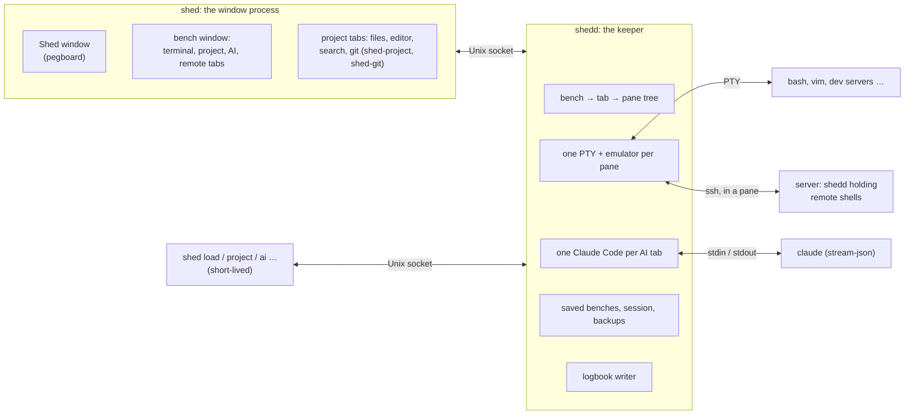
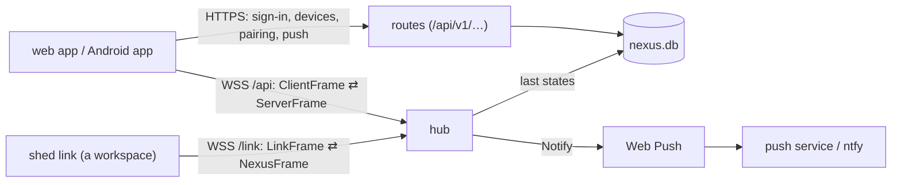

# How Shed works

This document describes Shed's moving parts: its two processes and how they talk,
how a pane's screen survives windows coming and going, the four kinds of tab
(terminals, project folders, Claude Code conversations, remote shells), how benches
are saved and brought back, and how the shell, the logbook, the browser and the
desktop fit in. The [User Guide](user-guide.md) describes the product;
[Development](development.md) covers building and testing; the
[Roadmap](roadmap.md) what is still open.

## Two processes

Everything that must outlive a window lives in the keeper: shells and the programs
in them, Claude Code sessions, the tree of benches and tabs, what is saved. The
window process draws, and does the work of a project tab itself (reading files,
watching the folder, running `git`), since none of it needs to run while the tab
is not shown. A remote tab is a pane like any other whose program is
`shed remote connect`, which reaches a keeper on the server over ssh.

**`shedd`, the keeper**, holds everything that must outlive a window: every PTY and
the program in it, the tree of benches, tabs and panes, and a terminal emulator per
pane. It is a daemon, one per user, found through a socket in
`$XDG_RUNTIME_DIR/shed/` and kept unique with a lock file there. The first `shed`
starts it if it is not running; it stops when Shed is closed, on `shed stop`, at
logout, or once nothing runs in it and no window is connected.

**`shed`, the window process**, draws the Shed window and one window per open bench,
with GPUI (the UI framework from the Zed editor, community edition). It is single
instance: running `shed` again, or a bench's launcher, only asks the keeper to have
the existing window process show something. Every other `shed` subcommand is a
short-lived client of the keeper.

Windows hold no state of their own beyond what they draw. Hiding a bench closes its
window and detaches from it; the keeper keeps it running. Closing a bench's window
asks first whether to close the bench or hide it.

## The protocol

Frames on the socket are `[u32 length][u8 kind][payload]`. Terminal input and output
travel as raw bytes, tagged with their pane, so a busy pane costs a copy and no
encoding. Everything else is a control message, `ClientMsg` to the keeper and
`KeeperMsg` back, encoded with postcard (in `shed-proto`).

A client opens with `Hello { version, kind }`, and the keeper answers `Welcome`.
The kind is a window, a CLI command, or the link (`shed link`, which hears what
windows hear but counts as no window: what it attaches stays hidden). The tree
is broadcast whole (`TreeChanged`) after every change to windows and the link; windows render from it, and every action a window or the CLI takes
(new tab, split, rename, move a tab, set colours, setup, aliases) is a message the
keeper applies to it.

Postcard encodes enum variants by position, so the rules are: new messages go at the
end of their enum, and `Hello`, `Shutdown` and `Error` keep their positions forever
(a test pins them). `PROTOCOL_VERSION` changes with every change to the messages; a
window refuses a keeper of another version and says so, and `shed stop` stops any
keeper, reading its process from the socket (`SO_PEERCRED`) and sending SIGTERM if it
does not understand the request.

## A pane's screen

Each pane has a terminal emulator in the keeper (`alacritty_terminal`, vendored with
a few read-only accessors, behind Shed's `Emulator` trait). The keeper feeds it all
output, which lets it:

- **answer the terminal's queries** (cursor position, device attributes, colours)
  itself, exactly once, whether or not a window is attached. Replies that binary
  output happens to provoke (`cat image.png`) are dropped, so they never land on the
  prompt;
- **replay** the pane: when a window attaches, the keeper serializes the emulator's
  whole state (scrollback, both screens, cursor, pen, modes, charsets, tab stops,
  colours, title, keyboard flags) as bytes that bring a fresh emulator to the same
  state, and sends them before any further output. A full-screen editor reappears
  mid-edit. If the output so far stops inside an escape sequence or a UTF-8
  character, the replay ends with that unfinished part, so the rest of it,
  arriving next, completes it in the window too.

The window process runs its own emulator per pane, fed by the replay and then the
live output, and draws from it. It keeps one only for the panes of each open
bench's three most recently shown tabs (the scrollback would otherwise sit in both
processes for every tab); a tab shown again after that asks the keeper for a
replay of its panes (`ClientMsg::Replay`). Whether such a pane is at its prompt
then comes from the tree (no foreground tool), as the prompt marks were before
the replay. Keys are encoded there, the xterm way or with the
kitty keyboard protocol when a program asks for it (presses, repeats, releases,
and modifier keys on their own), and sent to the keeper as input.

## Shell integration

Shed starts bash with its own startup file, which reads your `~/.bashrc` and then
Shed's hook (`shell/shed.bash`). zsh starts with `ZDOTDIR` pointing at a folder of
Shed's whose `.zshenv` puts your own `ZDOTDIR` back, runs your `.zshenv` and loads
the zsh hook (`shell/shed.zsh`); zsh then reads your `.zprofile` and `.zshrc` as
usual, and the hook finishes setting up at the first prompt, after them. Either
hook reports, as escape sequences in the output:

- `OSC 133` marks around the prompt and each command (prompt start, input start,
  command start, command end with its exit status);
- `OSC 7`, the current folder;
- a private `OSC 7777` with the text of each command, the history-walk state, and
  the shell's own aliases.

The keeper reads these marks from the output of every pane. They tell it where each
pane's prompt is (startup and teardown commands are typed one per new prompt, and a
prompt redrawn by the line editor does not count), what is running, and what to write to
the logbook. The folder and the program in the foreground are also read from
`/proc` every second, for tag rules and for saving.

Tag colours set in `[tag_colors]` belong to the keeper: `Config::recolor_tags`
gives tags those colours when a window sets a tab's tags, when tag rules make
them, when a saved bench loads or is listed for the Shed window, and across the
tree whenever `shed.toml` changes. Windows list the tags they can offer with
`bench_window::known_tags` (running and closed benches, and the configured ones).

The hook also gives each tab its own history file, binds Ctrl+Up and Ctrl+Shift+Up to
walk the logbook (through `shed hook walk`), and applies Shed's aliases from a file
the keeper writes per tab, at every prompt. The shell's own aliases edited in Shed
(`SetShellAlias`) are lines in `shell-aliases.sh` in the config folder, which the
keeper edits and makes `~/.bashrc` and `~/.zshrc` source; the hook (told the path by
`SHED_SHELL_ALIASES`) reads it at the first prompt and again whenever it changes,
then sends the shell's aliases again. Bash runs signal traps only once a line is
entered, so changes wait for the next prompt rather than interrupting the one shown.

## The AI prompt

When Shed's AI prompt is on, the keeper starts shells with `SHED_AI=1`, and the hook
takes over Enter (and Ctrl+J, which is what an Enter typed ahead arrives as): a
line starting with `>` is not run but sent to the keeper as an `OSC 7777` request,
and the line is emptied. The keeper runs the configured command (`sh -c`, in the
pane's folder, `claude -p` by default) with a prompt on its stdin: the request,
the shell, the system, the folder, the tab's last commands from the logbook and
the pane's last lines of text (neither for private tabs). Its output, cleaned of
code fences, is typed at the prompt as a bracketed paste, so it does not run. The
pane's `ai` state in the tree (asking, or failed and why) drives the chip in the
window; Escape there sends `CancelAsk`, which stops the command.

## The logbook

The logbook is a SQLite database (WAL mode, with an FTS5 trigram index for search).
The keeper writes it from a thread of its own; windows and the CLI open it read-only.
Each entry records the command, folder, exit status, start and duration, and the
pane, tab and bench it ran in, so the three scopes (tab, bench, everything) are only
filters on one table. Commands from private tabs are kept with the tab only.
A search as typed (`tag:prod deploy`) is split into text and tag by
`shed_logbook::parse_query`, so every client reads it the same way.

## Tab kinds

A tab has a kind (`TabKind`). A **terminal** tab holds panes, each a PTY in the
keeper. A **project** tab holds a folder (`Project { root, open, active, exclude }`:
its open files and excluded globs too, sent by the view with `SetProject`) and no panes: its
layout and active pane name a pane that does not exist, and `locate_pane` skips
it. The keeper keeps it in the tree and saves it; closing it (`CloseTab`) takes it
out at once, since nothing in it has to stop. A bench leaves the tree when its
last tab does, so a bench whose shells have all exited stays while it has a
project tab.

What a project tab shows lives in the window process: `ProjectView`
(`project_view.rs`), made when its bench first opens and kept while the tab is in
the tree, so unsaved edits survive hiding the bench. In a bench window, keyboard
focus goes to the active tab's active pane, or to the project view (`state::Focus`).

The parts without UI are crates of their own:

- `shed-project`: the file list (the `ignore` crate's parallel walk, honouring
  Git's ignore rules and the tab's excludes); a watch per folder (`notify`,
  inotify on Linux, non-recursive so ignored trees cost nothing), whose changes
  arrive in batches about 40 ms apart, new folders being watched as they appear;
  ranking files by a typed name (`nucleo-matcher`); searching the file list
  with ripgrep's engine (`grep-searcher`, `grep-regex`) on a thread per core,
  each file's hits handed on as it is done, stopping at a limit or when
  cancelled (no index: nothing can be out of date); and colouring
  (`tree-sitter-highlight` with compiled-in grammars, spans per line by byte
  range; Kotlin's query is Shed's own, in `queries/`).
- `shed-text`: the text being edited: a rope (`ropey`), one selection, undo
  grouped by typing runs, the editor's edits (indent, comment, move and
  duplicate lines, find and replace), and `reload`, which applies only the lines
  that differ (`similar`) so the cursor stays with its text.

`text_view.rs` draws a `shed-text` buffer: only the rows in view, each shaped and
painted on one canvas (no element per line), positions on the monospace cell
grid. It is editable or read-only, numbered or not, wrapped or not, and can grow
with its text, for the prompts to come. Colouring runs off the UI thread a moment
after typing pauses; the colours of the previous version show meanwhile.

Following the disk: watch batches reach `ProjectView::on_disk_change`, which
updates the file list and tree and, for an open file, reloads it if it has no
unsaved edits or flags the conflict if it has. Saving writes the file; the watch
event that follows finds the text unchanged and does nothing. Unsaved edits are
written to `$XDG_STATE_HOME/shed/recovery/` (`shed_project::recovery`) 1.5 s
after typing pauses and read back when the file next opens. A terminal's Ctrl+click on a path asks `AppState`
(through the `AppHandle` global) to open it in the bench's project tab.

## Git

Git runs through the `git` program (`shed-git`), so the user's config, credential
helpers, SSH agent, hooks and signing apply. It never waits on a terminal
prompt (`GIT_TERMINAL_PROMPT=0`): a command that needs one fails and says why.
Reads use machine formats: `status --porcelain=v2 --branch -z` for the branch,
upstream, ahead/behind and every changed file, `log` with NUL-separated fields,
`blame --line-porcelain`. A diff is made from the two versions of the file
(`git show HEAD:path`, `:path` for the index, the file on disk) with `similar`,
as hunks; staging, unstaging or discarding one hunk applies that hunk as a patch
(`git apply --cached`, `-R`).

What a Git panel knows and does is `shed_git::session`, without a UI: a
`GitSession` (the repository, its status and outgoing commits, the history,
commits' files, amend, a `PushReview` waiting) and operations that run Git and
block (`refresh`, `load_diff` from a `DiffSource`, `hunk_action`, `commit`,
`PushReview::read`/`confirm`, `history`, `BranchOp::run`, `conflicts_in`). In a
project tab (`project_git.rs`, a child module of `project_view.rs`), every
Git command runs on the background executor. The status is read again 150 ms
after any change the folder watch reports (`.git` included, so commits and
switches made outside Shed show) and after every action; a fetch runs every
`fetch_minutes`. Diffs open as tabs among the files (not saved with the bench),
drawn as a `uniform_list` of rows: hunk headers with their actions, lines with
both numbers, or old and new side by side. The outgoing commits
(`Repo::outgoing`: `@{upstream}..HEAD`, or `HEAD --not --remotes` without an
upstream) are read with each status; a push first reads them again with
`Repo::push_target` (the branch's `remote` and `merge` config, else `origin`)
into a `PushReview` the Changes panel shows until confirmed.

## Remote tabs

A remote tab (`TabKind::Remote { host, id }`) is a terminal tab whose pane runs
`shed remote connect HOST ID`, again whenever the bench loads (the pane's startup).
That makes sure the server has this build of `shedd` (`uname -m` and an id file
checked over ssh; the binary sent through ssh's stdin when they differ), then runs
`ssh -t HOST ~/.local/bin/shedd attach ID` in a loop (ssh's `ControlMaster`
shares one login between the steps).

On the server, `shedd attach` (`shed-keeper/src/attach.rs`) connects to the keeper
there (starting one, detached, if none runs: without the PC's `LANG`/`LC_*`
that ssh forwarded when the server lacks those locales, so its shells don't warn),
finds the bench `remote-ID`
(running, saved, or new), sizes its pane to the terminal, attaches, and relays:
the replay (after a full reset) and output to stdout, stdin to the pane, window
size changes to `Resize`. The terminal is put in raw mode. Only terminal bytes
cross ssh, so local and server Shed need not be the same version. A newer
`shedd` that finds an older keeper still holding the shells re-runs itself as
that keeper's program (`/proc/PID/exe attach ID`).

Exit codes tell the loop what happened: 0, the shell ended (or was ended); 2,
this end let go; 3, the shell was lost with its keeper (a reboot), so the loop
joins again, and the server's keeper brings the saved bench back. Closing the
bench or the tab (`CloseTab`) locally sends no Ctrl+C to a remote pane (it would
reach the server's program): the hangup ends ssh and the shell stays.
`EndRemoteTab` first writes a close request (an OSC 7777 sequence) into the pane,
which the attach turns into deleting the server's bench; dropping a bench tells
every `Cli` client attached to it that its panes exited, so the other PCs'
attaches end too.

The ID is the server's name for the shell (the tab id of the tab that made it),
so any PC can join it: `NewRemoteTab { join: Some(ID) }` makes a local tab
running `shed remote connect HOST ID` for that ID. Several attaches to one bench
are just several clients; each sends its terminal size with input (at most every
half second) and on SIGWINCH, so the last PC to type sets the size.
`shedd list` prints the server's shells, one tab-separated line each (id,
running/saved, attached clients from `KeeperStatus.attached`, server bench and
tab ids, folder, foreground program); it reads saved `remote-*` benches from the
store when no keeper runs, and starts nothing. The window asks for it over ssh
with `BatchMode` (`remote::list_shells`), so it never prompts.

A remote pane's commands are not written to the local logbook (the keeper skips
remote tabs); the server's keeper logs them, as its shell has Shed's hooks. Ctrl+R
in a remote tab runs `shedd logbook` (an SQLite `VACUUM INTO` copy to stdout)
into `logbook-HOST.sqlite` in the runtime folder, and searches it with the
server's bench and tab ids from `shedd list` as "here".

## Startup and teardown

A bench loads quietly by default (`load_bench(quiet)`: shells and scrollback, no
`after_prompt` queue, nothing held; a remote tab's connect command still runs);
`ShowTarget::LoadAndStart` or `start_on_open` run the startup as before.
`Bench.started` records that the startup ran since it opened: `RunStartup` queues
each pane's startup (with its waits, as a load would), `RunTeardown` stops tools
and runs teardowns keeping the bench, and closing a bench or a tab runs teardown
commands only when `started`.

## Sizes

The configured font size is also the interface's scale (`theme::ui_scale`, size
÷ 14, set when settings apply): chrome sizes go through `theme::us(n)`, AI and
project tabs multiply it with the tab's own zoom (`z()`), the tab bar with
`tab_bar_scale`. `ResetZoom` sets every running tab's zoom to 0 and rewrites
closed benches' files that had any.

## Scrollbars

GPUI draws none: `shed-app/src/scrollbar.rs` paints a thumb (one quad) over the
right edge of what scrolls and listens to the mouse at the window, so a drag goes
on outside it. A `scrollbar::Source` is a `ScrollHandle` (scrollable boxes and
uniform lists), a `ListState` (the AI conversation, which measures every entry so
the length is known), or custom metrics and a setter (the editor's own scroll; a
terminal's scrollback in lines, from `Emulator::history_size` and
`display_offset`).

Jumping between commands: the emulator marks the first cell of the line where a
command is typed (`Flags::SHED_PROMPT`, a vendored-alacritty patch) when the
shell's OSC 133;B arrives, splitting its input there; the mark moves with the
line into history. A replay writes `OSC 7777;shed;prompt-line` after each marked
line, so a reattached window's emulator marks the same lines.
`Emulator::jump_to_prompt` scrolls to the previous or next marked line. The AI
tab jumps between the starts of prompts and of the responses to them.

## Links and the browser

A bench's links (`Bench.links`, set with `SetBenchLinks` or `SavedEdit::Links`;
older saved files kept them on project tabs, and `SavedBench::to_bench` gathers
those into the bench) open through Shed's browser extension when it is there (`browser.rs`, `browser/chrome/`). The extension (Manifest V3,
its ID fixed by the public key in its manifest) connects at browser start to the
native messaging host `dev.shed.browser`, which `shed browser setup` registers in
each Chromium-based browser's `NativeMessagingHosts` folder; the host is
`shed browser-host` (through a small script that keeps `SHED_RUNTIME_DIR`). The
host listens on `browser.sock` in Shed's runtime folder. To open a link the
window writes a JSON line there; the host passes it to the extension as a native
message (length, then JSON), which focuses the most recently used tab whose
address starts with the link's (origin and path), or opens one, and answers the
same way. No socket, or no answer within three seconds, means no extension: the
link opens with the desktop's opener.

Pictures are read as data (bytes, kind, size: `shed_project::picture`) and
drawn (`shed-app/src/picture.rs`) from their bytes (`gpui::Image`, keyed by a
hash of them), not from their path, which GPUI caches: a picture changed on disk reloads with the open file. Their diffs
(project tab's Changes, the AI review) read both versions' bytes
(`Repo::show_bytes`, or the file) and show them side by side in place of hunks.

## AI tabs

An AI tab (`TabKind::Ai`: folder, extra folders, session id, model, mode, effort,
following) is a Claude Code conversation. The keeper runs `claude -p
--input-format stream-json --output-format stream-json --include-partial-messages
--permission-prompt-tool stdio` in the folder (`--resume` with the tab's session),
one process per tab, started by the first prompt (or as the user starts typing,
`AiStart`) and kept between turns (`server/ai.rs`). It sends `initialize` first;
the reply lists the commands and models (`AiInfo`). Prompts go in as JSON lines;
every line coming out goes through `shed_ai::Transcript`, which turns stream
events, tool calls, tool results and permission requests (`control_request`
`can_use_tool`) into entries. Changes are sent to every window as `AiUpdate`
(entries from the first changed one on, at most every 40 ms), and the tab's
activity (idle, working, waiting) and session id go into the tree. The user's
answer to a permission request goes back as a `control_response` (with
Claude Code's suggested rules for "for this session"); Stop is a `control_request`
`interrupt`. Model and mode changes go to the running process; other folders or
effort start a new one at the next prompt. `rate_limit_event`s carry the usage
limits (`AiLimits`).

The browser (Claude in Chrome) belongs to at most one AI tab (`AiTab.browser`;
`ai_settings` clears it on every other tab, `load_bench` on a bench loaded
while another tab has it). Claude Code runs with `--no-chrome`, and the
keeper adds Claude Code's own server for the extension (`claude
--claude-in-chrome-mcp`, named `claude-in-chrome`) with a `control_request`
`mcp_set_servers` when the tab is connected, and sets the servers back to none
when it lets go: at once, mid-turn too. Not `--chrome` with `mcp_toggle`:
Claude Code remembers a toggle per folder in `~/.claude.json`, which would
switch the extension off for the person's own `claude` in that folder too. Each
server process is its own connection to the extension, so the session gets a
tab group of its own. The window looks for the extension's folder in the
browsers' profiles (`browser::claude_browsers`) to say where Claude will work,
or that it is missing.

Each prompt goes out with a message id of Shed's own (`uuid`), which Claude
Code keeps in its session file; the transcript also notes the id of the last
message before each prompt (`PromptMark`). `AiEdit` (edit and send again) asks
Claude Code to `rewind_files` to that prompt's id (it runs with
`CLAUDE_CODE_ENABLE_SDK_FILE_CHECKPOINTING`), then stops it, cuts the
transcript, and starts it with `--resume SESSION --resume-session-at BEFORE
--fork-session` (a new session that starts as a copy up to there; before the
first prompt, a fresh one), and sends the new text.

Claude's questions come as a `can_use_tool` request for its AskUserQuestion
tool: the transcript keeps them in the `Permission` entry (`questions`), the
window draws them as a form, and `AiAnswerQuestions` answers with the tool's
input plus `answers` (question → chosen labels joined by ", ", or the user's
own words), which is where Claude Code reads them.

The window draws an answer from `shed_ai::markdown` (pulldown-cmark turned
into blocks of text with styled ranges), as pieces of selectable text
(`shed-app/src/ai_text.rs`); code blocks are coloured by `shed-project`'s
highlighter. A selection runs from (entry, piece, byte) to another; each piece's
`StyledText` layout maps the mouse to a byte. A copy puts plain text on the
clipboard and the same as HTML (`markdown::to_html`) in the string's metadata
behind `shed-html:`, which the patched Linux clipboard offers as `text/html`.

Sessions are read from Claude Code's own files
(`~/.claude/projects/<folder>/<id>.jsonl`), by the window to list them (titles from
its `ai-title` records) and by the keeper to show a session again. Pictures in a
prompt (sent, or base64 image blocks in a saved session) are written once to
`$XDG_STATE_HOME/shed/ai-pictures/<hash>.<ext>` (`Transcript::keep_picture`), and
`Entry::User.pictures` carries their paths for the window to show; pictures in a
tool's result (Claude reading a screenshot) go to `Tool.pictures` the same way,
and Claude Code's `[Image: original …]` notes that follow them, sent as user
messages, are not shown as prompts. The keeper deletes pictures there unseen for
60 days (`prune_pictures`, by modification time, which `keep_picture` renews).

Each entry the conversation list draws is an `EntryView` of its own (it asks
the `AiView` to draw it, and follows the `AiView`'s notifications), so its layout
is kept apart and a hover change inside one entry notifies that entry's view.
GPUI still marks the `AiView` dirty as its ancestor, and the entry views read
it, so they are all drawn again; moving the conversation's state into a model
of its own would let the others be reused.

The window's conversation list starts at `AiView::first` (the last
`SHOWN_AT_FIRST` entries), with one row above the entries while earlier ones are
out of it; that row, once painted, splices the next ones in (`show_from`),
keeping the view where it was. Rows and entries map through `row` / `entry_at`;
search, the prompt list and block jumps `reveal` an entry before scrolling to it.
Drafts are `AiTab.drafts`, saved with the bench. A window changes an AI tab's
settings and kept state one thing at a time (`AiChange`: settings, unsent text,
a draft added or removed, a change viewed, explanations), so two clients
changing different things at once do not undo each other; a draft is removed
only if it is still what the client saw. Each draft
names its session (`Draft.session`): Claude Code's session id, or a draft
session's key (`draft-…`, `AiTab.draft_session` while one is shown, opened with
`AiOpenSession` like a session). When Claude Code reports a session id the tab
did not have (the first one, or a fork's after an edit or a revert), the keeper
moves the drafts of the tab's previous key to it (`AiTab::move_drafts`); a
revert to before the first message makes them a draft session again. Older
files' plain `drafts` go to the tab's session when read.

`changes_ui.rs` is what a project tab's Changes and the review share: diff
rows (laid out by `shed_git::layout`: unified, or side by side with removed
lines facing the added ones) and their drawing, status letter colours, and
changed files by folder (`folder_rows`, also in `shed_git::layout`). The review is
`shed-review` (no UI: what changed, keys, Viewed marks, explaining) drawn by
`ai_review.rs`, a child module of the AI view, which runs `shed_review::read` off the UI
thread over each repository the tab works in: `Repo::head_at` finds in the reflog
where HEAD was when the turn's (or session's) first prompt was sent,
`commits_since` the commits after it and which the upstream has; with the
status, every change goes into one of four layers (not staged, staged,
committed, pushed), each with its diff. Its actions are Git commands
(`apply` for hunks, `undo_commits` = `reset --soft`, `revert_staged` =
`revert --no-commit`). Viewed marks are `AiTab.viewed`: a key per change and an
FNV hash of its texts, so a change that differs since is not viewed.

**Explain** asks aside (`shed_ai::aside`): the window runs `claude -p --resume
<session> --fork-session --no-session-persistence` in plan mode, with Edit,
Write and Bash disallowed and a JSON schema for the answer, giving it each
change numbered, how far it went and its diff (cut short:
`Found::explain_request`, 150 lines a file and 4000 in all;
`ExplainRequest::ask` runs it, `answered` turns the answers into what is kept). The fork knows the
conversation, so it can say why; it is not saved, so the session's file and
context stay as they were. Answers are `AiTab.explained` (key, hash, text).

The usage limits come from Claude Code's `rate_limit_event`s; the keeper keeps
the last ones (`state_dir/ai-limits.json`, with when they were reported), sends
them to each window as it says hello, and drops a window once it has reset.
Bench windows with an AI tab draw them (`ai_view::limit_bars`).

`list_sessions` links each session to the one it came from: the session holding
the message its first message follows, else an older one holding its first
prompt (Claude Code copies messages into a new file when it continues or forks
one). Where in the parent it goes on (past every message both have) tells
continued (at the parent's end) from branched (earlier); the list is a tree,
each family by its most recent session, and the window shows a family as one
row (`shed_ai::session_rows`: families opened or not, draft sessions first,
filtered by words). `load_session` reads a session with the files it goes on from, oldest
first, each up to where it does, a message id once; `PromptMark.session` keeps
which file the message before a prompt came from, and editing that prompt
resumes that file.
`shed-ai` has
no UI and no processes; its tests replay recorded streams
(`crates/shed-ai/tests/streams/`), and `crates/shed-app/tests/ai_tabs.rs` runs the
keeper against a stand-in `claude` (`SHED_CLAUDE`).

`ai_view.rs` draws the conversation with GPUI's `list` (variable-height rows,
only those in view, following the end as it grows), a light Markdown renderer,
and the prompt as a `TextView`.

## Saving and loading benches

A bench is saved as `~/.local/share/shed/benches/<name>.toml`, plain TOML meant to be
readable and editable: name, colour, badge, folder, aliases, and per tab its name,
tags, layout and panes, or for a project tab its folder (`[tabs.project]`,
`root = "~/code/web"`). A layout is written as text, like
`right 0.6 (0) (down 0.5 (1) (2))`. Per pane: its folder, what was running, and its
startup and teardown. Each pane's scrollback goes beside it, as zstd-compressed text.

`shed_save::backup` copies the setup (config folder's `*.toml`/`*.sh` and
`themes/`, the data folder's `*.toml` and `benches/*.toml`) into
`backups/<stamp>/{config,data}/`, built in a `.part` folder and renamed into
place. The keeper's `main.rs` runs `backup::daily` at start and hourly (one a
day, newest 14 kept); `shed backup` makes, lists and restores them (restore only
with no keeper running). Settings writers use `paths::write_whole` (temporary
file, then rename; links followed).

The keeper saves every running bench each minute, within a second of a change to
setup or aliases, on rename, when closing a bench, and when it stops.

A closed bench is changed in its file: Shed sends the keeper an edit (`EditSaved`:
rename, colour, badge, a tab's name, tags or place, a new or removed tab, a pane's
setup, aliases), which loads the file, applies it and saves it back, leaving the
scrollback as it was. A running bench is changed in the tree instead, and the keeper
refuses file edits to it. Clients say what changes (`shed_client::BenchEdit`) and
`BenchEdit::to_msg` picks the message for a running or a closed bench.

The Shed window asks the keeper for the closed benches and every card's preview
(`Pegboard`) four times a second while it is the active window, once a second
while it is only on screen, and not while nobody can see it: it asks again as it
comes into view.

Moving a tab where either bench is closed (`MoveTabAcross`) combines the two: from
a closed bench into a running one, the keeper starts the tab's panes as loading
would and takes the tab out of the file; from a running bench into a closed one,
it writes the tab into that file under new ids (so loading that bench cannot
mistake its panes for the ones still stopping), then stops the panes as closing
would; between closed benches it moves the tab and its scrollback between files.

**Loading** rebuilds the bench in the keeper: panes start in their folder, with
their old scrollback fed to the emulator dimmed above a "restored" line, then either
run their startup commands or bring back what was running, by the rack rules
(restart, type and wait for Enter, or leave out).

Panes with **Starts after** wait: the keeper holds their startup at their first
prompt until every pane they wait for is ready, which is when its queued startup
has finished with exit status 0 (from the shell marks), or when its output, with
escape sequences taken out and the commands Shed typed left out, shows its
**Ready when** text. A failure, or the pane closing, keeps its waiters held; the
pane's `held` state in the tree says why, and `StartNow` releases one.

**Closing** saves the bench, then runs each pane's stop sequence concurrently:
Ctrl+C, wait for the prompt; SIGTERM to the foreground group if needed; teardown
commands one per prompt; then a hangup.

**Closing Shed** records which benches run and which have windows
(`session.toml`, for `auto_restore`), closes every bench that way, and stops the
keeper; the window process quits when its connection ends.

Benches keep their ids when saved, so a loaded bench has the same tab and pane ids
as before; a pane's read loop only acts on the PTY it started, so a bench closed and
loaded again at once does not confuse old panes with new.

## Windows and the desktop

The Shed window has the app id `dev.shed`; each bench window
`dev.shed.bench.<key>`, where the key is the slug of the bench's first name and
never changes. A bench window's icon is set as it opens and, on X11, replaced
when the bench's colour or badge changes. For each bench Shed writes a hidden desktop entry and an icon (the
bench template: a terminal window on a workbench, rendered in the bench's colour
with resvg) to
`~/.local/share`, so docks show one icon per bench and a pinned one runs
`shed load <key>`. Installed packages provide Shed's own entry and icons in the
hicolor theme.

Each window's place (size and position while not maximized, and whether it is
maximized or full screen) is sent to the keeper half a second after it stops
changing (`SetWindow`), and when the window hides or Shed closes. The keeper keeps a
bench's in the tree and its saved file, and the Shed window's in `window.toml`;
windows open from it, centered instead if no display shows that spot any more. On
X11 the vendored `gpui_ce_linux` makes that work: it asks the window manager for
the position (with static gravity, so it means the window's content, not its
frame), reads where the window really is on screen, and sets a starting maximized
or full-screen state as a property before mapping, which is when window managers
read it.

Settings (`shed.toml`) and themes are watched and applied live by both processes.
With `theme = "auto"`, the window process follows the desktop's colour scheme
(through the XDG desktop portal) and tells the keeper, which answers programs'
colour queries from the theme in effect.

## macOS

The same code runs on macOS, with these differences:

- what a pane runs and where is read with `proc_pidinfo` and `KERN_PROCARGS2`
  instead of `/proc`, and the keeper's process is found with `LOCAL_PEERPID`
  instead of `SO_PEERCRED`;
- the runtime folder (socket and lock) is `$TMPDIR/shed`;
- zsh starts as a login shell, as Mac terminals start it, and the AI command runs
  in the login shell too (apps opened from the Dock get a bare PATH);
- there are no desktop entries or per-bench Dock icons: a Mac app has one Dock
  icon. `Shed.app` (`packaging/macos/bundle.sh`) holds both binaries, and has a
  menu bar with Quit (Cmd+Q, which asks as closing the Shed window does);
- the default keys use Cmd, the default font is Menlo, and Option types
  characters unless `[macos] option_as_alt` is set.

## Drawing

A terminal view turns its emulator's visible cells into a frame: runs of text with
the same style shaped together, and backgrounds only where they differ from the
default. On integrated GPUs every window-sized quad costs milliseconds per frame, so
a frame is kept to one window-sized layer: the vendored `gpui_ce_wgpu` turns the
first opaque full-window background into the clear colour, which is close to free,
and draws border-only boxes (cards, a focused pane's frame) as four edge strips,
which with the vendored `gpui_ce_render` (quads rasterized only inside their clip)
cost their border rather than their area. Shed never uses GPUI's `opacity`, which
draws through a window-sized layer. GPUI redraws a whole window whenever something
under the pointer changes its hover style, and renders again the view that holds
it and every view above it (other views are kept), so the Shed window's frames are
kept to a few milliseconds: the pegboard's card previews are painted line by line
rather than as an element per line. The vendored `gpui_ce_linux` fixes key releases lost on X11, and window placement
there (see above); it also stops an idle window's frame timer, which upstream ran
at the display's refresh rate for as long as the window was visible.
The patches are described in `SHED_PATCHES.md` in their folders.

## The nexus

The nexus (`shed-nexus`, [the plan](nexus-plan.md)) is a server of its own,
apart from Shed's two processes: an axum server with a SQLite database
(`nexus.db`, WAL, in its data folder), configured by `nexus.toml`. Workspaces'
links dial out to it; the web and Android apps (connectors) speak only to it. It
keeps the account, the paired devices and each workspace's last state, relays
between connectors and links, and sends push notifications. The API's types are
in `shed-api`; the nexus reads only their envelope.

- **The account** is one user: an argon2 password hash, a TOTP secret and ten
  recovery codes (hashed, single use). Until it exists, the nexus logs a setup
  link with a one-time code at every start; setting up takes the code, a user
  name and password, then a code from the authenticator. TOTP codes are taken
  within a step either side, and each step only once (the last used one is
  stored).
- **Signing in** takes password and TOTP (or a recovery code). A browser gets a
  session (`shed_session` cookie: `HttpOnly`, `Secure` unless turned off,
  `SameSite=Strict`) and a CSRF token it sends in `X-Shed-Csrf` with every
  change; a phone gets a device token for `Authorization: Bearer`. Tokens are
  256 random bits; the database keeps their SHA-256 only. Failed attempts
  (passwords, setup and TOTP codes) lock an address out after a few, and all
  sign-ins after many from everywhere; pairing requests have a rate of their
  own. Revoking a device, changing the password and approving a pairing ask
  for a fresh TOTP code. Every sign-in, failure, pairing, revocation and
  password change goes into the audit log.
- **Pairing**: a workspace asks (`pair/start`) and gets a code to show
  (`K7QF-2M9D`) and a secret to poll with; it is gone after ten minutes. The
  signed-in user approves the code, naming the workspace. The next poll makes
  the workspace (a device of kind workspace, with a token) and gives the token
  out, once; the nexus never keeps it.
- **Who may come in**: optionally only some address ranges, and only some
  countries (from a GeoIP CSV of ranges, which also gives the country shown with
  devices and audit entries). Behind a reverse proxy, the client's address is
  the last `X-Forwarded-For` entry, when the proxy is trusted. A browser's
  `/api` socket must come from an allowed origin (the public URL's by default).
  Answers carry a strict Content-Security-Policy and the usual hardening headers.

**Relaying.** `raw.rs` mirrors `shed_api::wire`'s frames with the payloads
(`call`, `topic`, `event`, `state`, `ok`) kept as raw JSON, read field by field
so the key order does not matter; a call the nexus does not know passes through
byte for byte (a test checks every frame round-trips unchanged). The hub
(`relay.rs`) knows every live socket. A connector's `Request` or `Subscribe`
goes to the workspace's link under an id the nexus picks; the `Response` or
`Event`s come back under it and go out under the connector's id. Each
subscription is forwarded as is, even when two connectors watch the same thing
(sharing streams can come later). A request unanswered for 60 s is answered
`Timeout`; one to a workspace not connected, `Offline` (or `NotFound`). When a
link goes, its subscriptions end (`Ended`, `Offline`) and its requests are
answered `Offline`; when a connector goes, its subscriptions are unsubscribed at
the link. The nexus does not read calls, so a workspace's policy (view only) is
enforced by its link. Revoking a device, or its session running out, closes its
sockets at once (with `Goodbye`). Sockets are pinged every 30 s and dropped
after 90 s of silence; one that cannot keep up (4096 frames queued) is dropped.
Frames may be up to 24 MB (pictures for AI prompts travel inside them).

**State.** A link sends its workspace's whole state when it changes; the nexus
passes it to every connector and keeps it (written to the database every few
seconds), so an offline workspace still shows as it was. `Welcome` carries the
workspaces and their last states; `Workspaces` goes out when one comes, goes or
is renamed.

**Push.** A link's `Notify`, and a workspace offline for two minutes, become
Web Push messages to every device whose subscription wants that kind. The
payload (JSON: kind, title, body, workspace and its name, bench, tab) is
encrypted for the device (RFC 8291, `aes128gcm`) and signed with the nexus's
VAPID key (RFC 8292), made on first start (`vapid.key`, 0600). Browsers'
push services and UnifiedPush distributors (ntfy) take the same requests, so
one path covers both. Subscriptions a push service no longer knows (404, 410)
are dropped.

The modules: `config.rs` (`nexus.toml`), `store.rs` (the database and its
numbered migrations), `auth.rs` (tokens, passwords, TOTP, recovery codes,
lockouts), `http.rs` (routes, errors as `ApiError` with a matching status, who
is calling, headers, the web app's files with `index.html` for any other path),
`pair.rs`, `relay.rs`, `raw.rs`, `push.rs`, `geo.rs`. Deploying it is
described in [Deploying a nexus](nexus-deploy.md).

## The code

| Crate | What it holds |
| --- | --- |
| `shed-model` | The bench → tab → pane tree, ids, colours, settings and themes, XDG paths, a bench's links as typed |
| `shed-proto` | The socket messages and framing |
| `shed-emu` | The `Emulator` trait and its `alacritty_terminal` backend, replay, key and mouse encoding, shell-mark parsing |
| `shed-keeper` | `shedd`: PTYs, the socket server, saving, closing, the shell marks |
| `shed-save` | Saved bench files, layouts as text, rack rules, scrollback, the session |
| `shed-logbook` | The logbook database, where it is, searches as typed (`tag:`), and the bash and zsh hooks |
| `shed-desktop` | Bench and app icons, desktop entries |
| `shed-text` | An editable text buffer: rope, selection, undo, the editor's edits, reload from disk |
| `shed-project` | A project's file list, a folder's entries and which project holds a path, folder watching, ranking files by name, colouring, pictures as data, unsaved edits kept aside |
| `shed-ai` | Claude Code conversations from its stream or session files; session lists, and their rows as shown (families, drafts, filter) |
| `shed-git` | Git through the `git` program: status, diffs as hunks, staging hunks, commits, branches, log, blame, conflicts; diffs and changed files laid out as rows; a Git panel's data and operations (`session`) |
| `shed-review` | An AI tab's review as data: changes since a turn or the session by how far they went, their keys and fingerprints, Viewed marks, explanations and the request for them |
| `shed-client` | Talking to the keeper without GPUI: the connection (starting `shedd`), blocking requests, the CLI's keeper commands, bench edits routed to running or closed benches, the pegboard's list, remote shells over ssh |
| `shed-app` | `shed`: the Shed and bench windows, terminal views, menus, the CLI |
| `shed-api` | The nexus API's types: frames, workspace state, calls, topics, HTTP bodies, errors |
| `shed-nexus` | `shed-nexus`: the account, devices, pairing, relaying, snapshots, push |

`browser/chrome/` is the browser extension (built into `shed`, written out by
`shed browser setup`). `vendor/` holds the patched copies of `alacritty_terminal`, `gpui_ce_wgpu`,
`gpui_ce_render` and `gpui_ce_linux`; `packaging/` the Debian and Arch packaging, desktop entry and
systemd unit, and the nexus's sample settings and unit (`packaging/nexus/`); `tools/screenshots/` the demo setup the docs' screenshots come from.
