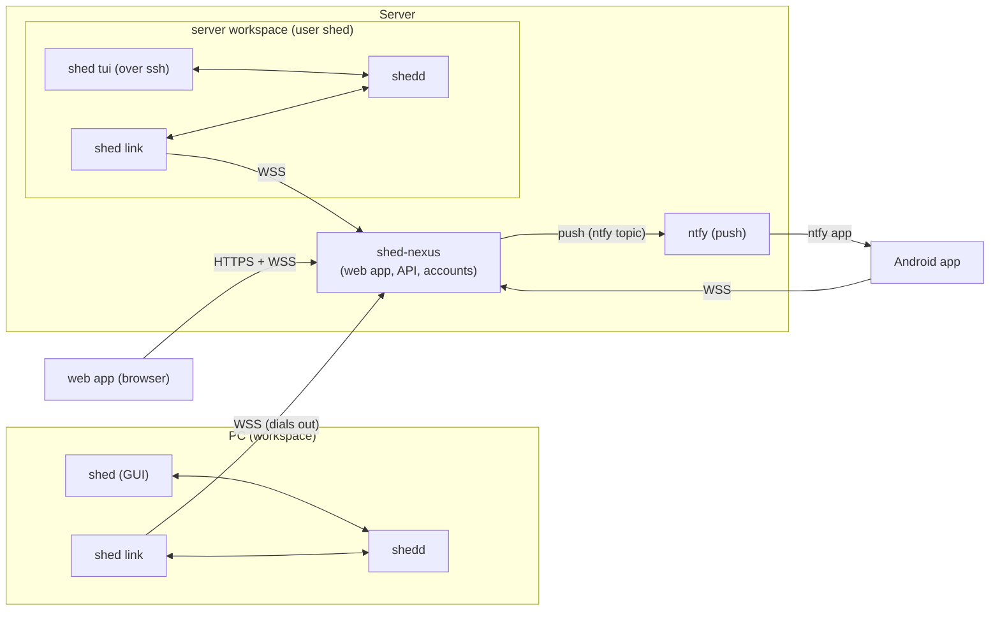

# Shed from anywhere: plan

Shed today runs on the machine in front of you. This plan lets it be reached
from anywhere and run where you are not. Any number of Shed **workspaces**
(a PC, a laptop, a server) link to a **nexus** you host. Through it, a web app
and an Android app see and drive them: benches, terminals, history, projects,
diffs and, above all, AI tabs. A server can also run a workspace of its own,
with a terminal interface, so Claude Code keeps working while the PCs are off.
This document records the decisions, their reasons and the order of work.

> **Status:** agreed 2026-11-19; phases 0–5 built on 2026-11-20: the API's
> types (`shed-api`, with `shed-codegen` for TypeScript and Kotlin), the nexus
> (`shed-nexus`), the link (`shed-link`: `shed link`, `shed nexus
> join/status/leave`, the keeper starting it, the link's state in the Shed
> window), the web app (`web/`), the server workspace with `shed tui` and the
> build without windows, and the Android app (`android/`). How it works now is
> in [How Shed works](architecture.md#the-nexus), how to use it in the
> [User Guide](user-guide.md#reaching-shed-from-elsewhere), how to host it in
> [Deploying a nexus](nexus-deploy.md). What is still open is on the
> [Roadmap](roadmap.md#shed-from-anywhere); this file stays as the record of
> what was decided and why.

## The picture

- **Workspace**: one keeper (`shedd`) on a machine, with its benches, and
  whatever clients it has (GUI, TUI, CLI). Shed as it is now is a workspace.
- **Nexus** (`shed-nexus`): a server you host. It holds the account and the
  paired devices, keeps the last state of each workspace, relays between
  connectors and workspaces, serves the web app and sends notifications. It
  owns nothing in a workspace.
- **Link** (`shed link`): a process on each linked workspace. It is a client
  of the keeper, like a window but with no UI, and dials out to the nexus.
- **Connectors**: the web app and the Android app. They speak only to the
  nexus.
- **TUI** (`shed tui`): a terminal client of a workspace's keeper, like the
  GUI. It is not a connector. It is mainly for the server workspace, over ssh,
  and works on any workspace.

## Principles

1. **Optional.** Shed without a nexus works exactly as now. A server
   workspace works without a nexus too (`shed tui` over ssh). Nothing about
   the nexus runs unless it is configured.
2. **The workspace owns its work.** The nexus relays and remembers the last
   state shown; it never decides. A workspace can refuse remote control or
   allow viewing only. **Private tabs never leave the machine** (connectors
   see that a private tab exists, not what is in it).
3. **The keeper stays small.** It holds every shell; nothing that can stall or
   crash it moves in. The link is a separate process, and so is its file, Git
   and logbook work (on its own threads). A crash there loses no shell.
4. **Content, not display.** The API carries what is there: conversations,
   files, diffs, history, the text of a terminal's screen. Each client lays
   it out for its screen. Zoom, fonts, themes and layout stay local to a
   client.
5. **Anyone can host it.** Open source: addresses, ports, paths, users, push
   servers and filters are all settings. Deploy docs use placeholders. No one's
   own infrastructure is written into the repository.
6. **A public API of its own.** The keeper's socket protocol (postcard, by
   position, one version) stays private to a machine. The nexus API is
   versioned JSON, because workspaces, the nexus and the apps update at
   different times.
7. **Each step keeps Shed working.** Refactors first get tests that pin the
   current behaviour; every phase ends with the whole suite green and the docs
   updated.

## Components

### The link (`shed link`)

The link connects to the local keeper as a client (a new `ClientKind::Link`)
and to the nexus over WSS with the workspace's token. It:

- **publishes** the workspace's state: the tree (running benches), the closed
  benches, AI tabs' activity, usage limits. Updates are debounced (at most 4
  a second) and private tabs are reduced to a placeholder;
- **serves requests** from connectors, relayed by the nexus. Actions on the
  tree go to the keeper as the same `ClientMsg`s the GUI sends. Project, Git,
  logbook and AI session work it does itself, with the same crates the GUI
  uses, on a thread pool;
- **streams** only what a connector is watching: an AI tab's transcript, a
  terminal's screen, a project's changes. It attaches to a bench while a
  connector watches it and detaches after;
- **enforces the workspace's policy**: off, view only, or full control
  (`[nexus] control` in `shed.toml`), and the private-tab rule;
- **raises notifications** (AI waiting for an answer, a turn done, a long
  command finished) as events the nexus turns into pushes.

The keeper starts it when `[nexus]` is set and enabled, and restarts it if it
dies (with a backoff). The GUI shows whether the workspace is linked and can
switch the link off. The keeper logs every remote action with the device that
sent it.

### Terminals as content

A connector does not get the PTY's raw bytes. The link runs a `shed-emu`
emulator per watched pane (fed by the keeper's replay and output, as a window's
is) and sends the **screen as text with attributes**: the grid's lines (spans of
text with colour and style, and whether a line wraps into the next), the
cursor, the title, and the modes that matter (alternate screen, mouse). Changed
lines go out at most ~30 times a second. Scrollback is fetched by range on
demand.

- **No terminal emulator in TypeScript or Kotlin.** Each client draws lines of
  styled text natively.
- **Fits any screen.** On the normal screen, a client re-wraps the logical
  lines (rows joined where they wrap) to its own width, so a shell's output
  reads well on a phone. On the alternate screen (vim, htop, `claude`), it
  shows the grid as it is, fitted or panned.
- **Flaky networks are fine.** It is state, not a stream: a reconnect sends
  the current screen, not everything missed (as mosh does).
- **Input** comes as key events (key, modifiers, text) or a paste. The link
  encodes them with `shed-emu`'s key encoding, which knows the program's modes
  (application cursor keys, the kitty protocol).

**Size.** A PTY has one size, and the program inside draws for it. By default
the size stays with whoever set it (the GUI). A connector can **take the size**
for a pane while it shows it, for a full-screen program on a phone; leaving
gives the previous size back. While a connector holds the size, the GUI shows
the pane at that size.

### The nexus (`shed-nexus`)

A Rust server (axum, tokio, SQLite), one binary, configured by `nexus.toml`.
It serves:

- the **web app** (static files, built from `web/`);
- **`/link`**: WSS for workspaces;
- **`/api`**: WSS for connectors, after sign-in;
- HTTP for sign-in, pairing and **uploads** (pictures for AI prompts, sent to
  the workspace through the link).

It keeps, in SQLite:

- the account: a password hash (argon2) and a TOTP secret;
- devices: workspaces, browsers and phones, each with a token hash, name,
  last-seen time and address;
- sessions;
- each workspace's **last snapshot**, so an offline workspace still shows,
  read only, as it was;
- push subscriptions;
- an audit log of sign-ins, pairings and revocations.

Logbooks, scrollback, files and transcripts stay on the workspaces. A
transcript is cached only as part of the last snapshot of an AI tab being
watched.

**Relaying.** Each request a connector sends names a workspace. The nexus
forwards it to that workspace's link with a correlation id and passes the
answer back. Subscriptions are reference-counted per workspace: the link
streams a pane or a transcript while at least one connector watches it.

### Security

The trust model is stated plainly: **the nexus is trusted**. Whoever controls
it can type into every linked workspace's shells. TLS (WSS, HTTPS) protects each
hop, and the nexus sees what passes through. End-to-end encryption between
connectors and workspaces was considered and left out: the web app is served
by the nexus, so a compromised nexus could serve one that leaks the keys, and
the server workspace usually runs on the same machine anyway. The nexus is
hardened instead:

- **Account**: one user for now. On first start the nexus writes a one-time
  setup link to a 0600 file in its data folder and logs where it is (the code
  is in the link's `#` fragment, so no proxy logs it); setting up means a
  password and a TOTP authenticator (shown as a QR code), plus single-use
  recovery codes.
- **Signing in** always asks for password and TOTP. A browser gets a session
  cookie (`HttpOnly`, `Secure`, `SameSite=Strict`; 7 days by default,
  configurable). A phone gets a **device token** that it keeps in the Android
  Keystore, optionally behind a fingerprint unlock in the app.
- **Pairing a workspace**: `shed nexus join https://nexus.example.com` prints
  a code. You type it into the web app (which lists waiting requests without
  their codes) and approve it, with TOTP again. The workspace gets a
  long-lived token, kept with the nexus's address in a 0600 file in Shed's
  data folder, outside the `*.toml` files that backups copy; the link sends it
  only to that address, and only over TLS (plain `http` only to the same
  machine). Waiting requests are capped per address, the oldest making way.
- **Devices** are listed with last seen time and address and can be revoked.
  Revoking closes their connections at once. Changing the password ends every
  session and device token (browsers, phones and desktops) but the current
  one; paired workspaces keep theirs.
- **Asking for TOTP again** for pairing, revoking, and account changes; wrong
  codes there are counted per device, apart from sign-ins.
- **Rate limiting and lockout** on sign-in, per address (IPv4, or IPv6 /64),
  counting attempts as they start. Many failures from everywhere slow down
  addresses that never signed in rather than locking out everyone, so a
  distributed attack cannot lock out the owner. Argon2 runs a few at a time;
  connections are capped and must send their headers in time. Push endpoints
  must be public addresses (no requests into the nexus's own network). An
  optional **country filter**
  (an allow-list, checked against a GeoIP database file you provide, such as
  db-ip lite) and optional address ranges. Off by default.
- **Behind a reverse proxy** (nginx + certbot in the docs) or with its own TLS
  (rustls), as configured. `X-Forwarded-For` is believed only from the
  configured proxies. WebSocket `Origin` checks and a strict
  Content-Security-Policy for the web app.
- **On the server**: the nexus and the server workspace run as **their own
  non-root users**, under systemd with its sandboxing options, never as root.

### The API

- **Transport**: JSON text frames over WSS for messages; binary frames for
  uploads. Every message is one of:
  - a **request** (`id`, `workspace`, `call`), answered by `ok` or `error`
    (with an error code);
  - a **subscription** (`sub`/`unsub` to a topic: a workspace's state, an AI
    tab, a pane's screen, a project's changes);
  - an **event** on a subscribed topic.
- **Versioned**: the API version is checked when a connection opens. Changes
  are additive where possible (new fields with defaults, new calls). The nexus
  accepts links from a range of versions, so workspaces need not update
  together.
- **Its own types** (crate `shed-api`), mapped from `shed-model` and the
  others rather than exposing them, so internal changes do not reach clients.
  **Rust is the source**: the TypeScript and Kotlin types are generated (a
  codegen crate, as in oddmoth) and never edited by hand.
- **What it covers**, by area (each is what the GUI offers today):

| Area | Calls and topics |
|---|---|
| Workspaces | list, online/last seen, link policy |
| Benches | running and closed (with card previews); new, load, close, hide, rename, colour, badge, order, startup/teardown runs |
| Tabs | new (terminal, project, AI, remote), close, move, rename, tags, private, dividers |
| Terminals | screen topic, scrollback by range, input (keys, paste), take/give size, split, close pane |
| Logbook | search with the three scopes, recent commands per tab |
| AI tabs | sessions (with drafts sessions), open/new session, transcript topic, send text and pictures, stop, answer permissions and questions, edit and resend, revert, queue, drafts, model/mode/effort, extra folders, usage limits, review of changes (viewed, explain) |
| Projects | file tree, quick open (ranked), read a file (with highlight token kinds), search in files (streamed), changes topic |
| Git | status, ahead/behind, diff per file, stage/unstage per hunk, commit, branches, log, fetch/pull/push |
| Notifications | which events push, per device |

Not in the first versions (now on the [Roadmap](roadmap.md#shed-from-anywhere)):
editing files from a connector (later, through `shed-text`), editing settings
and themes, multiple users, Claude in Chrome (shown, not controlled).

### Notifications

- **Live first**: each app says whether it is in view (`Visible`). While one
  is, notifications come to the apps over their WebSocket and they show them
  themselves (a toast in the web app, a banner in the Android app); nothing is
  pushed.
- **Android**, when no app is in view: a plain ntfy topic on a ntfy you run
  (`[push] ntfy_url`, like other projects' alerts: `alerts-shed`), which the
  phone reads in the ntfy app; tapping one opens the tab
  (`shed://w/…/b/…/t/…`). Without a topic, UnifiedPush: Shed's app registers
  through the ntfy app as distributor, and payloads are encrypted for the app
  (RFC 8291), so the ntfy server cannot read them.
- **Browser**, when no app is in view: Web Push from the service worker (VAPID
  keys made by the nexus on first start). Payloads are encrypted for the
  browser too.
- **Events**: AI waiting for an answer, an AI turn done, a long command
  finished, a workspace gone offline. Per device, each can be on or off (the
  shared ntfy topic carries what any phone wants).

### The web app (`web/`)

Angular, standalone components and **signals** (zoneless), with a small UI kit
of its own. The architecture is like oddmoth's (feature folders, an API
service over one WebSocket, generated API types), but it is standalone and
shares no code with oddmoth or its common library. Strings go through a simple
key-based dictionary (English only for now, ready for more). It is installable
as a PWA. The nexus serves the built files.

### The Android app (`android/`)

Native Kotlin with Jetpack Compose: an OkHttp WebSocket, kotlinx.serialization
over the generated API types, the UnifiedPush library, the device token in the
Keystore, the photo picker and camera for AI prompts. It has no Google Play
Services dependency, so it can be built from source or go to F-Droid.

### The server workspace and the TUI

The server runs the same `shedd` as everywhere, as user `shed` (lingering, so
it survives logout, with the `shedd.service` user unit). The same keeper still
holds the shells of remote tabs (`remote-ID` benches), so **remote tabs from
local Shed and the server workspace live side by side** on one server. Claude
Code there is signed in once as that user. Usage limits belong to the account,
so every workspace on it shows the same limits.

**Binaries.** `shed` gets cargo features: `gui` (GPUI), `tui` (ratatui +
crossterm) and the link, which is always built. A desktop build has
everything. A server build (`--no-default-features --features tui`) has no
GPUI or display libraries, so `shed tui`, `shed link` and the CLI work on a
bare server. `shedd` is unchanged.

**`shed tui`** connects to the keeper like the GUI, and detaching (a dropped
ssh) leaves everything running. It covers:

- benches and tabs;
- terminal panes, drawn from `shed-emu` as tmux does, with splits;
- AI tabs: transcript, prompt, permissions and questions, sessions, drafts,
  limits, pictures by path;
- the logbook;
- project tabs: the file tree, a file viewer with colours, search, Git
  status, diffs, staging and commits. Editing opens `$EDITOR` in a terminal
  pane; there is no editor of its own.

It is more limited than the GUI where a terminal cannot do better.

### Other workspaces in the desktop app

Shed's desktop app, signed in to the nexus as a device of its own (kind
`desktop`, `shed nexus signin`), shows another workspace in its windows,
switching between "This PC" and the others. Rather than rebuild the window
on the API, it speaks the other workspace's keeper protocol, byte for byte,
through a **tunnel**: `ClientFrame::TunnelOpen` → `NexusFrame::TunnelOpen` →
the link connects to its keeper's socket, and binary WebSocket messages
(`[u32 id][bytes]`) carry the data, the nexus swapping ids as for requests.
Only desktops may open tunnels, only to workspaces whose `shed.toml` says
`[nexus] desktop_clients = true` with full control (they see everything,
private tabs too: they are the user's own signed-in computers). A desktop's
sign-in ends after 30 days (`desktop_days`), renewed by signing in again,
and its connection is never taken for that workspace's own window
(`ClientKind::Remote`). Terminals and
AI conversations work fully this way; what the window reads from the local
disk (project tabs, the logbook, Claude Code's session files) comes next,
through the API's calls. See [the architecture](architecture.md#other-workspaces-in-the-window).

## Phases

Each phase leaves Shed working and documented, with every test passing.

### 0. A safety net

Tests that pin what is about to move:

- the Git operations as the project view drives them;
- the review of an AI tab's changes and its viewed/explained state;
- logbook queries per scope;
- session listing with drafts;
- quick-open ranking;
- search in files.

Plus a headless GUI smoke check (the Xvfb script, extended to open a project,
an AI and a terminal tab) to run after each refactor.

### 1. A headless core

Move the logic that is not drawing out of `shed-app` into crates that the GUI,
the link and the TUI all use. The GUI calls them in-process as it does now, so
local performance does not change. Add `ClientKind::Link`, `shed-api` with its
first types, and the codegen. The GUI behaves exactly as before.

The heavy lifting is already in library crates (`shed-git`, `shed-project`,
`shed-ai`, `shed-logbook`). What is left in `shed-app` is the code that drives
them (async tasks, debouncing, cancelling, small state machines), mostly inside
GPUI view methods. The controllers move to plain threads and channels, with
the view subscribing to their state. In order, easiest first:

| What | From | To | Size | Difficulty |
|---|---|---|---|---|
| Keeper connection, blocking request helper, the CLI's keeper commands | `keeper_conn.rs`, `main.rs` | new `shed-client` | ~250 | easy |
| Logbook paths, `tag:` query parsing | `logbook.rs`, `logbook_view.rs` | `shed-logbook` | ~100 | easy |
| Remote shells listing, browser, desktop notifications | `remote.rs`, `browser.rs`, `notify.rs` | `shed-client` | ~550 | easy (no GPUI already) |
| Pure helpers: links, diff layout, folder rows, folder reading, recovery files, project root | `links.rs`, `changes_ui.rs`, `project_view.rs`, `state.rs` | `shed-project`, `shed-git`, `shed-model` | ~250 | easy |
| A picture as data (bytes, size, kind), apart from GPUI's image | `picture.rs` | `shed-project` | ~80 | easy; unblocks the next two |
| Git controller: refresh and fetch loop, operation runner, push review, diff loading, hunk actions, history, branches | `project_git.rs` | `shed-git::session` | ~450 | medium |
| AI review: collecting changes, keys and fingerprints, viewed, explain with its budget | `ai_review.rs` | `shed-ai::review` | ~350 | medium |
| Project controller: walk and watch, file index, quick open, cancellable streamed search, replace all, file loading and saving | `project_view.rs` | `shed-project::session` | ~500 | medium-hard |
| AI tab model: session families and drafts listing, turn changes, tasks, completion, answers, time and pace formatting, transcript text, links in text | `ai_view.rs`, `ai_text.rs` | `shed-ai::tab`, `shed-ai::text` | ~700 | hard (spread through `AiView`) |
| Bench edits routed to running or closed benches, pegboard listing, tab moves and closes, following AI edits, AI notification rule | `pegboard.rs`, `state.rs` | `shed-client` | ~250 | medium |

One protocol change belongs here too: an AI tab's state (drafts, unsent text,
viewed, explained) is saved by sending the whole `AiTab` back
(`AiSettings`), so two clients editing one tab at once would undo each
other. It becomes field-level messages (a draft added or removed, unsent text
set, a change marked viewed).

### 2. Nexus and link

- `shed-nexus`: account setup, sign-in with TOTP, pairing, devices, snapshots,
  relaying, the audit log;
- `shed link` with policy and terminals as content;
- `shed nexus join/status/leave`, and the link's state shown in the GUI;
- tests: an in-process nexus, keeper and link, with a fake connector.

### 3. The web app

Sign-in and devices, then:

1. workspaces and benches;
2. AI tabs in full;
3. terminals;
4. the logbook;
5. projects and Git;
6. Web Push.

### 4. The server workspace

The `tui` build, `shed tui`, and the server setup: the users, systemd units,
linger, the nexus behind nginx, ntfy. The deploy guide uses placeholders.

### 5. The Android app

The same order as the web app, plus UnifiedPush.

## Open

Terminals as content (above) was settled: the link sends a pane's screen as
styled text (`crates/shed-link/src/screen.rs`), and no app has a terminal
emulator. The points still open (which device holds a pane's size, packaging
the server build, what was left out of the first versions) are on the
[Roadmap](roadmap.md#shed-from-anywhere).
