# Shed User Guide

This guide walks through how Shed is meant to be used, from the first start to the
settings file. Screenshots come from a demo setup (`tools/screenshots/`).

- [The idea](#the-idea)
- [The Shed window](#the-shed-window)
- [A bench's window](#a-benchs-window)
- [Project tabs](#project-tabs)
- [AI tabs](#ai-tabs)
- [Remote tabs](#remote-tabs)
- [Opening, hiding, closing](#opening-hiding-closing)
- [Setup: startup, teardown and aliases](#setup-startup-teardown-and-aliases)
- [History and the logbook](#history-and-the-logbook)
- [Asking for a command](#asking-for-a-command)
- [Finding, selecting, links](#finding-selecting-links)
- [Tags and private tabs](#tags-and-private-tabs)
- [Colours and appearance](#colours-and-appearance)
- [Keyboard shortcuts](#keyboard-shortcuts)
- [Shed in a terminal (shed tui)](#shed-in-a-terminal-shed-tui)
- [Reaching Shed from elsewhere](#reaching-shed-from-elsewhere)
- [Shed in a browser](#shed-in-a-browser)
- [Shed on your phone](#shed-on-your-phone)
- [A workspace on a server](#a-workspace-on-a-server)
- [The `shed` command](#the-shed-command)
- [Settings: shed.toml](#settings-shedtoml)
- [Where things are kept](#where-things-are-kept)
- [Troubleshooting](#troubleshooting)

## The idea

Work on a project is spread over many things: terminals running its servers, its
code and Git, AI sessions, shells on its servers, its pages in the browser. Shed
puts them together, one **bench** per project or job, and keeps them running
whether or not you are looking.

- **Shed** itself: one window, with the Shed icon, that shows and manages every
  bench.
- **Benches**: each has its own window, colour and taskbar icon, a default folder,
  its links (web pages that go with its work), and tabs.
- **Tabs**, in a bench's window, of four kinds, each with its icon:

  | Kind | What it holds |
  | --- | --- |
  | **Terminal** | Shells, split into **panes** side by side or stacked, each with its own startup and teardown |
  | **Project** | A folder of code: file tree, editor, search, Git |
  | **AI** | Claude Code conversations, working in a folder of the bench |
  | **Remote** | A shell on a server, kept there, so it outlives the bench |

- **The keeper** (`shedd`), a background process that holds every shell, program
  and Claude Code session. You never deal with it directly; it is why closing a
  window does not stop anything.
- **Elsewhere**, optionally: a terminal interface (`shed tui`), and, through a
  server you host (a nexus), a web app and an Android app that reach your
  benches from anywhere (see [Reaching Shed from elsewhere](#reaching-shed-from-elsewhere)).

A bench is always in one of three states:

| State | What it means | Where you see it |
| --- | --- | --- |
| **Open** | Running, with its window | Its own taskbar icon |
| **Hidden** | Running, without a window | In Shed |
| **Closed** | Saved, nothing running | In Shed |

A bench is saved with everything needed to bring it back: its tabs and their
layout, each pane's folder, scrollback and setup, the files open in its project
tabs, its AI sessions with their drafts and queued messages, its links. Opening a
closed bench brings that back **quietly**: shells in their folders, files and
conversations as they were, and nothing started until you choose **Run Startup**.

Closing **Shed** closes everything. Starting Shed again shows every bench closed,
and nothing starts on its own: you open the benches you want. (To have Shed reopen
what was running instead, see [`auto_restore`](#settings-shedtoml).)

## The Shed window

Run `shed`, or pick Shed from your application menu.

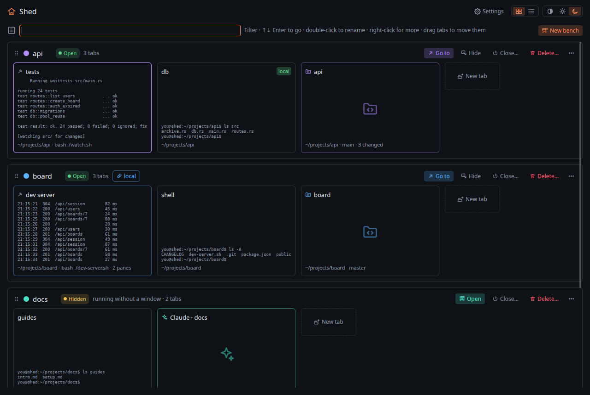

Every bench is listed by name, with its state and its tabs. The state is a
coloured badge beside the name: green **Open**, amber **Hidden** ("running without
a window"), grey **Closed** (with when it was saved). Each tab is a card with a live
preview of its screen: running programs update as you watch, and closed benches
show, dimmed, what was on screen when they were saved.

**Compact view**: the two buttons left of the light/dark switch choose between
the cards and a compact list, to see everything at a glance. Each bench is a
framed box with a header line (its colour dot, filled while it runs and a ring when closed; its
name, click to open, double-click to rename; whether it is hidden or when it was
saved; its links; **Open** or **Go to**; **⋯**) with its tabs below in even
columns, each on a light ground of its own. Each tab has an icon for what it is (terminal, program running, project,
AI, remote; the waiting icon when it waits for you), its title, its tags as small
dots, and what runs in it or its folder, cut short with "…" (hover for all of it).
A short bar in the bench's colour marks the tab the bench shows. Tabs work like
cards: click, drag, middle-click, right-click; **New tab** shows when the mouse is
over the bench. Shed remembers the choice (`compact_pegboard` in `shed.toml`).

**Benches** (the row above the cards):

- **Open** opens a closed or hidden bench in its window; **Go to** brings an open
  one forward. Beside it, **Hide** closes its window and keeps it running,
  **Close…** stops its programs and runs its teardown, and **Delete…** removes it;
  the last two ask first.
- A bench **opens quietly**: its shells in their folders with their scrollback,
  and nothing else runs (remote tabs still connect). **Open and Run Startup**, in
  a closed bench's menu (**⋯** or right-click), opens it with its startup. A
  running bench's menu has **Run Startup** and **Run Teardown**. (With **Run
  startup when a bench opens** on in Settings, opening runs it, and the menu
  offers **Open Quietly** instead.)
- Double-click the **name**, or the pencil beside it, to rename the bench. Enter
  or clicking elsewhere keeps the new name; Escape leaves it as it was (this goes
  for every name and tag you type, in Shed and in bench windows).
- Click the **colour dot** to pick another colour.
- **⋯**, or a right-click anywhere on the bench, has everything else: new tab,
  rename, badge, colours, hide, close, delete.
- **New bench**, top right, makes a bench and opens it.

**Tabs** (the cards):

- Click a card to go to that tab, opening the bench if needed.
- Double-click its title (or its pencil) to rename it. Middle-click, or **Close
  Tab…** in its right-click menu, closes it, after asking.
- **New tab** at the end of a bench's cards adds one.
- Drag a card onto another card to put it there, or onto another bench to move it
  there; **Move to Bench** in its menu does the same. Between running benches a
  tab moves with everything running in it. Into a closed bench, what runs in it
  stops (Shed asks first, and its teardown runs); it starts again when that bench
  opens. A closed bench's tab moved into a running one starts as opening would
  start it.
- Right-click a card for its menu:

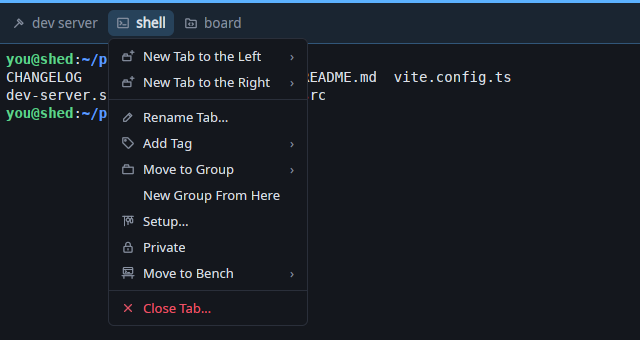

**Setup…** opens the tab's [Setup](#setup-startup-teardown-and-aliases) right in
Shed.

**Closed benches** are managed the same way: rename, recolour or badge them; add,
rename, tag, reorder or remove their tabs; change their setup and aliases. Each
change goes into the bench's saved file, and the bench opens with it next time.
Going to one of its tabs opens the bench.

Type in the field at the top to filter: by bench, tab, tag, folder or the program
running. Up and Down move through the tabs shown; Enter goes to the selected one;
Escape clears the filter.

**Order**: drag a bench by its grip (the dots left of its colour) onto another
bench to put it there, or use **Move Up** and **Move Down** in its menu. The order
is kept, and Super+1 … Super+9 raise bench windows in it. A bench stays in its place
as it opens and closes; benches never moved come after the others, by name.

## A bench's window

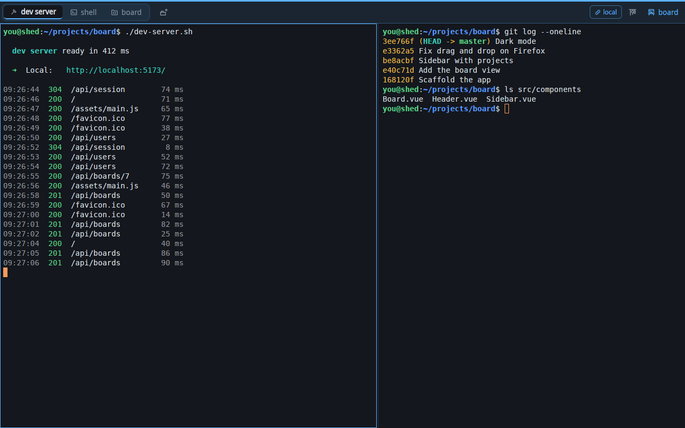

The coloured stripe and the tab bar carry the bench's colour; so does the border of
the focused pane, when a tab is split. The tab bar is set apart by a faint ground
of that colour and a line under it, the shown tab lighter and in bolder type; how
large it is drawn is a setting (**Tab bar size** in Settings).

- **Tabs**: click to switch, double-click to rename, drag to reorder: dropped on
  a tab's left half it goes before it, on the right half after it (a line shows
  which), into that tab's group either way; a group's first tab leaving keeps
  the group, the next tab starting it. Middle-click
  or **Close Tab…** in the right-click menu closes one, after asking, so a slip
  does not stop what runs in it; closing a tab's only pane (Ctrl+Shift+W) asks
  the same. Each tab has one icon, the same as in Shed's compact view: what it is
  (terminal, program running, project, AI, remote), or, in the bench's colour,
  that it is working or that a command is [waiting for Enter](#opening-hiding-closing).
- **New tab**: the button after the last tab, or Ctrl+Shift+T. When the tabs do
  not fit on one row they wrap onto more, the bar growing to hold them. The
  controls on the right (usage limits, Run Startup, Setup, the bench's name and
  its links) stay on one row when there is room; when the tabs need more rows,
  they stack into a narrower block of rows of their own, each level with a row
  of tabs, so the tabs get the width.
- **Groups**: right-click a tab, **Divider Before**: **Space** starts a group
  there (each group sits on a tray of its own, a gap between, and a bench without dividers is one group on one tray, the new-tab button after the trays; a group goes onto the next row whole, and wraps inside
  only when it alone is wider than the bar), **New Row** starts its group on a row
  of its own, **None** joins it to the tabs before. Dividers are saved with the
  bench.
- **Zoom**: Ctrl+= / Ctrl+- / Ctrl+0, or **Ctrl+wheel** anywhere in the tab
  (Cmd on macOS). A zoomed tab shows how much on the tab (`120%`); click that to
  go back to the usual size.
- **Splits**: Ctrl+Shift+E splits right, Ctrl+Shift+O splits down; drag the line
  between panes to resize; Alt+arrows move between panes.
- **Right-click** a pane for copy, paste, split and close; a tab for rename, tags,
  setup, private, **Move to Bench** and close; the bench's name (right of the tab bar) for rename,
  badge, colours, **Appearance** (Auto, Light or Dark, for all of Shed), Show Shed
  and Close Bench.
- On the right of the tab bar: on a bench with an AI tab, Claude's usage
  limits (see [AI tabs](#ai-tabs)); the bench's [links](#links); for a terminal
  tab the **rack**, which opens the Setup panel (or Ctrl+Shift+S); and the
  bench's name with its menu. Super+Space brings Shed forward.

A new tab or pane opens in the folder of the one you were in. (Set
`new_pane_dir = "bench"` to use the bench's folder instead.)

## Project tabs

A **project tab** holds a folder of code instead of terminals. It is marked with a
folder icon in the bench's colour, in the tab bar and on its card in Shed, and it
is saved and loaded with the bench like any other tab.

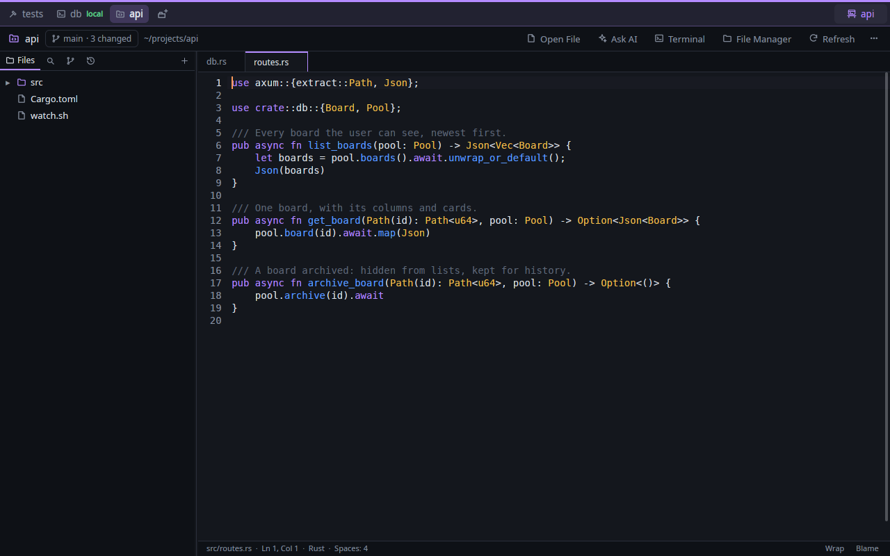

To open one:

- right-click the **new tab** button, or the bench's name, and choose **New Project
  Tab…**, then pick the folder;
- right-click a terminal and choose **Open Folder as Project**: the Git repository
  the terminal is in, or its folder;
- run `shed project` in a terminal of the bench (the same), or `shed project DIR`;
- in Shed, **New Project Tab…** in a bench's menu, running or closed.

**Files.** The folder's files are a tree on the left: click a folder (or press
Right and Left) to open and close it, a file to open it. **Ctrl+P** (or **Open
File**) opens a file by typing part of its name: `pv` finds `project_view.rs`. The
list leaves out what Git ignores (`.gitignore`) and what you exclude: right-click
a file or folder and choose **Exclude from Project**; the **⋯** menu brings
excluded ones back. Right-click also opens a terminal there, shows it in the file
manager, or copies its path. **New File…** and **New Folder…** (right-click
a folder or file, the **+** at the right of the Files panel, or the **⋯** menu)
ask for a name in that folder (by default the one selected); a name with slashes,
`ui/button.rs`, makes the folders on the way. A new file opens at once, a new
folder opens in the tree. Above the tree, **Terminal** opens a terminal tab in
the project's folder, **File Manager** opens the folder, and **Refresh** reads
everything again.

**Search.** **Ctrl+Shift+F** (or **Search** above the tree) searches every file
of the project as you type, with the editor's selection to start from. **Aa**
matches case, **W** whole words, **.\*** takes a regular expression. Results come
file by file; click a line to open the file there, the match selected. Type a
replacement and **Replace All…** changes every match in every file found, after
asking; files open with unsaved changes are skipped. Drag the panel's edge to
make it wider.

**Editing.** Open files are tabs above the editor; middle-click or **×** closes
one (asking first if it has unsaved changes, marked with a dot). The editor
colours Rust, JavaScript, TypeScript, HTML, CSS, Java, Kotlin, JSON, XML, YAML,
TOML, Markdown, Python, shell, Go, C and C++, and edits as editors do:

| Keys | Does |
| --- | --- |
| Ctrl+S | Saves |
| Ctrl+Z, Ctrl+Shift+Z (or Ctrl+Y) | Undo, redo |
| Ctrl+C, Ctrl+X, Ctrl+V | Copy, cut, paste; with nothing selected, the whole line |
| Ctrl+D | Duplicates the line (or the selection) |
| Ctrl+Shift+K | Deletes the line |
| Alt+Shift+Up, Down | Moves the line |
| Tab, Shift+Tab | Indents, outdents |
| Ctrl+/ | Comments the lines out, or back in |
| Ctrl+F, Ctrl+H | Find, find and replace (Enter next, Shift+Enter back; Alt+C case, Alt+W whole word) |
| Ctrl+G | Goes to a line (`120`, or `120:8`) |
| Ctrl+W | Closes the file |
| Alt+Z | Wraps long lines at the edge, or not (also **Wrap** in the status bar) |

On a Mac, Cmd takes Ctrl's place. Wrapping applies to every open file and is
remembered (`[editor] wrap` in `shed.toml`); a wrapped line keeps one number.

**Pictures** (PNG, JPEG, GIF, WebP, SVG, BMP, ICO, TIFF) open as pictures,
with their size in pixels and bytes above: **Fit** shows the whole picture
(never enlarged), **100%** one pixel per point, **−** and **+** (or Ctrl+wheel)
zoom out and in, scrolling when it is larger than the space. A picture changed
on disk shows as it is now.

**Following the disk.** When a file changes on disk (the AI edited it, Git
switched branches, a build wrote it), an open file without unsaved changes
reloads at once: the changed lines flash, and the cursor stays with its text. The
tree marks files changed in the last few minutes with a dot, and the folders
they are in. A file with unsaved changes is not touched: a bar offers the disk's
version or keeping yours. Unsaved changes are also kept aside as you type, so if
Shed or the bench closes first, they come back the next time the file opens.

**Git.** When the folder is in a Git repository, the header shows the branch, how
far it is ahead (↑) and behind (↓) its upstream, and how many files changed; it
turns red during a merge or rebase. Shed fetches every five minutes while the tab
is open, so "behind" stays true (`[git] fetch_minutes` in `shed.toml`; 0 turns it
off). Click the branch for its menu: fetch, pull with rebase or with merge, push
(and force-push, asking first), new branch, switch (or check out a remote
branch), merge into the current branch, rebase onto another, delete (asking first),
stash, pop the stash, and history. In this and every menu, an item with › opens
its submenu beside it when the mouse is over it: on the right where there is
room, else on the left, the menu itself staying where it is.

**Changes** (beside Files and Search) lists conflicted, staged and changed files.
Each file has a box: ticked, it goes in the next commit (it is staged); click
the box to add or leave out a file. The folder button at the right of Fetch,
Pull and Push shows the files by folder, as a tree (folders holding a single
folder joined, `src/app`); click a folder to close or open it, its box to add or
leave out every file under it. The list button goes back to the flat list; the
choice is remembered (`[git] tree`). Hover a file to stage (+), unstage (−) or
discard it (↺, after asking); **Stage All** and **Unstage All** do every file.
A new folder holding more than 300 files (an unignored `node_modules`, a build
folder) is one row, `name/` with how many files it has, staged or discarded
whole; a section lists at most 1000 rows and says how many files there are in all.
Click a file for its diff: hunk by hunk, each with **Stage**, **Unstage** or
**Discard…**, unified or **Side by Side**; a picture's diff is its two
versions side by side, **Before** and **After**, each with its size. **Go to
File** (above the diff, or the file icon when you hover a file in the list)
opens the file itself and shows where it is in **Files**. **Not Pushed** lists the commits the
upstream does not have yet (all of them, for a branch never pushed); click one
for its files. Below the list, write the message and **Commit N Files**, or
**Commit and Push…**; **Amend** changes the last commit (its message comes in to
edit). **Fetch**, **Pull** and **Push** are above, with the counts; right-click
Push to force-push (with lease). Every push asks first: it shows the branch, the
remote branch it goes to (and the remote's address), and the commits it sends,
with **Push N Commits** and **Cancel**. Git runs as in your terminal, with your credentials and SSH keys;
when it needs a password it cannot ask for, it says so.

**History** lists commits, newest first, with their branches and tags; click one
for its files, a file for what the commit changed in it. **History** in a file's
menu (or a diff's bar) shows that file's commits. **Blame**, at the right of the
editor's status bar, shows who last changed the cursor's line, when, and in which
commit. Shed's own cards for project tabs show the branch and how it stands.

**Conflicts.** After a merge or rebase stops on conflicts, Changes says so, with
**Continue** and **Abort**. Open a conflicted file: a bar takes **Ours**,
**Theirs** or **Both** for the conflict at the cursor, goes to the **Next**, asks
the AI tab to resolve it (**Ask AI**), and **Mark Resolved** saves and stages it.
**Three Ways** shows our version and theirs, whole, on either side of the file
you are resolving (which you edit and save as usual).
The − and + beside a conflicted file take our or their whole version.

### Links

A bench's web pages (the app running locally, staging, dashboards, the CI) are
the bench's **links**. They sit as chips on the right of its tab bar, whatever
tab is showing, and beside the bench in Shed (in both views). Add one with **Add
Link…** in the bench's menu (its name on the tab bar, or **⋯** in Shed) or in a
project tab's **⋯** menu, then type a name and the address: `local
localhost:3000`. Clicking one brings forward the browser tab already showing it
(anywhere under that address) instead of opening it again; right-click for **Open
in New Tab**, copying the address, **Rename…** (any name, spaces too; the address
stays), **Change Address…** or removing it. Links are saved with
the bench, and can be changed while it is closed. (Links that older versions kept
on project tabs move to their bench by themselves.)

Bringing a tab forward needs Shed's small browser extension, since browsers do
not let other programs find their tabs. Run `shed browser setup` once: it
registers Shed with Chrome, Chromium, Brave, Edge and Vivaldi and writes the
extension; then load it in the browser (its extensions page, Developer mode,
**Load unpacked**, and the folder it names). Without it, links open in a new tab
each time.

**From a terminal.** Ctrl+click a path in a terminal of the bench, such as a
compiler's `src/main.rs:12:5`, and it opens in the project tab whose folder holds
it, at that line.

The open files are saved with the bench and open again with it. Closing a
project tab asks first, as for any tab, and leaves its files alone. A bench whose
last terminal has exited stays open while it has a project tab.

## AI tabs

An **AI tab** is a [Claude Code](https://claude.com/claude-code) conversation with
an interface of its own: Claude Code does the work, Shed shows it. It works in one
folder (where Claude Code keeps its sessions) and can be given the bench's other
project folders too.

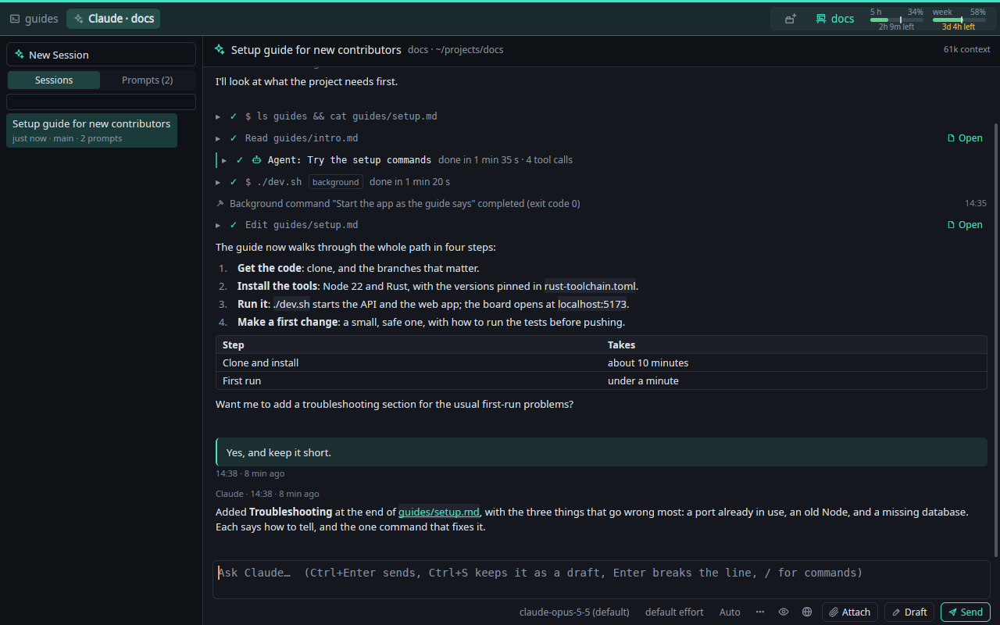

To open one: **Ask AI** in a project tab's header (it goes to that project's AI
tab, or opens one), **New AI Tab** in the new-tab button's menu or the bench's
menu (pick one of the bench's folders or another), or `shed ai [DIR]` in a
terminal of the bench.

- **Prompts**: the switch over the list on the left shows **Prompts (N)**
  instead of sessions: one row per prompt of this session (its first line,
  number and time), filtered by the field above it; a click scrolls the
  conversation to it, and the prompt whose turn is in view is marked.
- **Sessions** are on the left, newest first, with Claude Code's own titles (else
  the first prompt), when they were last used, the Git branch and how many
  prompts. Claude Code sometimes carries a conversation on in a new session
  file (after a long one is compacted, say), and editing an earlier message
  branches one off; Shed lists such files as one conversation: one row, opening
  the most recent, every prompt once, read back from all its files ("3 parts").
  Its **▸** lists the files, each with **↳ continued** or **↳ branched after
  #29**. Hover a session for its whole title. **Rename…** in its right-click
  menu, or a double-click on it (or on the title above the conversation),
  names it: Enter keeps the name, Escape leaves it, and an empty name gives
  Claude Code's own title back. The name is Claude Code's too (its `/rename`):
  it shows in `claude --resume`. Type to filter. Click one to show it and carry on with it; **New
  Session** starts afresh. Right-click a session to continue it in a terminal
  (`claude --resume`), in Claude Code's own interface. **Delete Session…** (in red,
  in the same menu) gets rid of a session you do not want: it asks first, saying
  its title, date and prompts, and the later sessions that continue it, which go
  with it (on a conversation's row, that is the whole conversation). Claude
  Code's files for it move to Shed's trash, `~/.local/state/shed/ai-trash`,
  kept 30 days (each with a `restore.txt` saying how to move them back), then
  deleted; its drafts go too. A session open in another AI tab cannot be
  deleted until it is closed there; the tab you delete it from goes to a new
  session. The quick commands that the
  `> request` prompt makes are not saved as sessions, so they do not crowd the list.
- **The prompt** grows with what you type. Enter breaks the line; **Ctrl+Enter**
  (Cmd+Enter) or the send button sends. While Claude works, sending queues the
  message instead: queued messages show above the prompt (each with **Remove**)
  and go one by one as turns end, whether the bench's window is open or not.
  They are kept with the bench, so they wait across a restart; with Claude free
  again, **Send Now** sends one. What you have written in the prompt is kept too,
  and is there when the tab opens again. **Draft** (or Ctrl+S) keeps the message for
  later instead, with its files and pictures. Drafts belong to their session:
  **Drafts (N)** opens this session's, and each has **Send** (queued if Claude
  is busy), **Edit** and **Delete…**. **Edit** opens the draft in the prompt
  (what you were writing is set aside) and marks it in the list: **Save Draft**
  (the ✓, or Ctrl+S) keeps the change in place, **Cancel** (or Esc) leaves it as
  it was, **Send** sends it; opening another draft puts the first back. In the sessions
  list, a session with drafts says how many. A draft kept in a new session, before
  anything is sent, makes it a **draft session**: listed first with the sessions
  (a pencil, titled by its first line, "Draft · N messages kept"), to come back
  to and add to. Sending from it starts the session, and its drafts stay with it;
  right-click it to delete it with its drafts. Drafts follow the conversation
  when Claude Code makes a copy of it (editing or reverting a message). They are
  kept with the bench, in no order. Typing `/` lists Claude Code's commands and
  skills to complete (Tab or Enter picks one). Ctrl+Up and Ctrl+Down go through earlier prompts; what you were writing is kept, and comes back below the newest one (or after sending an earlier one). Paste a
  screenshot with Ctrl+V, or drop pictures, and they go with the prompt: small
  thumbnails above it, each with a × to leave it out. Sent pictures stay in your
  message as thumbnails (a click opens one whole), also in sessions shown again;
  Shed keeps a copy in `~/.local/state/shed/ai-pictures` (deleted after 60 days
  unseen; showing the session again brings it back), and a picture missing from
  there says so instead. Screenshots and other pictures Claude reads show
  the same way under the step that read them. **Attach** (the paperclip below
  the prompt) picks files to go with the message (**Attach a Folder…** in the
  **⋯** menu, a folder); files copied in a file manager and pasted with Ctrl+V
  go too, as do dropped ones. Pictures go as pictures; other files (PDFs,
  documents, code) and folders show by name (the path on hover, a × to leave
  one out) and go as their paths, for Claude to read with its own tools. In a project tab, **Ctrl+Shift+A** sends the editor's selection (with
  its file and lines) or the file to the AI tab; **Send to AI** in the tree's menu
  sends a file or folder.
- **Files Claude names** (`src/main.rs`, `src/main.rs:42`, a path from its
  folder, the bench's projects or an absolute one, or just a file's name when one
  file of the bench's projects has it) are links when they exist: underlined in
  the bench's colour, the hand and a light ground under the mouse; a click opens
  the file in the project tab that holds it, at that line (a project tab opens
  for its project if none does). Code Claude quotes (`like this`) is set on a
  faint ground in the text's colour, so only links are coloured. Tool lines that read or change
  a file have **Open** for the same.
- **Times**: under each of your messages and over each response, in small text,
  when it was written and how long ago (`14:32 · 5 min ago`; another day with the
  date). Sessions opened again keep their times, from Claude Code's record.
- **The conversation** streams in: answers drawn from their Markdown (headings,
  lists, tables, links, code blocks coloured by language), each tool Claude uses on
  one line (click it for the command, the change as a diff, and what came back,
  each in a block to select in or copy whole; hovering the line shows **Copy**
  for the whole command), thinking folded away. An opened step closes from its
  line, or from **▴ Collapse** at its end; **Collapse All Steps** in the
  right-click menu closes them all. A long conversation opens at its last 150
  entries; scrolling to the top brings in the next ones (or **Show Earlier**,
  **Show All**), and searching, the prompt list and the block jumps bring in what
  they need.
- **Sub-agents**: when Claude hands work to an agent of its own, its line
  says how it is doing as it goes: turning while it runs, with how long, what
  it is doing now and how many tool calls it has made ("Agent: Check every link
  in the guides · running 4 min · $ curl … · 4 tool calls"), then done (and in
  how long), failed or stopped. Opened, it shows the prompt Claude gave it, its
  steps (each tool call a line that opens to what it did and what came back,
  what it said in between) and its report. An agent's own messages never show
  as yours or Claude's. Agents and commands Claude leaves running **in the
  background** say so; they keep going while you write, and a note in the
  conversation says when one finishes ("Agent “Check every link…” finished",
  "Background command "Build the docs site" completed"). Sessions opened again
  show their agents' steps too (Claude Code keeps them beside the session).

  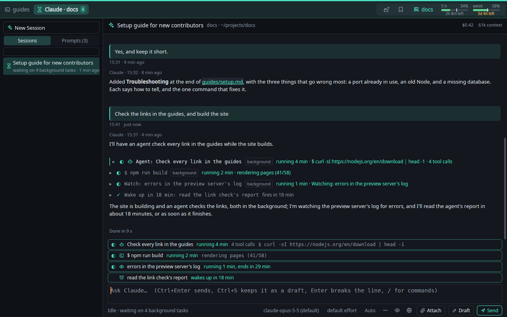

- **Claude Code's notes**: what Claude Code adds to a conversation shows as a
  note of its own, never as if you had typed it: a background task finishing,
  a watch seeing something, a wake-up firing, a command run in Claude Code's
  own interface and its output (`/compact`, `! git status`), the summary left
  when a long conversation was compacted, context a hook added. A note with
  more to it opens with a click. Its internal reminders are left out.
- **Wake-ups, scheduled jobs and watches**: Claude can set itself to come back
  later (a wake-up, a scheduled job, maybe repeating) or watch a command's
  output. What is waiting shows above the prompt ("Wakes up in 18 min · read the
  link check's report", "Scheduled job, every minute · …", "Watching, ends in 28
  min · …"), counting down; the step that set it says when it fires. When it
  fires, Claude goes on by itself: a note says why, and the tab shows Claude
  working (a message you send meanwhile waits its turn). They belong to the
  tab's running Claude Code: closing the tab or its bench, changing the tab's
  folders or effort, or stopping Shed's keeper cancels them, and a note says
  so.
- **Going back**: hover one of your messages for **Edit**, **Send Again** and
  **Copy** (also in its right-click menu). **Edit** puts it in the prompt field;
  sending it goes back to that message: the messages after it go, the files
  Claude changed since then are put back as they were, and the edited message
  gets a new answer. **Send Again** does the same with the message as it was (for
  the last message at once; for an earlier one Shed asks first). Esc cancels an
  edit. The earlier conversation is kept as its own session in the list.
  **Revert…** (in red, also **Revert to Here…** in the right-click menu) goes
  back to before a message without sending anything: that message and
  everything after it leave the conversation, and Claude goes on from there
  with what you send next. Shed asks first, with **Revert, Files Too** (the
  files Claude changed since are put back) or **Revert the Conversation Only**
  (the files stay as they are); the conversation as it was stays in the list.
- **Copying**: drag over the text to select it (double-click a word, triple-click
  a paragraph, Shift+click to extend), then Ctrl+C. Each answer has a **Copy**
  button when the mouse is over it (on the last part of a response with tools in
  between, **Copy whole response** copies everything Claude said in it; also
  **Copy Response** in the right-click menu), and each code block one above it
  (the code only). Copies paste formatted where formatting is kept (mail, documents, chat;
  on Linux) and as text elsewhere; an answer's **Copy** gives its Markdown as the
  text. Right-click for **Copy as Markdown**, **Copy Message as Plain Text** and
  **Copy the Whole Conversation**. Clicking a link opens it.
- **Permission**: when Claude wants to change a file or run a command that needs
  your say, a card shows what and how, with **Allow**, **Allow for This Session**
  and **Deny**; the tab's icon shows it is waiting. **Stop** (or Escape at the
  prompt) interrupts.
- **Questions**: when Claude asks you something (to choose between ways to go),
  it shows as a card: each question with its options to click (a dot when one
  answer is wanted, a box when several may be), a description under each, and
  the one Claude recommends marked. **Other** lets you write your own answer
  (Enter sends). **Send Answers** sends them; with a single question, clicking an
  option is the answer. **Skip** declines. Afterwards the card shows what you
  answered.
- **Below the prompt**: while Claude works, three dots take turns beside what it
  is doing (the tool running, thinking, writing) and for how long. Then the model
  (the default one by name: "Opus 5.5 (default)"), its effort ("high effort";
  click for the efforts the model offers; while the model's context is smaller
  than 1M tokens, the same menu has **Context: 1M tokens**, Claude Code's
  `[1m]` model, "· 1M" after its name), the mode (new AI tabs start in
  **Auto**), and
  the eye, which makes files Claude edits open in their project tab as it goes,
  and the globe, which connects the tab to your browser (below).
  The modes: **Ask Before Edits**; **Accept Edits** (file changes go through,
  commands still ask); **Auto** (Claude Code's safety check approves routine
  actions and stops risky ones); **Read Only (Plan)** (looks and plans, changes
  nothing); and **Full Auto…** (everything without asking, shown in red; Shed
  asks first). The **⋯** menu finds text in the
  conversation (also Ctrl+F), inserts a file's text into the prompt (for long
  prompts kept on disk), and saves the prompt or the whole conversation as a file.
- **The browser**: the globe below the prompt (or **Connect to the Browser** in
  the **⋯** menu) lets this tab's Claude use your Chrome or Brave through the
  [Claude in Chrome](https://claude.com/chrome) extension: open pages, click,
  fill forms, read what is on them, take screenshots. One AI tab at a time is
  connected: connecting another lets go of the first. It takes effect at once,
  even while Claude is working. A connected tab says so above its prompt (and in
  which browsers the extension is), with **Disconnect**, and its icon is a globe
  on the tab bar and in Shed. In the browser, Claude works in a tab group of its
  own. Steps read as "Browser: open https://…", "Browser: click". Needs the
  extension installed and signed in, and the browser open; when no Chrome or
  Brave here has it, the strip says how to get it.
- **After a turn**, the files it changed are listed above the prompt: click one to
  see its diff in its project tab, ready to stage or throw away. When Claude keeps
  a task list, it shows there too.
- **Review** (**Review…** beside those files, **Review Changes** in the **⋯**
  menu, or Ctrl+Shift+R) shows, in place of the conversation, everything that
  changed in the repositories the tab works in, during **This turn** or **This
  session**, whatever did it: Claude may have staged, committed or even pushed
  some of it. Each change is marked by how far it went, with what fits it:

  | Marked | What you can do |
  | --- | --- |
  | **Not staged** | Stage or discard it, whole or hunk by hunk |
  | **Staged** | Unstage it, whole or by hunk; **Commit Staged** with a message, below |
  | **Committed** (not pushed), with its commit | **Undo (back to staged)**: the commit, and any after it, comes out and its changes stay staged, to change and commit again; **Amend with Staged** puts what is staged into the last commit |
  | **Pushed**, with its commit | **Revert…**: its opposite is staged, to adjust and commit as a new commit (pushed history is never rewritten) |

  The files and diffs look and work as in a project tab's Changes: the status
  letter in its colour, the folder button for files by folder (the same
  `[git] tree` setting), and **Side by Side** (or S) for the diff, with line
  numbers; pictures as their two versions side by side. **Go to File** opens
  the file in its project tab and shows it in that tab's **Files**. **Push…** sends the commits not pushed yet, after showing where and which.
  **Explain** (or E) asks what changed in the selected file and why, **Explain
  All** (Shift+E) for every change: a copy of the session, which knows the
  conversation, answers in a few sentences per change, shown as **Why** above
  its diff. The session itself never sees the question or the answer, so its
  context does not grow: the copy is a fork Claude Code does not save, and it
  cannot change anything. It uses the session's model and counts toward your
  usage like a prompt. Explanations are kept with the tab; one of an earlier
  version of a change says so.
  Each change has a **Viewed** box (Space); the header counts them ("2 of 5
  viewed"), and a change that differs since it was viewed is not viewed any
  more. ↑ and ↓ go through the changes, N to the next one not viewed, E / Shift+E explain, S side by side, Escape
  back to the conversation. Viewed marks are kept with the tab. Where the branch
  was when the turn or session began comes from Git's own record (the reflog);
  further back than it goes, only what is not committed is shown.

  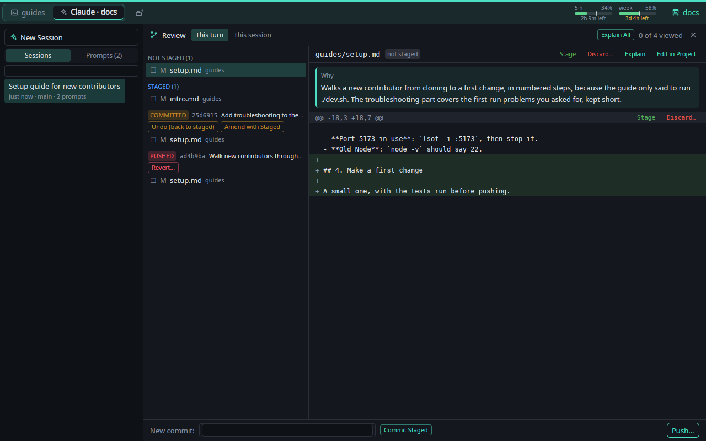
- **Notifications**: when Claude finishes or needs your answer while you are not
  looking at its tab, the desktop says so. Clicking the notification (or its
  **Open**) brings the bench's window forward at that tab, opening the window if
  the bench was hidden. (On macOS the notification says it, but a click does not
  reach Shed.)
- **Above**: the session's title. Your usage limits for the 5-hour window and
  the week are on the bench's tab bar, as small bars (green, amber from 70 %,
  red from 90 %; the last ones Claude Code reported, kept across restarts until
  they reset, the tooltip saying how long ago when it was a while), each with its
  name and how much is used above it and the time left until it resets written
  small beneath (`2h 14m left`; hover for more).
  A thin line on each bar marks where a steady pace through the window would be
  now: past it, you are using it faster than that; when at that pace the limit
  would come before the reset, the time left turns amber and the tooltip says
  when (otherwise, how much you would have used by the reset). Beside the
  title: what the session has cost, and how full its
  context is ("84k / 1M context": used, and the window Claude Code reports for
  the model). **Also works in** lists the bench's other projects: click one to
  let Claude read and change it too.

Claude Code runs in the keeper, like a terminal's programs: hiding the bench or
closing its window does not stop it. Closing the tab or the bench does; the
session stays, and opens again with the tab.

## Remote tabs

A **remote tab** is a shell on a server that keeps running when the bench closes,
and comes back, screen and scrollback and all, when it opens again. It is marked
with a server icon.

Open one with **New Remote Tab** in the new-tab button's menu or the bench's menu:
pick a host from your `~/.ssh/config`, then **New Shell**, or **Other Host…** and
type it as ssh takes it (`user@host`). Or run `shed remote new HOST` in a terminal
of the bench.

The first time, Shed copies its keeper (`shedd`) to `~/.local/bin` on the server
over ssh (again only when Shed changes); nothing else is installed and no root is
needed. The server's keeper holds the shell; the tab shows it over ssh. So:

- **Closing or hiding the bench** keeps the shell and whatever runs in it. Opening
  the bench joins it again.
- **A dropped connection** (network, sleep) is noticed within about 15 seconds;
  the tab says "Connection to HOST lost; joining again…" and joins at once. When
  joining fails it says why and tries again after 3 s, then 6 s, up to every 30 s,
  until it works or you press Ctrl+C.
- **Reconnect**, in a remote tab's menu (on the tab bar, or its card on the
  pegboard), drops the connection and joins again right away ("Reconnecting to
  HOST…"), for when the tab looks stuck. The shell on the server is the same, with
  everything in it. Other remote tabs to that server share the connection, so they
  join again too. After Ctrl+C stopped the joining, Reconnect starts it again.
  The web app, the Android app and `shed tui` (`C-b m`) offer it too.
- **A server restart** stops the shell, but its keeper saved it: the next time the
  tab connects, a new shell starts in the same folder, under the old scrollback.
- **Closing the tab** asks: **Close Here** (the default) only lets go of the shell,
  which keeps running on the server; **End the Shell** stops it, and what runs in
  it, for every PC.

### The same shell from several PCs

The shells live on the server, not in a bench, so any PC with Shed can join them,
like tmux sessions. A host's entry under **New Remote Tab** lists the shells the
server keeps besides **New Shell**: their folder, the program in front, and how
many PCs show them now (or *saved*, after a server restart). Pick one and it opens
as a tab of this bench, screen and scrollback and all; each PC keeps it in
whichever bench and tab it likes. From a terminal: `shed remote list HOST`, then
`shed remote new HOST --join ID`.

Every PC joined to a shell sees everything in it, and any of them can type. The
shell takes the size of the PC that typed last (or resized its window last).
Listing asks the server over ssh without a password, so it needs a key, or a
remote tab to that host already open on this PC (its connection is reused).

### History

Commands typed in a remote tab are kept on the server, in its own logbook,
whichever PC typed them, and not in this PC's. Ctrl+R in a remote tab searches the
server's history (a copy is fetched over ssh when it opens; *this tab* is the
shell, *all* is everything run on that server through Shed).

Passwords and 2FA prompts appear in the tab, since ssh runs there; the steps share
one connection, so you are asked once.

Servers must run Linux. The `shedd` copied is the one beside `shed`, which needs
a C library at least as new as this machine's (and the same architecture); for
older servers, other architectures, or when Shed runs on a Mac, put a static
build beside `shed` as `shedd-x86_64-static` or `shedd-aarch64-static` (see
[Development](development.md#remote-tabs)) and Shed copies that instead.

## Opening, hiding, closing

**Hiding** a bench closes its window and nothing else. Its programs keep running,
and opening it again shows every pane exactly as it is: the screen, the scrollback,
even a full-screen editor mid-edit. Hide a bench from its name's menu, with
Ctrl+Shift+H, or from Shed.

**Closing** a bench saves it, then stops what runs in it: each pane gets Ctrl+C (and
SIGTERM if that is not enough), then, if its startup ran since it opened, its
teardown commands run at the prompt, one by one (a teardown undoes a startup). Closing a bench's window asks whether to close the bench or only hide it.
Close a bench from Shed, from its name's menu, or with Ctrl+Shift+Q; that dialog
also offers to delete it.

Windows open as you left them: the same size and place, maximized or full screen,
and each tab at its zoom, whether the bench was hidden, closed, or Shed itself was
closed. The Shed window keeps its place too. (On Wayland the desktop decides where a
window goes; its size and state are still kept.)

**Opening** a closed bench rebuilds it: every tab and split, every pane in its
folder with its old scrollback dimmed above the prompt under a "restored" line;
project tabs with the files they had open (and unsaved edits kept aside); AI tabs
on their session, with their drafts, queued messages and unsent prompt; remote
tabs joined to their shells on the server. That is all, by default: nothing runs, which is safer now that benches hold
projects and AI sessions. **Run Startup** (the ▷ icon on the tab bar, shown when
the bench has a startup that has not run) starts it whenever you like, without
reopening; **Run Teardown** (the ■ icon, shown once it ran) stops what runs and runs the teardown, the
bench staying open. Both are in the bench's menu too.

Opened with its startup (**Open and Run Startup**, `shed load NAME --start`, or
always with `start_on_open = true`), then, for each pane:

- If it has **startup commands**, they run one after another, each at its prompt.
- If not, what was running when it was saved comes back according to the **rack**:
  editors, watchers and dev servers on the rack restart by themselves; anything
  else is typed at the prompt and waits for Enter; commands on the never list (`rm`,
  `git push`, `sudo`) are left out. A tab with a command waiting shows a small
  return-arrow icon.

Benches save themselves every minute, within a second of a change to their setup,
aliases or name, and when you log out or shut down. If Shed or the machine stops
unexpectedly, at most the last minute is lost.

**Deleting** a bench stops it if it runs and removes its saved file and its
launcher.

**Taskbar and dock.** Every bench writes a launcher for itself, so it shows as its
own app with its own icon, a terminal window on a workbench in the bench's colour. Pin it to your dock:
clicking it opens that bench (and Shed, if it is not running). Renaming the bench
keeps the pin working.

## Setup: startup, teardown and aliases

The Setup panel (the rack button, Ctrl+Shift+S, or **Setup…** in a tab's menu)
shows how a tab's panes start and stop, and lets you change it:

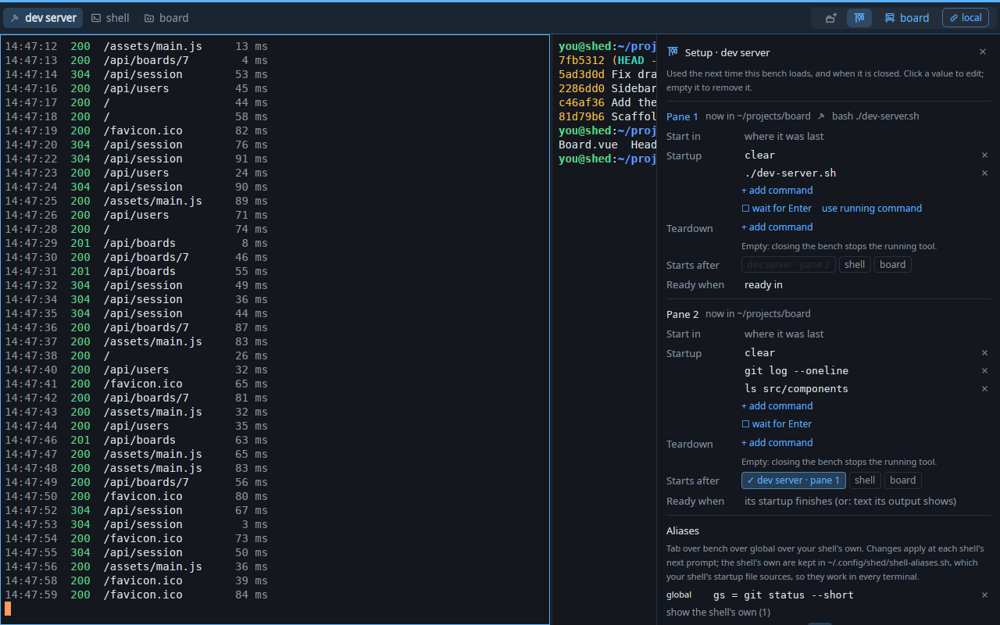

For each pane:

- **Start in**: the folder the pane opens in. Empty: where it was last.
- **Startup**: commands run in order when the bench opens, instead of what was
  running when it was saved. **Wait for Enter** types them instead of running them.
  **Use running command** adds what runs in the pane now.
- **Teardown**: commands run, in order, when the bench is closed, after its running
  program has stopped. For example `docker compose down` after a `docker compose
  up -d`. Empty: closing just stops what runs.
- **Starts after**: other panes of the bench this one's startup waits for. Click a
  pane to pick it (again to drop it).
- **Ready when**: when this pane counts as ready, for the panes that start after it.
  Empty: once its startup commands have finished without an error. Or a text its
  output shows, for programs that keep running, such as `ready in` for a dev
  server or `Listening on` for a backend.

So a stack starts in order without `sleep`s: the database pane runs
`docker compose up -d`; the backend pane starts after it, runs `git pull` and
`make run`, and is ready when it prints `Listening on`; the frontend starts after
the backend. While a pane waits, a chip on it says for what (in red if that
failed), its tab shows the hourglass, and **Start Now** in its menu starts it
anyway.

Click a value to edit it, empty it (or use ×) to remove it. Changes are saved at
once and apply the next time the bench opens or closes.

**Aliases** live at four levels: **tab**, **bench**, **global** and your **shell**'s
own. A tab's shells see all of them, tab over bench over global over the shell's.
The panel lists every alias in effect with its level and what it overrides ("show
the shell's own" adds the shell's); add one as `name = command` and pick its level.
Every one can be changed or removed there, and shells pick up changes at their next
prompt, with nothing to reload.

The shell's own aliases you change in Shed go to `~/.config/shed/shell-aliases.sh`,
and the first change adds a line to `~/.bashrc` (and `~/.zshrc`, if you have one)
that sources it, so they work in every terminal, not only Shed's. Changing one
defined in `~/.bashrc` overrides it there; removing one adds an `unalias` line, so it
is gone everywhere. Other terminals see changes when they next start.

From a shell inside Shed, `shed setup` prints the same, `shed setup --edit` opens it
in your editor, and `shed alias add gs "git status"` (with `--bench`, `--global` or
`--shell`) or `shed alias rm gs` change aliases.

## History and the logbook

Every command you run in a Shed shell goes into the **logbook**, with its folder,
exit status, how long it took, and the tab and bench it ran in. Your history is then
available at three levels:

| Keys | Walks |
| --- | --- |
| Up / Down | This tab's history, as in any shell |
| Ctrl+Up / Ctrl+Down | Everything run in this bench |
| Ctrl+Shift+Up / Ctrl+Shift+Down | Everything run anywhere |

Type the start of a command first to walk only commands that start with it. While
walking the bench's or everyone's history, a small chip by the prompt shows where
you are (`bench 3/120`) and which tab a command came from.

**Ctrl+R**, at a prompt, opens the search. Type to search; Tab switches between this
tab, this bench and everything; `tag:prod` keeps only commands from tabs tagged
`prod`. Enter puts the command on the prompt, Alt+Enter runs it.

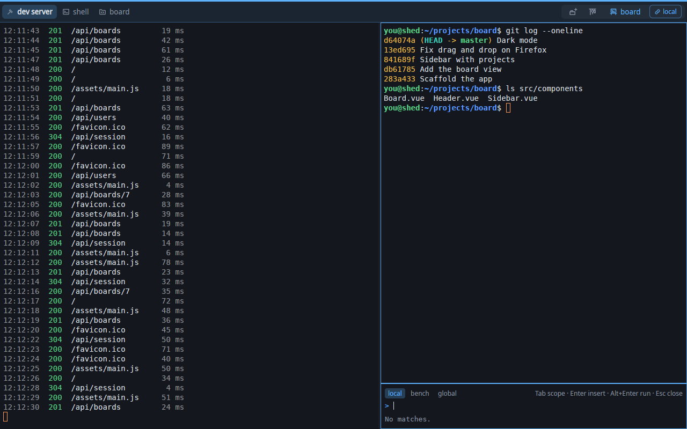

Commands typed with a leading space are not kept. `shed log` lists recent commands
from a shell (`shed log docker --scope bench`).

## Asking for a command

Start a line with `>` and say what you want, in your own words:

```
> start this project
> which process is using port 8080, and stop it
> undo my last commit but keep the changes
```

Press Enter and Shed asks an AI for the command, while a chip by the prompt says
it is asking (Escape stops it). The command it answers with is put on the prompt,
**not run**: read it, change it if needed, and press Enter to run it.

The AI runs in the pane's folder, so it can look at the project (its README,
`package.json`, `Makefile`, scripts) to answer questions like "start this
project". Along with your request it is told the shell and system, the folder,
the tab's recent commands and the text on the screen; private tabs send only the
request and the folder.

By default Shed asks [Claude Code](https://claude.com/claude-code) (`claude -p`),
with your own login. Any command that reads a request on its input and prints a
command works instead; set it under `[ai]` in [`shed.toml`](#settings-shedtoml),
or set `command = ""` to turn this off. With it off, a line starting with `>` is
an ordinary shell line again (in bash, a redirection).

## Finding, selecting, links

- **Ctrl+Shift+F** finds text in the scrollback. The newest match comes first; Enter
  goes to older ones, Shift+Enter to newer; Escape closes the bar. Matching ignores
  case unless you type a capital.

  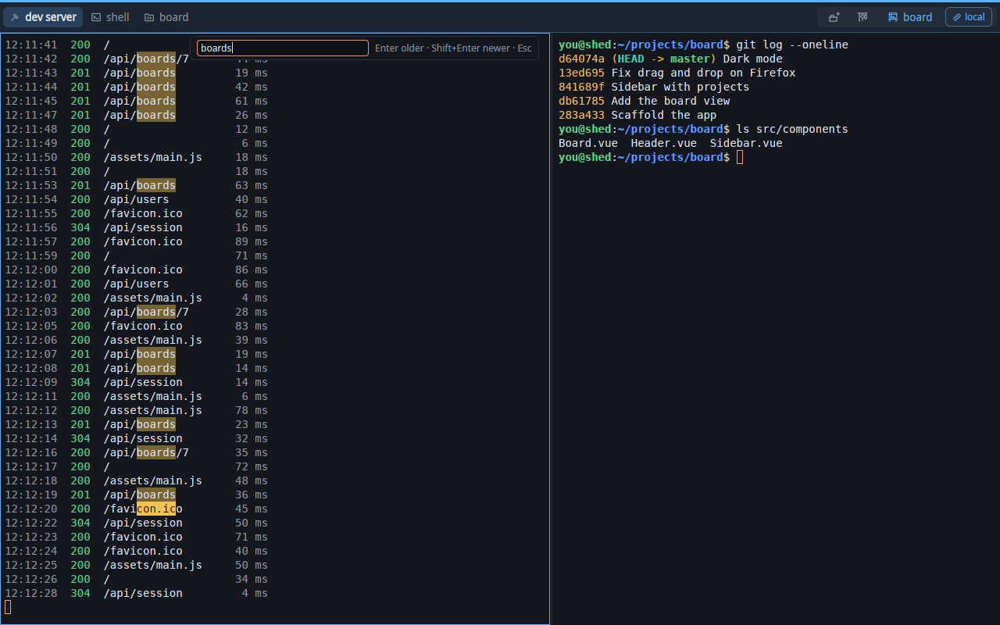

- **Selecting** text copies it to the primary selection; middle-click pastes it.
  Ctrl+Shift+C and Ctrl+Shift+V copy and paste with the clipboard. On X11,
  middle-click pastes whichever is newer: text copied in another program after
  your last selection (a page's copy button, say) is pasted rather than the
  older selection. In programs that
  use the mouse (vim, htop), hold Shift to select.
- **Ctrl+click** opens a link, or a file path (relative to the pane's folder).
- **Scrollbars**: whatever scrolls has one on its right edge (the AI
  conversation and sessions, the file tree, open files, Git lists and diffs,
  search results, Shed's list): drag the thumb, or press the track to bring the
  thumb there and drag on. Turning the wheel brings up **Top** and **End**
  buttons near the bottom right for a few seconds (only those that go
  somewhere); in an AI tab, **End** also follows the conversation again. In a
  terminal and an AI tab there are **Prev** and **Next** too, which go from
  command to command (the line you typed it on, Shed marks it from the shell's
  prompt marks and keeps it across reopening) or message to message (yours, and
  each response); Ctrl+Shift+↑ / ↓ do the same from the keyboard. A terminal's shows while it is scrolled back into its
  history, or under the mouse at the right edge.
- **Zoom**: Ctrl+= and Ctrl+-, Ctrl+0 to reset. Every kind of tab zooms: a
  project tab's code, file tree and lists, an AI tab's conversation and prompt.
  Each tab keeps its own zoom, also after the bench closes.

## Tags and private tabs

A **tag** is a short coloured label on a tab: `prod`, `staging`, `db`. Add one from
the tab's menu: **Add Tag** lists the tags Shed knows (on any tab, open or closed,
or set in Settings), each with its colour, and **New Tag…** takes a new one (type
`prod`, or `prod red` for a colour). From its shell:
`shed tag add prod --color red --tint`. A tag can **tint** the whole tab, which is a
useful warning on production shells.

**Settings → Tags** lists every tag with how many tabs have it. Pick a colour for
one and every tab with that tag takes it, in running and closed benches, and so do
tags added later; **Default** goes back to the tag's own colour. **Add a tag**
gives a new tag a colour before any tab has it, so it is offered when adding tags.
The colours are kept in `shed.toml`:

```toml
[tag_colors]
prod = "red"                  # red, orange, yellow, green, blue, violet, teal, grey, or #rrggbb
db = "violet"
```

Tags can also come from **rules** in `shed.toml`: for example, every tab running
`ssh` to a host with `prod` in its name gets a red `prod` tag.

A **private** tab keeps its commands to itself: they stay in its own history and
never show in the bench's or the global one. It also never leaves the machine:
the web and Android apps (see [Reaching Shed from elsewhere](#reaching-shed-from-elsewhere))
show that it is there, not what is in it.

## Colours and appearance

Each bench takes the next free colour when it is made. Pick another from its colour
dot in Shed or its name's menu: sixteen colours, or **Custom Colour…** for any
`#rrggbb` (or a colour's name).

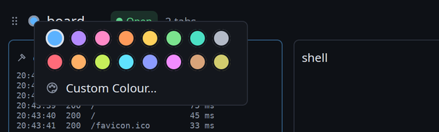

The colour shows in the bench's stripe, tabs, focused pane border, its card in Shed,
and its taskbar icon. A **badge** (one or two letters) can be drawn on the icon too,
for anyone running more benches than they can tell apart by colour (set
`icon_badges = true`).

**Light and dark.** By default Shed follows your desktop's light or dark setting
and switches with it. The switch at the top right of the Shed window sets **Auto**,
**Light** or **Dark**.

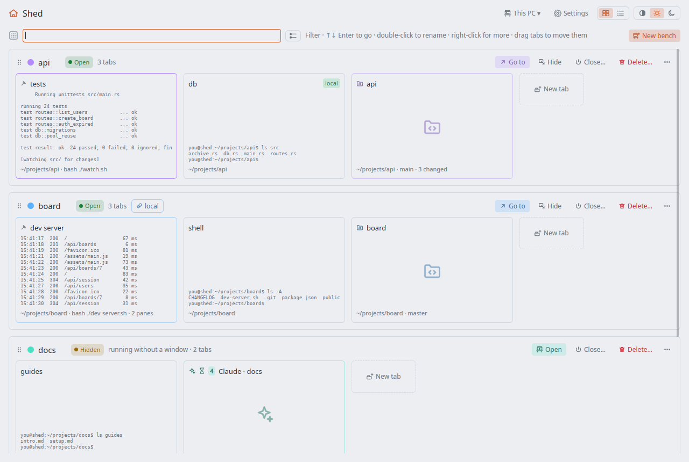

## Keyboard shortcuts

| Keys | Action |
| --- | --- |
| Ctrl+Shift+T | New tab |
| Ctrl+Shift+W | Close pane |
| Ctrl+Tab, Ctrl+Shift+Tab, Ctrl+PageDown, Ctrl+PageUp | Next / previous tab |
| Ctrl+1 … Ctrl+9 | Go to tab 1 … 9 |
| Ctrl+Shift+E / Ctrl+Shift+O | Split right / split down |
| Alt+arrows | Move between panes |
| F2 / Shift+F2 | Rename tab / bench |
| Ctrl+Shift+S | Setup panel |
| Ctrl+Shift+Q | Close bench |
| Ctrl+Shift+H | Hide bench (it keeps running) |
| Super+Space, Ctrl+Shift+Space | Bring Shed forward |
| Super+1 … Super+9 | Raise bench window 1 … 9 |
| Ctrl+Shift+N (in Shed) | New bench |
| Ctrl+Shift+C / Ctrl+Shift+V, Shift+Insert | Copy / paste |
| Ctrl+Shift+F | Find in scrollback |
| Ctrl+R (at a prompt) | Search the logbook |
| Up, Ctrl+Up, Ctrl+Shift+Up (at a prompt) | Walk tab / bench / all history |
| Shift+PageUp / Shift+PageDown | Scroll a page |
| Ctrl+= / Ctrl+- / Ctrl+0 | Zoom the tab in / out / reset, any kind of tab (kept with the tab, and saved) |
| Ctrl+Shift+↑ / ↓ | A terminal: to the line of the previous / next command typed; an AI tab: to the previous / next message (yours, or the response) |

In a **project tab**: Ctrl+P opens a file by name, Ctrl+Shift+F searches every
file, Ctrl+Shift+A sends the selection (or the file) to the AI tab, Ctrl+W closes
the file, and the editor's own keys are listed under [Project tabs](#project-tabs).
In an **AI tab**: Ctrl+Shift+R opens the review, Ctrl+Enter sends (or queues while Claude works), Enter breaks the line, Ctrl+Up and Ctrl+Down
go through earlier prompts, Escape stops a turn, Ctrl+F finds in the conversation.
`new_project_tab` can be bound to a key in `[keys]`. On macOS, Cmd takes Ctrl's
place in these.

**On macOS** Cmd does what Ctrl+Shift does above, as in other Mac terminals:

| Keys | Action |
| --- | --- |
| Cmd+T / Cmd+W | New tab / close pane |
| Cmd+1 … Cmd+9, Cmd+Shift+] / Cmd+Shift+[ | Go to tab / next, previous tab |
| Cmd+D / Cmd+Shift+D | Split right / split down |
| Cmd+Option+arrows | Move between panes |
| Cmd+Shift+S / Cmd+Shift+W | Setup panel / close bench |
| Cmd+Shift+H | Hide bench |
| Cmd+Shift+Space, Cmd+Option+1 … 9 | Bring Shed forward / raise bench window 1 … 9 |
| Cmd+N (in Shed) | New bench |
| Cmd+C / Cmd+V, Cmd+F | Copy / paste, find in scrollback |
| Cmd+= / Cmd+- / Cmd+0 | Zoom |
| Cmd+↑ / ↓ | Previous / next command or message |
| Cmd+Q | Close Shed (as closing its window does) |

Ctrl+R, the history keys and F2 are the same. Option types characters, as it
does everywhere on a Mac; for shells' Alt keys (Alt+B, Alt+F) set
`option_as_alt = true` under `[macos]`.

Every key can be changed in [`shed.toml`](#settings-shedtoml).

## Shed in a terminal (shed tui)

`shed tui` shows Shed in the terminal it runs in: on a server over ssh
(`ssh -t server shed tui`), or anywhere a window cannot open. It talks to the
same keeper as the windows, so the benches, terminals and AI conversations are
the same ones, and a window and a terminal can show a bench at once. Leaving
it (`Ctrl+B d`), closing the terminal or a dropped connection ends only the
interface: everything keeps running in the keeper, and the next `shed tui`
finds it as it was. A Shed built without windows (see
[Working on Shed](development.md#a-build-without-windows)) runs it for plain
`shed`, and `shed new` and `shed load` too. For a server that keeps a
workspace of its own, see [A workspace on a server](#a-workspace-on-a-server).

It covers what a terminal can show: the benches, every kind of tab, terminal
panes and splits, AI tabs, project tabs with Git, and the logbook. Pictures
are described rather than shown; files are edited in `$EDITOR`; there are no
drag and drop, launchers or desktop notifications.

**Benches.** The first screen lists every bench, running or closed, with its
tabs, as the Shed window does; the selected one's screen shows on the right
when there is room. Enter opens a bench (a closed one loads), `L` loads it
with its startup, `n` makes one (a name, then a folder), `r` renames, `c`
colours, `x` closes (saved; asks), `D` deletes (asks), `/` filters, Esc goes
back to the bench you were in.

**A bench** has a tab bar on top (its name in its colour, then each tab: `▤`
project, `✻` AI, `⇄` remote; `●` an AI tab at work, `!` one waiting for you)
and a status line at the bottom: the bench, messages, whether the keeper is
there. Click a tab to show it. Usage limits of Claude, when known, sit at the
right of the tab bar. The tab and pane in front are the bench's, as in its
window: switching here switches a window showing the same bench too, and a
pane takes the size of whichever drew it last.

**The prefix.** Shed's own keys come after **Ctrl+B**, as in tmux, so every
other key (Ctrl+C included) goes to the program in the pane. `Ctrl+B Ctrl+B`
sends Ctrl+B itself. `Ctrl+B ?` lists all keys.

| Keys | Does |
| --- | --- |
| `C-b d` | Leave; everything keeps running |
| `C-b s` | The benches |
| `C-b c` / `C-b t` | New terminal tab here / new tab of any kind (terminal, project, AI, remote shell, command), asking for its folder |
| `C-b n`, `C-b p`, `C-b 1`…`9` | Next, previous, numbered tab |
| `C-b ,` / `C-b $` | Rename the tab / the bench |
| `C-b <` / `C-b >` | Move the tab left / right (to another bench: `C-b m`) |
| `C-b &` | Close the tab (asks; a remote tab can be let go or ended) |
| `C-b m` | Everything for this tab and its bench, as a menu (a remote tab's: **Reconnect** too) |
| `C-b %` / `C-b "` | Split right / down |
| `C-b` arrows, `C-b o` | Focus the pane that way / the next pane |
| `C-b x` | Close the pane (asks) |
| `C-b z` | Zoom the pane to the whole tab (again: back) |
| `C-b [` | Scroll back: arrows, PgUp/PgDn, `g`/`G`, `[`/`]` from prompt to prompt, `/` search, `n`/`N`, `q` leaves |
| `C-b r` | Search history (the logbook): Tab cycles this tab, bench, everything; Enter types the command into the pane, without running it |
| `C-b e` | Edit a file in `$EDITOR`, in a new terminal tab |

**Terminal panes** are drawn as the keeper sees them, splits with a line
between them (the lines around the focused pane in the bench's colour). Each
pane takes the size it is drawn at. Keys reach programs as they would in a
window, the kitty keyboard protocol included when a program asks; pastes are
bracketed when it asks. Programs that use the mouse get it (Shift+drag keeps
it for your terminal's own selection); for others the wheel scrolls back.

**AI tabs** show the conversation with Claude's Markdown set in bold, lists,
code (coloured) and tables. Tools are one line each; click one (or `Alt+T`
for all) to unfold its input, diff and result. Type below and Enter sends;
while Claude works it is queued (`Alt+Q` lists the queue: send now or take
out). Esc stops the turn. `/` completes Claude Code's commands (Tab takes
one). When Claude asks for a permission or asks questions, the choices show
above the prompt: arrows or `1`–`9`, Enter (Allow, Allow for this session,
Deny; for questions their options, your own answer, or skip); Tab types a
prompt instead. The line above the prompt says whether Claude works or waits,
the model, the mode (Full Auto in red), effort, cost, how full the context
is, and the usage limits.

A sub-agent's line says how it does (`running 3 min · $ cargo test · 4 tool
calls`, `done in 40 s`); unfolded, it shows the kind of agent, its steps
(`N earlier steps not shown` before the latest) and its report. Claude Code's
own notes (a background task finished, a wake-up, a command's output, a
compaction) are lines of their own, their detail folded. Wake-ups, scheduled
jobs and watches Claude set wait above the prompt, counting down (`⏰ Wakes up
in 18 min`), and the tool that set one says when it fires. `Alt+I` attaches a
file or folder by its path: a picture goes as a picture, anything else as its
path in the message (under "Attached files:"), for Claude to read.

| Keys | Does |
| --- | --- |
| `Alt+Enter` | A new line in the prompt |
| `PgUp` / `PgDn` | Scroll the conversation |
| `Alt+S` / `Alt+N` | The sessions (Enter opens, → shows a conversation's files, `r` renames, `D` deletes after asking, `n` new) / a new session |
| `Alt+M` / `Alt+O` / `Alt+E` | Model / mode (Full Auto asks first) / effort |
| `Alt+D` / `Alt+P` | Keep the prompt as a draft / the drafts (send, put back in the prompt, delete) |
| `Alt+I` / `Alt+X` | Attach a file, folder or picture by its path / remove what is attached |
| `Alt+R` | Review the changes: by layer, each file's diff; `v` marks it viewed, `e` asks Claude to explain it (`E` all not yet explained), `t` this turn or the whole session |

**Project tabs** list the folder as a tree on the left (Enter opens folders
and files, ← closes) and show the file on the right, coloured as in the
windows; Tab moves between them. `o` (or Ctrl+P) opens a file by name, `/`
(or Ctrl+F) searches the files (results stream in; Esc stops; Alt+R regular
expression, Alt+C case, Alt+W whole word), `e` edits the file in `$EDITOR`.
`g` shows Git: the files changed, staged and not, and the selected one's
diff. `s`, `u`, `d` stage, unstage and discard a file (`S` stages everything;
discarding asks); in the diff (Enter), `[` and `]` go from hunk to hunk and
`s`, `u`, `d` do the same to one hunk. `c` commits what is staged, `C`
amends, `l` shows the history (Enter: a commit's files and diffs), `b` the
branches (switch, merge, rebase, delete, new, stash), `f` fetches, `F` pulls,
`p` pushes after showing what goes where (`P` force-pushes).

**Colours** are Shed's theme (`theme` in `shed.toml`; dark unless the terminal
says it is light through `COLORFGBG`), drawn as 24-bit colours. With
`NO_COLOR` set, nothing is coloured.

## Reaching Shed from elsewhere

Shed can be reached from anywhere, and can run where you are not. The pieces:

- a **nexus**: a server you host (see [Deploying a nexus](nexus-deploy.md)). It
  holds your account and the devices you paired, keeps the last state of each
  workspace, relays between them and the apps, and serves the web app;
- **workspaces**: the machines running Shed that you link to it, a PC, a
  laptop or a server;
- the **web app** ([Shed in a browser](#shed-in-a-browser)) and the **Android
  app** ([Shed on your phone](#shed-on-your-phone)), which see and drive the
  linked workspaces through the nexus;
- a **server workspace** ([A workspace on a server](#a-workspace-on-a-server)):
  Shed on a server, reached with `shed tui` over ssh, so benches and Claude Code
  keep working while your PCs are off.

None of it is needed: without a nexus, Shed works just the same on its own.

**The account** is made once. On its first start the nexus writes a one-time
setup link to a file in its data folder and its log says where ([Deploying a
nexus](nexus-deploy.md#4-the-account)); the code is in the link after `#`, so it
stays out of servers' logs. Open it, choose a user name and password, scan the
QR code with an authenticator app, type the code it shows, and keep the
recovery codes (each signs you in once if the authenticator is lost).
**Signing in**, in the web app or the Android app, always asks for the user
name, the password and a code.

### Linking a workspace

Link each machine to the nexus once:

```sh
shed nexus join https://nexus.example.com
```

It shows a code. In the web app or the Android app, **Devices** → **Approve a
Workspace…**, type that code, a name for the workspace and a code from your
authenticator. The list of workspaces asking to pair shows their name, version
and address, never their code, so only someone who sees the machine can approve
it. The address must be `https://` (plain `http://` only for a nexus on this
same machine).

From then on, while Shed runs, a small background process (the link) keeps
this workspace on the nexus: its benches, tabs, terminals, projects, history and
AI tabs, reachable from the apps. It connects again by itself after a network
drop. The Shed window's header says how it is doing (**Linked** with the
workspace's name, **Linking…**, **Link off**); clicking it switches the link off,
or on again, keeping the pairing. `shed nexus status` says the same; `shed nexus leave`
unlinks the machine (remove it in the apps' Devices too). Revoking a workspace
in Devices cuts it off at once.

In `shed.toml`:

```toml
[nexus]
url = "https://nexus.example.com"   # set by `shed nexus join`; must stay the paired nexus
enabled = true                      # false keeps the pairing but does not link
control = "full"                    # "view": the apps can look at tabs but change nothing
# ca_file = "~/nexus-ca.pem"        # for a nexus with a certificate of your own making
desktop_clients = false             # true: Shed on your other computers can show this one
```

The pairing's token is not in `shed.toml` (which backups copy): it is in
`~/.local/share/shed/nexus.json`, readable only by you, with the nexus it belongs
to. The link sends it only there: if `url` is changed to another nexus, the link
does not connect (`shed nexus status` says why) until you pair with that one.

Private tabs show in the apps as "Private", with nothing of their folders,
screens, commands (also those run before the tab was made private), files or
Claude Code sessions, and cannot be made public from there; making a tab private
ends what the apps were watching of it. A project or AI tab's Git, seen from the
apps, covers only that tab's folder, even when the repository is larger. A
view-only workspace shows everything in the apps but offers no changes, and
does not let them browse the machine's folders. Whoever runs the nexus can see
and type into what it relays, so host it yourself.

### Other workspaces in this window

Shed's window can show another workspace linked to your nexus (a server, the
computer at the office) instead of this PC's, one at a time. Its terminals and
AI tabs work as they do here, because Shed speaks to that workspace's keeper
itself, through the nexus.

1. **Sign this desktop in** to the nexus: the switcher at the top of the Shed
   window (**This PC ▾**) → **Sign In to Nexus…** (the nexus's address, your
   user name, password and a code from the authenticator), or in a terminal:

   ```sh
   shed nexus signin https://nexus.example.com
   ```

   This desktop becomes a device of your account (**Shed desktop** in the apps'
   Devices, where revoking it cuts it off). Its token is kept in
   `~/.local/share/shed/nexus-client.json`, readable only by you. Signing in is
   apart from linking this PC (`shed nexus join`), which never lets anyone
   show other workspaces. `shed nexus signout` (or **Sign Out** in the
   switcher) forgets it here.
2. **Let desktops in** on the workspace to show, in its `shed.toml`:

   ```toml
   [nexus]
   desktop_clients = true
   ```

   It needs `control = "full"`. Off by default: a desktop shown a workspace sees
   all of it, **private tabs too** (they are your own signed-in computers),
   and can do anything there that Shed's window can.
3. **Switch**: the switcher lists **This PC** and the nexus's workspaces;
   offline ones say so and cannot be chosen. Choosing one closes this
   workspace's bench windows (its benches keep running, as when Shed's window
   closes), connects, and shows the other's benches in the Shed window; the
   benches you had open there come back. The switcher then shows its name, and
   its bench windows' titles end with it (`Shed — api · office`). Choosing
   **This PC** comes back, with the benches you had open here; so does opening
   one of this PC's benches from its launcher. Shed starts on This PC each time.

If the workspace cannot be reached, or does not let desktops in, or runs
another version of Shed, a note above the benches says why and nothing
changes. If the connection drops, Shed comes back to This PC and says so.
Closing Shed's window closes this PC's benches as always; the other
workspace's keep running there. Someone at that workspace is not disturbed:
running `shed` or a bench's launcher there opens Shed's own window as usual,
and the benches you show from here are not that computer's open windows.

What lives on that workspace's disk comes through the nexus too. Its
**project tabs** work as here: the file tree, the editor (coloured here),
opening by name (Ctrl+P), search and replace in files, following changes made
there, and the Git panel (status, diffs, staging and discarding by file or by
hunk, commit, push, pull, fetch, switching and making branches, history,
blame). Files opened from its terminals (Ctrl+click) or from Claude's answers, and
those Claude edits, open in its project tabs. Unsaved edits are kept aside on
this PC under the workspace's name, never mixed with this PC's own files.
Not there for another workspace, and said so where they would be: the
three-way view of a conflict, merging, rebasing, deleting branches, the stash
and finishing a merge from the panel (use a terminal tab there), the file
manager, and what a private tab holds (the workspace keeps it to itself).

Ctrl+R searches that workspace's command history (by tab, bench or all,
`tag:` included). Its AI tabs list, rename and delete its Claude Code
sessions, show the conversation's pictures, and Review shows the whole
session's changes with Viewed and Explain (the turn's alone, and the
review's stage, commit and undo buttons, are not there for another
workspace: do those in a project tab there). Files you attach to a prompt
or a draft are sent to that workspace first (up to 16 MB each; not
folders), and their path there is what Claude reads. New project and AI
tabs choose a folder in a browser of that workspace's folders (Up, a path
to type, Open This Folder). Its benches get no desktop launchers here.
Notifications from its AI tabs come here as usual.

## Shed in a browser

The web app is served by the nexus, at its address
(`https://nexus.example.com`), on a computer or a phone. Sign in as
[Reaching Shed from elsewhere](#reaching-shed-from-elsewhere) says; it shows
every workspace linked there.

What the web app shows:

- **Workspaces**: each linked workspace with its benches as cards in their
  colours, each tab with its icon, tags, what runs in it and, for terminals,
  its last lines; AI tabs that work or wait for you say so. Usage limits are
  beside each workspace. Closed benches can be opened (or opened with their
  startup), renamed, recoloured or deleted. A workspace that is offline still
  shows, read only, as it was when it was last seen. A workspace set to allow
  viewing only says **View only**, and nothing there can be changed.
- **A bench**: its tabs on a bar in its colour; **+** makes a terminal,
  project, AI or remote tab (choosing a folder on the workspace: its full
  path shows, `..` goes up, and a path can be typed, `~/…` too); a tab's
  menu (right-click, or the arrow after the tabs) renames it, makes it private
  or closes it, after asking; a remote tab's also has **Reconnect**. The bench's name opens its menu: rename, badge,
  colour, Run Startup, Run Teardown, the logbook, Close Bench…. A link to a tab
  (`…/w/<workspace>/b/<bench>/t/<tab>`) opens that tab.
- **AI tabs**, as in Shed: the conversation with its steps (click one for its
  detail, change and result), thinking folded, permission cards (**Allow**,
  **Allow for This Session**, **Deny**) and questions (pick options, or write
  your own answer). A sub-agent or a task in the background says how it does
  after its line (`running 3 min · Read src/main.rs · 4 tool calls`, `done in
  40 s`); click it for the kind of agent, its steps (each opens to its change
  and result) and its report. Claude Code's own notes (a background task
  finished, a wake-up, a command's output, a compaction) are lines of their
  own, their detail folded. Wake-ups, scheduled jobs and watches Claude set wait
  above the prompt, counting down ("Wakes up in 18 min"; hover for what it will
  tell Claude). The prompt sends with Enter on a computer (Shift+Enter
  breaks the line) and with its button on a phone; `/` lists Claude Code's
  commands. **Attach** adds files (as can pasting or dropping them): pictures
  go as pictures (they can be taken with the camera on a phone too); any other
  file, up to 16 MB, is copied to the workspace and its path goes with the
  message for Claude to read (the copies are deleted after 30 days unused).
  While Claude works, sending queues the message
  (**Edit**, **Send Now**, **Remove**); **Draft** keeps it for later; **Stop**
  interrupts. Below the prompt: the model, its effort, the mode (**Full Auto…**
  asks first), and the follow and browser switches. The clock button lists the
  sessions (draft sessions first; double-click to rename; right-click for
  **Delete Session…**, which asks first and moves its files to Shed's trash,
  as in the window); **Review** shows
  what Claude changed, with **Viewed** and **Explain**.
- **Terminals** show the text of the screen, re-flowed to the width of the
  browser, so a shell's output reads well on a phone; full-screen programs
  (vim, htop) show as they are, scaled to fit or panned. Scroll up for older
  lines. Tap the terminal to type; on a phone a bar of keys (Esc, Tab, Ctrl,
  Alt, arrows, `|`, `~`, `/`) sits above the keyboard. **Take the size** makes the
  terminal the size of your screen while you look at it (for a full-screen
  program on a phone); leaving gives the size back. A full-screen program that
  takes the mouse (htop, mc, vim with `mouse=a`) gets clicks and the wheel (a
  tap on a phone); hold Shift to select text instead. In less and man pages
  the wheel scrolls the page. The logbook button finds earlier commands and
  types one in.
- **Project tabs**: the file tree, files with their colours, **Go to File**
  (Ctrl+P), search in files, and **Changes**: stage, unstage or discard files
  and hunks (discarding asks), commit (or amend), branches, history, Fetch,
  Pull and Push. Files are read only, apart from small text files.
- **Logbook** (on each workspace, and in a bench's menu): commands with their
  exit status, folder and time; search a tab, its bench, or everything, and
  `tag:label`.
- **Devices**: browsers, phones, Shed desktops and workspaces with when and where they were
  last seen; rename or revoke them (revoking asks for a code); workspaces
  asking to pair, each with **Reject…** (asks first) and **Approve…**
  (approving needs the code the workspace printed; see
  [Linking a workspace](#linking-a-workspace)); the record of sign-ins and
  changes.
- **Settings**: notifications in this browser (Claude waiting for you, a turn
  done, a long command finished, a workspace gone offline: each can be on or
  off); clicking one opens its tab. **Turn On** subscribes this browser,
  **Turn Off** stops them here (your choices are kept for turning them on
  again). Change the password, sign out.
- **Notifications while Shed is open**: while the page is in front of you
  (shown and focused), or the Shed app on your phone is, nothing is pushed to
  any of your devices; the open app shows the notification itself, here as a
  toast at the bottom (**Open** goes to its tab; none for the tab you are
  already on). Only when no Shed app is in view does it come as a browser or
  phone notification.

On a phone, **Add to Home Screen** installs it as an app (on iPhone, needed for
notifications). Private tabs are listed, never shown: what is in them stays on
their workspace.

## Shed on your phone

The Android app shows and drives your workspaces from anywhere, through your
nexus (see [Reaching Shed from elsewhere](#reaching-shed-from-elsewhere)).
Build and install it as [android/README.md](../android/README.md) says, then
sign in with the nexus's address (`https://nexus.example.com`), your user name,
password and a code from your authenticator. Fingerprint unlock is in its
Settings.

- **Workspaces**: each linked computer, online or when it was last seen, with
  its benches (in their colours), how many AI tabs work or wait for you, and
  your usage limits. Closed benches can be loaded from there.
- **A bench**: its tabs in order, with tags; **New Tab** opens a terminal,
  project, AI or remote tab in a folder you pick (its full path shown, **..**
  going up); a long press renames or closes a tab (closing asks first), or
  reconnects a remote tab.
- **AI tabs** work as on the computer: the conversation with its steps
  (tap one for the command, the change and what came back), permission cards
  (**Allow**, **Allow for This Session**, **Deny**), Claude's questions, and the
  prompt. The paperclip attaches a **File…** (the system's file picker: any
  file up to 16 MB, copied to the workspace, its path sent with the message for
  Claude to read), a **Picture…** or **Take a Photo…**. A sub-agent or a task in
  the background says how it does under its line (`running 3 min · 4 tool
  calls`, `done in 40 s`); tap it for its kind, steps and report. Claude
  Code's own notes are rows of their own (tap for the detail), and wake-ups,
  scheduled jobs and watches wait above the prompt, counting down (tap one for
  what it will tell Claude). While Claude works, messages queue. Drafts,
  sessions, the model, effort and mode (**Full
  Auto…** asks first), and **Review** with Viewed and **Explain** are there too.
  A long press on one of your messages offers Edit, Send Again and Revert…; on
  a session in the sessions list, Rename… and Delete Session… (asks first).
- **Terminals** show the active pane's screen, its lines re-wrapped to the
  phone; scrolling up fetches earlier lines. Type in the field (Enter sends) and
  use the key bar for Esc, Tab, Ctrl, Alt and the arrows. For a full-screen
  program (vim, htop), **Take the size** makes the program draw for the phone
  while you look; leaving gives the size back. When the program asks for the
  mouse (htop, vim with `mouse=a`), a tap clicks there and dragging up or down
  turns the wheel.
- **Logbook**, **project files** (tree, Quick Open, search, a file viewer with
  colours) and **Git** (stage, unstage or discard by hunk, commit, history,
  branches, fetch, pull, push).
- **Devices**: everything signed in or paired, revoking (with a code), and
  **Approve a Workspace…** with the code it showed (see
  [Linking a workspace](#linking-a-workspace)); **Reject…** on a waiting
  request you did not make.
- **Notifications**: Claude waiting for you, a turn done, a long command
  finished, a workspace gone offline, each on or off. While the app (or Shed
  in a browser) is in front of you they show inside it, as a banner at the
  bottom with **Open**. Otherwise they come through ntfy, never through Google:
  usually a ntfy topic your nexus publishes to, which you subscribe to in the
  ntfy app (Settings → Notifications shows it, with **Copy**); with a nexus
  that has no topic, through UnifiedPush, where Settings shows whether the
  nexus pushes to this phone and turning notifications off tells it to stop.
  Tapping a notification opens its tab, even with the app closed.

Private tabs show as private: what is in them never leaves the computer. A
workspace that allows viewing only shows everything and offers no changes.

## A workspace on a server

A server can run Shed itself, as a user of its own, so benches, terminals and
Claude Code keep working while your PCs are off. There, Shed is built without
windows (the CLI, `shed tui` and the keeper), the keeper runs as a user service
that stays up with nothing open, and Claude Code is signed in once (its usage
limits are the account's, shown on every workspace using it). [Deploying a
nexus](nexus-deploy.md#a-server-workspace-optional) has the steps. Then, from
anywhere:

```sh
ssh -t shed@server.example.com shed       # a build without windows runs shed tui
```

Leaving (`Ctrl+B d`) or a dropped connection ends only the interface; see
[Shed in a terminal](#shed-in-a-terminal-shed-tui) for its keys. `shed nexus
join` on the server links it like any workspace (see
[Linking a workspace](#linking-a-workspace)), so it shows in the web and
Android apps too. Remote tabs from your PCs to that user on the server use the
same keeper, so they show up there as benches of their own.

## The `shed` command

| Command | Does |
| --- | --- |
| `shed` | Opens the Shed window (starting the keeper if needed) |
| `shed new [--name N] [--cwd DIR]` | Makes a bench and opens it |
| `shed load NAME [--start\|--quiet]` | Opens a bench: raises it, shows it, or loads it if closed (quietly, unless `--start` or `start_on_open`) |
| `shed hide NAME` | Hides a running bench: closes its window, keeps it running |
| `shed list` | Lists benches: open, hidden and closed |
| `shed save NAME [--as COPY]` | Saves a bench now; `--as` saves a copy, handy as a template |
| `shed delete NAME` | Deletes a bench |
| `shed setup [--edit]` | Shows (or edits) this tab's startup and teardown |
| `shed alias [add NAME CMD \| rm NAME] [--bench\|--global\|--shell]` | Lists or changes aliases |
| `shed project [DIR] [--bench NAME]` | Opens a folder (by default the Git repository you are in) as a project tab |
| `shed ai [DIR] [--bench NAME]` | Opens an AI tab working in a folder (by default the Git repository you are in) |
| `shed browser setup` | Registers Shed's browser extension, so links bring their open tab forward |
| `shed remote new HOST [--bench NAME] [--join ID]` | Opens a remote tab: a shell on HOST that outlives the bench, or joins one HOST keeps |
| `shed remote list HOST` | Lists the shells HOST keeps (ID, folder, program, PCs showing it) |
| `shed tag add LABEL [--color C] [--tint]` | Tags this tab |
| `shed log [QUERY] [--scope local\|bench\|global] [--tag T]` | Lists commands from the logbook |
| `shed status` | Shows whether the keeper runs and what it holds |
| `shed stop` | Saves everything and stops the keeper, and every program in it |
| `shed backup [list \| restore NAME]` | Backs up your setup now, lists the backups, or puts one back (see [Backups](#backups)) |
| `shed init bash`, `shed init zsh` | Prints the shell integration, for a shell Shed did not start |
| `shed nexus join URL [--name N]`, `status`, `leave` | Links this machine to a nexus, says how the link is doing, or unlinks it (see [Reaching Shed from elsewhere](#reaching-shed-from-elsewhere)) |
| `shed tui [BENCH]` | Shed in this terminal (see [Shed in a terminal](#shed-in-a-terminal-shed-tui)); a build without windows runs it for plain `shed` |

## Settings: shed.toml

**Settings** in the Shed window's toolbar opens the ones most changed: appearance,
font and its size (the size is for everything: terminals and code, AI
conversations, project trees, menus and Shed's own windows; 14 is the usual),
**Reset Everywhere** for zoom (every tab of every bench, open or closed, back to
the usual size, to start alike everywhere), tab bar size, the Shed window's view, reopening benches at
start, where new tabs open, taskbar badges, how often project tabs fetch, and
the colour of each tag ([Tags](#tags-and-private-tabs)). Each
change applies at once and is written to `shed.toml`, keeping the rest of the file
as you wrote it (a value that does not fit is refused and said). **Open shed.toml**
there opens the file for everything else.

Settings live in `~/.config/shed/shed.toml`. Every setting is optional, and changes
apply as soon as the file is saved.

```toml
theme = "auto"                 # follow the desktop; or "shed-light", "shed-dark",
                               # or the name of a file in ~/.config/shed/themes/
theme_light = "shed-light"     # what "auto" uses when the desktop is light
theme_dark = "shed-dark"       # and when it is dark
auto_restore = false           # reopen what was open or hidden when Shed last closed
start_on_open = false          # opening a bench runs its startup (off: it opens quietly)
autosave_seconds = 60

[keeper]
stay = false                   # keep the keeper running with nothing open (a server's)

[font]
family = "DejaVu Sans Mono"
size = 14
line_height = 1.25
emoji = "Noto Color Emoji"     # colour emoji ("Apple Color Emoji" on macOS)

[window]
padding = 6                    # pixels between the window edge and the text
new_pane_dir = "current"       # or "bench": where new tabs and panes open
icon_badges = false            # draw each bench's badge on its taskbar icon
compact_pegboard = false       # the Shed window as a compact list (its toolbar switches it)
tab_bar_scale = 1.0            # how large a bench window's tab bar is drawn (0.7 to 2)

[shell]
integration = true             # load Shed's bash or zsh integration into its shells

[macos]
option_as_alt = false          # Option sends Alt to the shell instead of typing é, @, …

[ai]                           # the "> request" prompt
command = "claude -p --no-session-persistence"   # request on stdin, prints a command; "" turns it off
history = true                 # send the tab's recent commands along
screen = true                  # send the text on the screen along

[git]                          # Git in project tabs
fetch_minutes = 5              # fetch this often while a project tab is open; 0: never
tree = false                   # changed files by folder (the toggle in Changes)

[editor]                       # the editor in project tabs
wrap = false                   # wrap long lines at the edge (Wrap, or Alt+Z)

[tag_colors]                   # a colour per tag label, for every tab with it
prod = "red"

[rack]                         # what restarts by itself when a bench opens
auto = ["nvim", "vim", "hx", "ssh", "htop", "btop", "less", "tail -f", "cargo watch", "npm run dev"]
never = ["rm", "git push", "sudo"]

[keys]                         # key = action, or "none" to unbind
"ctrl-shift-d" = "split_right"
"alt-left" = "none"

[[tag_rule]]                   # tag tabs by what they run, or where
tool = "ssh *prod*"            # a pattern over the running command
tag = "prod"
color = "red"
tint_tab = true

[[tag_rule]]
cwd = "~/work/infra/*"         # a pattern over the folder
tag = "infra"
```

**Rack rules** look at the last step of a `&&` or `;` chain, and the first program
of a pipe: `cd app && npm run dev` restarts, `tail -f log | grep ERROR` restarts.

**Key actions**: `copy`, `paste`, `zoom_in`, `zoom_out`, `zoom_reset`,
`scroll_page_up`, `scroll_page_down`, `logbook`, `search`, `new_tab`, `close_tab`,
`close_pane`, `next_tab`, `prev_tab`, `split_right`, `split_down`, `focus_left`,
`focus_right`, `focus_up`, `focus_down`, `new_bench`, `close_bench`, `hide_bench`, `rename_tab`,
`rename_bench`, `setup`, `shed`, `activate_tab_1` … `activate_tab_9`,
`focus_bench_1` … `focus_bench_9`. Keys are written like `ctrl-shift-t`,
`alt-left`, `super-space`, `f2`.

**Themes** are TOML files in `~/.config/shed/themes/`: `foreground`, `background`,
`cursor`, `cursor_text`, `selection`, sixteen `ansi` colours, and an optional `[ui]`
section for Shed's own colours (`background`, `tab_active`, `tab_hover`, `text`,
`text_dim`, `divider`, `accent`, `danger`). The built-in `shed-dark` and
`shed-light` are good starting points.

**Global aliases** are in `~/.config/shed/aliases.toml`, as `name = "command"`;
bench and tab aliases are saved with their bench, and the shell's own that you
change in Shed are in `~/.config/shed/shell-aliases.sh`.

## Where things are kept

| What | Where |
| --- | --- |
| Settings, themes, global aliases | `~/.config/shed/` |
| Saved benches (`<name>.toml`, plain TOML you can edit) and their scrollback | `~/.local/share/shed/benches/` |
| What ran when Shed last closed; the order of benches | `~/.local/share/shed/session.toml`, `order.toml` |
| The logbook (SQLite), per-tab shell history, the keeper's log | `~/.local/state/shed/` |
| Pictures from AI prompts and screenshots Claude read (60 days unseen); the last usage limits | `~/.local/state/shed/ai-pictures/`, `ai-limits.json` |
| Claude Code's own sessions (Claude Code keeps them; AI tabs read them) | `~/.claude/projects/` |
| Claude Code sessions deleted in AI tabs (30 days, each with a `restore.txt`) | `~/.local/state/shed/ai-trash/` |
| Unsaved edits of open files, kept aside until saved | `~/.local/state/shed/recovery/` |
| Browser extension and its native host | `~/.local/share/shed/browser-extension/`, `browser-host/` |
| Launchers and icons for Shed and each bench (Linux) | `~/.local/share/applications/`, `~/.local/share/icons/` |
| Backups of your setup | `~/.local/share/shed/backups/` |
| The pairing with a nexus (0600, not backed up); the link's log | `~/.local/share/shed/nexus.json`; `~/.local/state/shed/link.log` |

macOS uses the same folders under your home (`~/.config/shed/` and so on).

### Backups

Once a day, while Shed runs (when the keeper starts, and when the day turns),
the keeper copies your setup into `~/.local/share/shed/backups/<date>/`:
`shed.toml`, `aliases.toml`, `shell-aliases.sh`, your themes, every saved bench
and `session.toml` / `order.toml` / `window.toml` (scrollback is left out). The
last 14 backups are kept. Settings files are also always written whole (to a
file beside them, then swapped in), so a crash never leaves one half written; a
`shed.toml` that is a link (dotfiles) stays a link.

```sh
shed backup                  # one now
shed backup list             # the backups there are
shed stop                    # benches are saved first
shed backup restore 2026-11-12
```

A restore puts that backup's files back, after backing up what is there now (a
`…-before-restore` backup), so it can be undone. Benches saved since then and not
in the backup stay as they are.

## Troubleshooting

- **"The running keeper is from another version of Shed"**: after an update, the
  old keeper is still running. Run `shed stop` (benches are saved first), or answer
  yes when `shed` offers to restart it.
- **Something went wrong**: the keeper writes `~/.local/state/shed/shedd.log`;
  `SHED_LOG=debug shed` logs more. If Shed's windows close by themselves (a
  crash), why is in `~/.local/state/shed/shed.log`, with where it happened; the
  benches keep running, and `shed` opens them again.
- **The keeper at login**: packages include a systemd user unit,
  `systemctl --user enable --now shedd.service`, so the first Shed window opens at
  once. Shells started this way inherit systemd's environment.
- **Shells other than bash and zsh** work as terminals, without the logbook,
  history keys and aliases.
