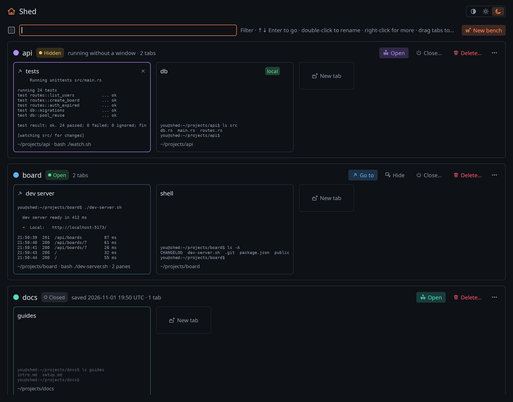
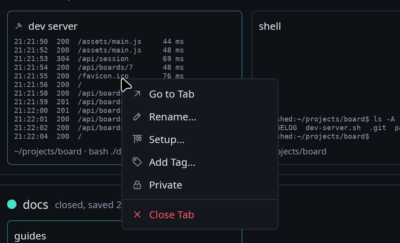
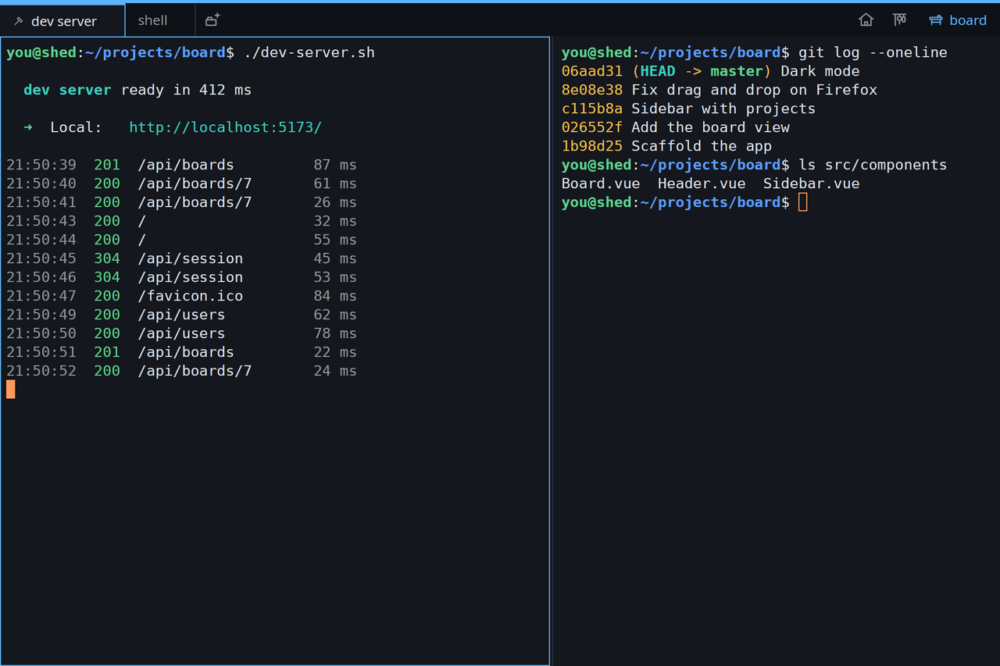
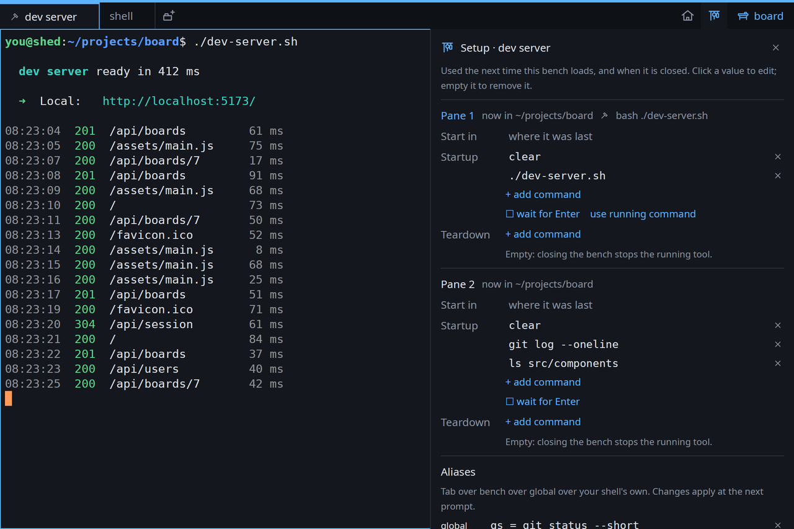
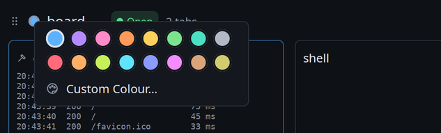
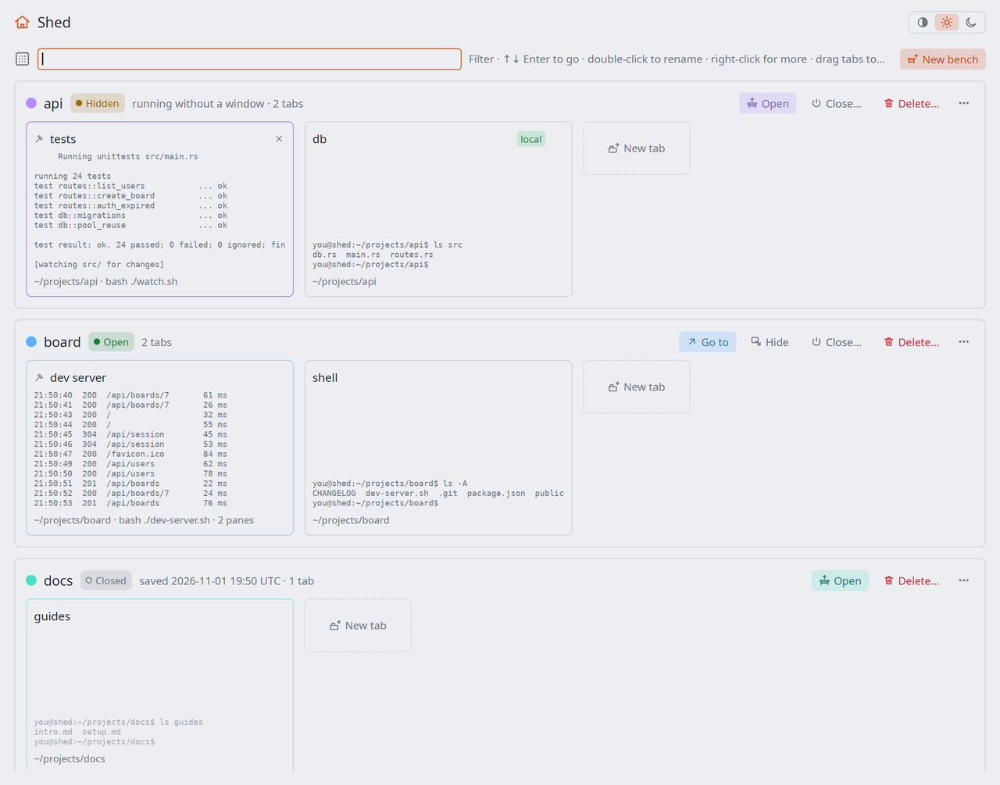

# Shed User Guide

This guide walks through how Shed is meant to be used, from the first start to the
settings file. Every screenshot comes from a demo setup (`tools/screenshots/`), so
what you see is what Shed shows.

- [The idea](#the-idea)
- [The Shed window](#the-shed-window)
- [A bench's window](#a-benchs-window)
- [Opening, hiding, closing](#opening-hiding-closing)
- [Setup: startup, teardown and aliases](#setup-startup-teardown-and-aliases)
- [History and the logbook](#history-and-the-logbook)
- [Finding, selecting, links](#finding-selecting-links)
- [Tags and private tabs](#tags-and-private-tabs)
- [Colours and appearance](#colours-and-appearance)
- [Keyboard shortcuts](#keyboard-shortcuts)
- [The `shed` command](#the-shed-command)
- [Settings: shed.toml](#settings-shedtoml)
- [Where things are kept](#where-things-are-kept)
- [Troubleshooting](#troubleshooting)

## The idea

Shed has four kinds of things:

- **Shed** itself: one window, with the Shed icon, that shows and manages everything.
- **Benches**: one per project or job. A bench has its own window, colour and
  taskbar icon, a default folder, and tabs.
- **Tabs**, in a bench's window, and **panes**: a tab can be split into several
  panes side by side or stacked, each with its own shell.
- **The keeper** (`shedd`), a background process that holds every shell and
  program. You never deal with it directly; it is why closing a window does not
  stop anything.

A bench is always in one of three states:

| State | What it means | Where you see it |
| --- | --- | --- |
| **Open** | Running, with its window | Its own taskbar icon |
| **Hidden** | Running, without a window | In Shed |
| **Closed** | Saved, nothing running | In Shed |

Closing **Shed** closes everything. Starting Shed again shows every bench closed,
and nothing starts on its own: you open the benches you want, and each comes back
as it was saved. (To have Shed reopen what was running instead, see
[`auto_restore`](#settings-shedtoml).)

## The Shed window

Run `shed`, or pick Shed from your application menu.



Every bench is listed by name, with its state and its tabs. The state is a
coloured badge beside the name: green **Open**, amber **Hidden** ("running without
a window"), grey **Closed** (with when it was saved). Each tab is a card with a live
preview of its screen: running programs update as you watch, and closed benches
show, dimmed, what was on screen when they were saved.

**Benches** (the row above the cards):

- **Open** opens a closed or hidden bench in its window; **Go to** brings an open
  one forward. Beside it, **Hide** closes its window and keeps it running,
  **Close…** stops its programs and runs its teardown, and **Delete…** removes it;
  the last two ask first.
- Double-click the **name** to rename the bench.
- Click the **colour dot** to pick another colour.
- **⋯**, or a right-click anywhere on the bench, has everything else: new tab,
  rename, badge, colours, hide, close, delete.
- **New bench**, top right, makes a bench and opens it.

**Tabs** (the cards):

- Click a card to go to that tab, opening the bench if needed.
- Double-click its title to rename it; the **×** in its corner closes it.
- **New tab** at the end of a bench's cards adds one.
- Drag a card onto another card to put it there, or onto another bench to move it
  there. A tab moves with everything running in it.
- Right-click a card for its menu:



**Setup…** opens the tab's [Setup](#setup-startup-teardown-and-aliases) right in
Shed.

**Closed benches** are managed the same way: rename, recolour or badge them; add,
rename, tag, reorder or remove their tabs; change their setup and aliases. Each
change goes into the bench's saved file, and the bench opens with it next time. Two
things need the bench running: going to a tab (which opens the bench), and moving
a tab to another bench (open both first).

Type in the field at the top to filter: by bench, tab, tag, folder or the program
running. Up and Down move through the tabs shown; Enter goes to the selected one;
Escape clears the filter.

Shed lists benches by name, so a bench stays in place as it opens and closes.

## A bench's window



The coloured stripe and the tab bar carry the bench's colour; so does the border of
the focused pane, when a tab is split.

- **Tabs**: click to switch, double-click to rename, middle-click or **×** to close,
  drag to reorder. A small icon on a tab shows that a program is running in it, or
  that a command is [waiting for Enter](#opening-hiding-closing).
- **New tab**: the button after the last tab, or Ctrl+Shift+T.
- **Splits**: Ctrl+Shift+E splits right, Ctrl+Shift+O splits down; drag the line
  between panes to resize; Alt+arrows move between panes.
- **Right-click** a pane for copy, paste, split and close; a tab for rename, tags,
  setup, private and close; the bench's name (right of the tab bar) for rename,
  badge, colours, Show Shed and Close Bench.
- On the right of the tab bar: the **house** brings Shed forward (or Super+Space),
  and the **rack** opens the Setup panel (or Ctrl+Shift+S).

A new tab or pane opens in the folder of the one you were in. (Set
`new_pane_dir = "bench"` to use the bench's folder instead.)

## Opening, hiding, closing

**Hiding** a bench closes its window and nothing else. Its programs keep running,
and opening it again shows every pane exactly as it is: the screen, the scrollback,
even a full-screen editor mid-edit. Closing a bench's window hides it.

**Closing** a bench saves it, then stops what runs in it: each pane gets Ctrl+C (and
SIGTERM if that is not enough), then its teardown commands run at the prompt, one
by one. Close a bench from Shed, from its name's menu, or with Ctrl+Shift+Q; the
dialog also offers to delete it.

**Opening** a closed bench rebuilds it: every tab and split, every pane in its
folder with its old scrollback dimmed above the prompt under a "restored" line.
Then, for each pane:

- If it has **startup commands**, they run one after another, each at its prompt.
- If not, what was running when it was saved comes back according to the **rack**:
  editors, watchers and dev servers on the rack restart by themselves; anything
  else is typed at the prompt and waits for Enter; commands on the never list (`rm`,
  `git push`, `sudo`) are left out. A tab with a command waiting shows a small
  return-arrow icon.

Benches save themselves every minute, within a second of a change to their setup,
aliases or name, and when you log out or shut down. If Shed or the machine stops
unexpectedly, at most the last minute is lost.

**Deleting** a bench stops it if it runs and removes its saved file and its
launcher.

**Taskbar and dock.** Every bench writes a launcher for itself, so it shows as its
own app with its own icon, a workbench in the bench's colour. Pin it to your dock:
clicking it opens that bench (and Shed, if it is not running). Renaming the bench
keeps the pin working.

## Setup: startup, teardown and aliases

The Setup panel (the rack button, Ctrl+Shift+S, or **Setup…** in a tab's menu)
shows how a tab's panes start and stop, and lets you change it:



For each pane:

- **Start in**: the folder the pane opens in. Empty: where it was last.
- **Startup**: commands run in order when the bench opens, instead of what was
  running when it was saved. **Wait for Enter** types them instead of running them.
  **Use running command** adds what runs in the pane now.
- **Teardown**: commands run, in order, when the bench is closed, after its running
  program has stopped. For example `docker compose down` after a `docker compose
  up -d`. Empty: closing just stops what runs.

Click a value to edit it, empty it (or use ×) to remove it. Changes are saved at
once and apply the next time the bench opens or closes.

**Aliases** live at three levels: **tab**, **bench** and **global**. A tab's shells
see all three, tab over bench over global, and all of them over the aliases your
shell defines itself, which stay available. The panel lists every alias in effect
with its level and what it overrides; add one as `name = command` and pick its
level. Shells pick up changes at their next prompt.

From a shell inside Shed, `shed setup` prints the same, `shed setup --edit` opens it
in your editor, and `shed alias add gs "git status"` (with `--bench` or `--global`)
or `shed alias rm gs` change aliases.

## History and the logbook

Every command you run in a Shed shell goes into the **logbook**, with its folder,
exit status, how long it took, and the tab and bench it ran in. Your history is then
available at three levels:

| Keys | Walks |
| --- | --- |
| Up / Down | This tab's history, as in any shell |
| Ctrl+Up / Ctrl+Down | Everything run in this bench |
| Ctrl+Shift+Up / Ctrl+Shift+Down | Everything run anywhere |

Type the start of a command first to walk only commands that start with it. While
walking the bench's or everyone's history, a small chip by the prompt shows where
you are (`bench 3/120`) and which tab a command came from.

**Ctrl+R**, at a prompt, opens the search. Type to search; Tab switches between this
tab, this bench and everything; `tag:prod` keeps only commands from tabs tagged
`prod`. Enter puts the command on the prompt, Alt+Enter runs it.

Commands typed with a leading space are not kept. `shed log` lists recent commands
from a shell (`shed log docker --scope bench`).

## Finding, selecting, links

- **Ctrl+Shift+F** finds text in the scrollback. The newest match comes first; Enter
  goes to older ones, Shift+Enter to newer; Escape closes the bar. Matching ignores
  case unless you type a capital.
- **Selecting** text copies it to the primary selection; middle-click pastes it.
  Ctrl+Shift+C and Ctrl+Shift+V copy and paste with the clipboard. In programs that
  use the mouse (vim, htop), hold Shift to select.
- **Ctrl+click** opens a link, or a file path (relative to the pane's folder).
- **Zoom**: Ctrl+= and Ctrl+-, Ctrl+0 to reset.

## Tags and private tabs

A **tag** is a short coloured label on a tab: `prod`, `staging`, `db`. Add one from
the tab's menu (type `prod`, or `prod red` for a colour), or from its shell with
`shed tag add prod --color red --tint`. A tag can **tint** the whole tab, which is a
useful warning on production shells.

Tags can also come from **rules** in `shed.toml`: for example, every tab running
`ssh` to a host with `prod` in its name gets a red `prod` tag.

A **private** tab keeps its commands to itself: they stay in its own history and
never show in the bench's or the global one.

## Colours and appearance

Each bench takes the next free colour when it is made. Pick another from its colour
dot in Shed or its name's menu: sixteen colours, or **Custom Colour…** for any
`#rrggbb` (or a colour's name).



The colour shows in the bench's stripe, tabs, focused pane border, its card in Shed,
and its taskbar icon. A **badge** (one or two letters) can be drawn on the icon too,
for anyone running more benches than they can tell apart by colour (set
`icon_badges = true`).

**Light and dark.** By default Shed follows your desktop's light or dark setting
and switches with it. The switch at the top right of the Shed window sets **Auto**,
**Light** or **Dark**.



## Keyboard shortcuts

| Keys | Action |
| --- | --- |
| Ctrl+Shift+T | New tab |
| Ctrl+Shift+W | Close pane |
| Ctrl+Tab, Ctrl+Shift+Tab, Ctrl+PageDown, Ctrl+PageUp | Next / previous tab |
| Ctrl+1 … Ctrl+9 | Go to tab 1 … 9 |
| Ctrl+Shift+E / Ctrl+Shift+O | Split right / split down |
| Alt+arrows | Move between panes |
| F2 / Shift+F2 | Rename tab / bench |
| Ctrl+Shift+S | Setup panel |
| Ctrl+Shift+Q | Close bench |
| Super+Space, Ctrl+Shift+Space | Bring Shed forward |
| Super+1 … Super+9 | Raise bench window 1 … 9 |
| Ctrl+Shift+N (in Shed) | New bench |
| Ctrl+Shift+C / Ctrl+Shift+V, Shift+Insert | Copy / paste |
| Ctrl+Shift+F | Find in scrollback |
| Ctrl+R (at a prompt) | Search the logbook |
| Up, Ctrl+Up, Ctrl+Shift+Up (at a prompt) | Walk tab / bench / all history |
| Shift+PageUp / Shift+PageDown | Scroll a page |
| Ctrl+= / Ctrl+- / Ctrl+0 | Zoom in / out / reset |

Every key can be changed in [`shed.toml`](#settings-shedtoml).

## The `shed` command

| Command | Does |
| --- | --- |
| `shed` | Opens the Shed window (starting the keeper if needed) |
| `shed new [--name N] [--cwd DIR]` | Makes a bench and opens it |
| `shed load NAME` | Opens a bench: raises it, shows it, or loads it if closed |
| `shed list` | Lists benches: open, hidden and closed |
| `shed save NAME [--as COPY]` | Saves a bench now; `--as` saves a copy, handy as a template |
| `shed delete NAME` | Deletes a bench |
| `shed setup [--edit]` | Shows (or edits) this tab's startup and teardown |
| `shed alias [add NAME CMD \| rm NAME] [--bench\|--global]` | Lists or changes aliases |
| `shed tag add LABEL [--color C] [--tint]` | Tags this tab |
| `shed log [QUERY] [--scope local\|bench\|global] [--tag T]` | Lists commands from the logbook |
| `shed status` | Shows whether the keeper runs and what it holds |
| `shed stop` | Saves everything and stops the keeper, and every program in it |
| `shed init bash` | Prints the shell integration, for a shell Shed did not start |

## Settings: shed.toml

Settings live in `~/.config/shed/shed.toml`. Every setting is optional, and changes
apply as soon as the file is saved.

```toml
theme = "auto"                 # follow the desktop; or "shed-light", "shed-dark",
                               # or the name of a file in ~/.config/shed/themes/
theme_light = "shed-light"     # what "auto" uses when the desktop is light
theme_dark = "shed-dark"       # and when it is dark
auto_restore = false           # reopen what was open or hidden when Shed last closed
autosave_seconds = 60

[font]
family = "DejaVu Sans Mono"
size = 14
line_height = 1.25

[window]
padding = 6                    # pixels between the window edge and the text
new_pane_dir = "current"       # or "bench": where new tabs and panes open
icon_badges = false            # draw each bench's badge on its taskbar icon

[shell]
integration = true             # load Shed's bash integration into its shells

[rack]                         # what restarts by itself when a bench opens
auto = ["nvim", "vim", "hx", "ssh", "htop", "btop", "less", "tail -f", "cargo watch", "npm run dev"]
never = ["rm", "git push", "sudo"]

[keys]                         # key = action, or "none" to unbind
"ctrl-shift-d" = "split_right"
"alt-left" = "none"

[[tag_rule]]                   # tag tabs by what they run, or where
tool = "ssh *prod*"            # a pattern over the running command
tag = "prod"
color = "red"
tint_tab = true

[[tag_rule]]
cwd = "~/work/infra/*"         # a pattern over the folder
tag = "infra"
```

**Rack rules** look at the last step of a `&&` or `;` chain, and the first program
of a pipe: `cd app && npm run dev` restarts, `tail -f log | grep ERROR` restarts.

**Key actions**: `copy`, `paste`, `zoom_in`, `zoom_out`, `zoom_reset`,
`scroll_page_up`, `scroll_page_down`, `logbook`, `search`, `new_tab`, `close_tab`,
`close_pane`, `next_tab`, `prev_tab`, `split_right`, `split_down`, `focus_left`,
`focus_right`, `focus_up`, `focus_down`, `new_bench`, `close_bench`, `rename_tab`,
`rename_bench`, `setup`, `shed`, `activate_tab_1` … `activate_tab_9`,
`focus_bench_1` … `focus_bench_9`. Keys are written like `ctrl-shift-t`,
`alt-left`, `super-space`, `f2`.

**Themes** are TOML files in `~/.config/shed/themes/`: `foreground`, `background`,
`cursor`, `cursor_text`, `selection`, sixteen `ansi` colours, and an optional `[ui]`
section for Shed's own colours (`background`, `tab_active`, `tab_hover`, `text`,
`text_dim`, `divider`, `accent`, `danger`). The built-in `shed-dark` and
`shed-light` are good starting points.

**Global aliases** are in `~/.config/shed/aliases.toml`, as `name = "command"`;
bench and tab aliases are saved with their bench.

## Where things are kept

| What | Where |
| --- | --- |
| Settings, themes, global aliases | `~/.config/shed/` |
| Saved benches (`<name>.toml`, plain TOML you can edit) and their scrollback | `~/.local/share/shed/benches/` |
| What ran when Shed last closed | `~/.local/share/shed/session.toml` |
| The logbook (SQLite), per-tab shell history, the keeper's log | `~/.local/state/shed/` |
| Launchers and icons for Shed and each bench | `~/.local/share/applications/`, `~/.local/share/icons/` |

## Troubleshooting

- **"The running keeper is from another version of Shed"**: after an update, the
  old keeper is still running. Run `shed stop` (benches are saved first), or answer
  yes when `shed` offers to restart it.
- **Something went wrong**: the keeper writes `~/.local/state/shed/shedd.log`;
  `SHED_LOG=debug shed` logs more.
- **The keeper at login**: packages include a systemd user unit,
  `systemctl --user enable --now shedd.service`, so the first Shed window opens at
  once. Shells started this way inherit systemd's environment.
- **Shells other than bash** work as terminals, without the logbook, history keys
  and aliases.
